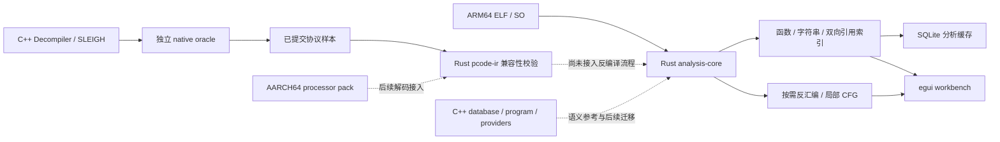

# LLMGhidra

以 Rust 为核心、面向 Android ARM64 原生 ELF/SO 的反编译器项目。桌面采用 egui，打开文件后自动建立函数、字符串、导入导出和双向引用索引；昂贵分析按需执行。

目前已接通的是 **Rust ELF → 自动索引 / 局部 CFG / 反汇编 → egui**。P-code IR 为独立 Rust crate；SLEIGH、SSA 构造、反编译优化和 C 伪代码输出尚未接入工作台。保留的 C++ 原生核心是算法参考及可独立构建的兼容性基准，不能据此认为 Rust 已完成全量反编译器。

## 目录和边界

```text
LLMGhidra/
├── src/                       # Cargo workspace，默认开发与产品入口
│   ├── analysis-core/         # ELF、ARM64 解码、并发索引、SQLite 缓存
│   ├── workbench/             # egui 桌面
│   ├── pcode-ir/              # Rust P-code raw/SSA 图和交换协议
│   ├── database/              # 已有 C++ 数据库迁移源，保留作复用/迁移参考
│   ├── program/               # 已有 C++ ProgramDB 源，不覆盖本地差异
│   └── headless/              # 已有 C++ providers，未接入 Cargo
├── native/                    # 可选 CMake：Decompiler / SLEIGH / zlib
├── resources/processor-pack/  # AARCH64 .sla 及完整语言源、调用约定
├── docs/design/               # 当前 Rust 自动索引设计
├── docs/reference/            # 历史数据库/Program 语义资料
├── docs/migration/            # 本次资产选择、来源与 SHA-256 清单
├── tools/migration/           # 白名单导入脚本（不参与正常构建）
└── LICENSE / NOTICE / licenses/ / UPSTREAM_COMMIT
```



## Windows 构建与运行

使用原生 Windows PowerShell、Rust 1.88+ / MSVC 工具链，不使用 WSL。下列命令从 `LLMGhidra` 执行：

```powershell
cargo build --manifest-path src/Cargo.toml -p llmghidra-workbench --release --locked
./src/target/release/llmghidra-workbench.exe 'D:/samples/libsample.so'
```

Cargo 构建不依赖旧目录、Java、Gradle、Qt 或 `native/` 的 CMake 构建。操作说明见 [Workbench README](src/workbench/README.md)，IR 语义和 oracle 构建见 [P-code README](src/pcode-ir/README.md)。依赖锁 `src/Cargo.lock` 随应用提交。

可选原生参考库与 SLEIGH 编译器：

```powershell
cmake -S native -B out/native -G 'Visual Studio 17 2022' -A x64 -DLLMGHIDRA_BUILD_SLEIGH_COMPILER=ON
cmake --build out/native --config Release --parallel
```

该目标不构建旧 Qt 应用、Java bridge 或 ProgramDB CLI。ARM64 资源包含小端、大端与 AppleSilicon 变体以保持 `.ldefs` 引用闭包，当前 Rust 分析目标仍为 Android 小端 ARM64。

## 历史资产整理

本次迁移决策、保留边界和验证情况见 [迁移报告](docs/migration/LEGACY_REUSE.md)。`LLMGhidra1` 保留在本机供历史查阅，已在外层仓库忽略；正常构建和 P-code 源码校验不依赖它。旧资料中的测试结论仅代表原记录的时间和代码，不能代替当前项目验收。

上游 Ghidra 版本标记见 [UPSTREAM_COMMIT](UPSTREAM_COMMIT)。原生 Ghidra 与 ARM64 语言资源保留原许可证头；zlib 使用 [zlib License](licenses/zlib_License.txt)，不是 Apache-2.0。Rust 第三方依赖遵循各自 crate 许可证。
