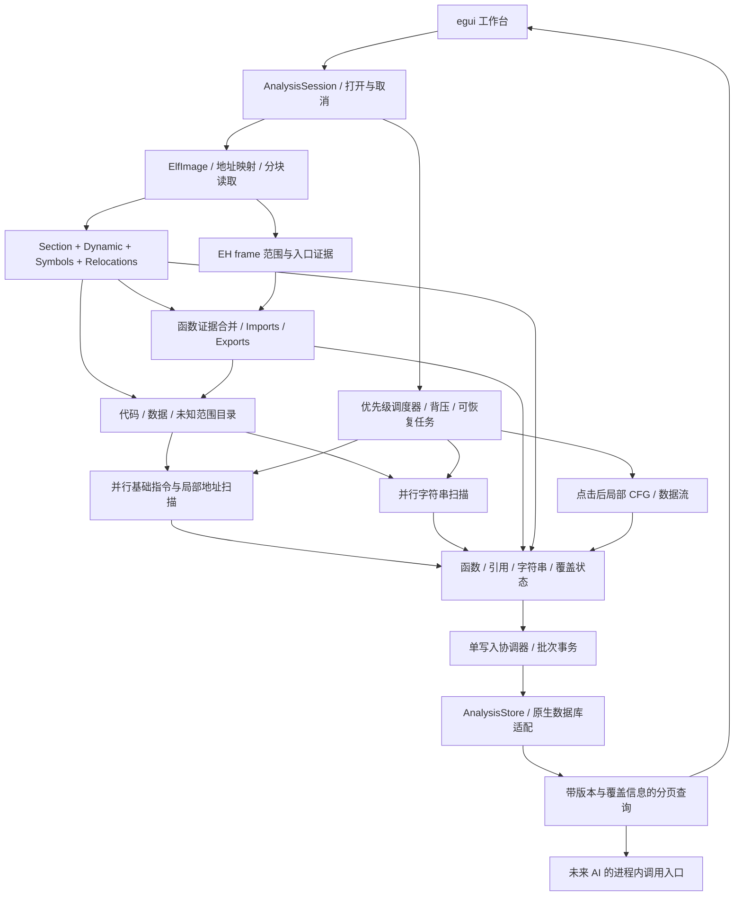

# ARM64 ELF 自动基础分析与可交互索引设计

日期：2026-10-23  
状态：自动基础索引已开始落地，完成项、实测与剩余项见 `../../src/workbench/AUTO_INDEX_VALIDATION.md`。下文仍描述目标架构，不能把全部设计条目视为已实现。时间、内存指标均为待验收目标，不是当前实测成绩。  
适用代码：`src/analysis-core`、`src/workbench`，以及已有原生 `src/program`、`src/database`。

## 1. 目标与范围

打开 Android ARM64 SO 后，用户应自动获得可浏览、可搜索、可追踪的函数、字符串、导入导出及关键交叉引用，不必先点击 Index symbols，也不必知道某个地址才能开始工作。首屏尽早可用，基础索引自动持续补全；复杂控制流、跨函数数据流、类型恢复、P-code 和反编译按需执行。

“按需分析”只约束昂贵的语义恢复，不意味着把基础发现也全部推给用户。允许后台对相关代码和数据做有界、分块的线性扫描，不能再把“只读了文件头”当作文件已经分析完成。

本方案交付范围是完整的本地基础索引与桌面交互闭环，包括持久化、取消恢复、无 section 文件的降级路径、来源及覆盖率。实施步骤只是依赖顺序，不代表缩小为临时 Demo。

- 保持 Rust + egui、IDA 9.x 浅色布局方向：左侧 Functions，中间反汇编/Hex/Segments/Strings/Imports/Exports，底部或右侧 Xrefs。
- 聚焦 ELF64 little-endian AArch64。其他架构可以展示元数据，必须明确标注分析能力不支持，不能报告 ARM64 索引完成。
- 不开发 server、MCP、网络协议、工具注册、远程服务，也不围绕现有 `--serve` 扩展功能。未来集成复用进程内查询接口。
- 不引入 Java/JVM/Dalvik。JNI 在此仅指原生函数、名称、注册表及其引用，不需要 Java 运行时。
- 本次任务只编写设计，不修改运行代码、不启动批量测试。实施完成后集中验收；不使用 WSL。

## 2. 当前为什么会“加载完什么都没有”

以下是本次直接检查源码所得，不是推测：

| 当前位置 | 实际行为 | 用户可见后果 |
| --- | --- | --- |
| `analysis-core/src/elf.rs::open` | 读取 ELF header 和 program headers | 建立地址映射，没有建立基础分析索引 |
| `elf.rs::seed_functions` | 仅在 ELF entry 非零且可执行时加入入口 | 常见 entry=0 的共享库初始函数列表为空 |
| `workbench/src/ui.rs::poll / Event::Open` | 设置 seed_functions 后直接 navigate，没有自动调用 index | 即使有大量动态函数符号，也需要手动索引 |
| `elf.rs::initial_address` | entry 只要落在可执行 LOAD 内就采用；否则选第一个可执行段起点 | RX 段包含 ELF 头时会从 ELF 头字节开始显示反汇编 |
| `elf.rs::symbols` | 通过 section 遍历 `.dynsym/.symtab`，没有 PT_DYNAMIC 恢复路径 | 去 section 后无法恢复动态符号 |
| `engine.rs::analyze` | 对单个请求地址做有界递归下降，发现直接 BL 目标 | 没有自动全局函数发现与全局调用索引 |
| `engine.rs::Analysis.edges` | 仅当前分析结果中的控制流边 | 没有全局 incoming/outgoing 查询，没有数据/字符串引用 |
| `ui.rs::merge_functions` | 按地址和名称组合去重 | 同地址别名可变成多条函数行，缺少统一函数身份 |
| `pool.rs::WorkerPool` | 有界 FIFO 工作队列 | 有并发基础，但没有交互优先级、分块续跑和阶段覆盖统计 |

当前 Rust workspace 的成员只有 `pcode-ir`、`analysis-core`、`workbench`。C++ 的 `program`、`database` 源码存在，不意味着 Rust UI 已经接通这些存储能力。

另外，当前符号名称按符号逐次读取，单次最多读 4 KiB；不能在自动索引中继续对相邻名称大量重复读取。应改成字符串表分块缓存和偏移索引。现有 200,000 个符号等上限也不能在触发后默默宣称完成。

## 3. 指定样本的证据与设计约束

样本：`C:/Users/fjqisba/Desktop/steam-3.10.9/lib/arm64-v8a/libreactnative.so`。使用 Windows 原生 `llvm-readelf` 只读检查 header、sections、dynamic 和 dyn-syms，并读取异常展开头前 12 字节；未执行样本。

SHA-256：`28AA21C60DE143AE45DF4223666E048EEFD740FB33DA6A44F91DEA5C68207773`。

| 项目 | 本次观测 |
| --- | --- |
| 文件 | 6,562,560 bytes，约 6.26 MiB，ELF64 LE / ET_DYN / AArch64 |
| ELF entry | `0x0` |
| 头表 | 9 个 program headers，28 个 section headers |
| 可执行 LOAD | VA `0x0` 起，file size `0x615870`；包含元数据、只读数据、代码 |
| `.text` | VA `0x331130`，size `0x2d4924` |
| `.plt` | VA `0x605a60`，size `0xfe10` |
| 函数符号 | 7,413 条 FUNC/IFUNC 行，其中 7,057 条已定义、356 条 UND |
| 已定义函数地址 | 6,790 个不同地址；这不是整个文件的完整函数总数 |
| JNI 导出 | `JNI_OnLoad` 与 `JNI_OnLoad_Weak` 同址 `0x383f84`，需保留别名 |
| 异常展开 | `.eh_frame_hdr`、`.eh_frame`、PT_GNU_EH_FRAME 均存在 |
| FDE 索引头 | bytes `01 1B 03 3B 1C 85 01 00 A2 30 00 00`；声明计数 12,450 |
| 重定位 | `.rela.dyn` 401,688 bytes；`.rela.plt` 97,512 bytes；entry size 24 |
| 初始化信息 | INIT_ARRAY size 88，FINI_ARRAY size 16；需结合重定位解释指针 |
| 字符串来源 | `.rodata`、`.dynstr` 及其他 file-backed 数据范围 |

FDE 计数是头部声明值，本次没有逐个校验 FDE、合并覆盖区间，也未测量字符串或交叉引用总数。禁止把 12,450 当作已恢复的独立函数数，更不能与 6,790 直接相加。

最重要的样本约束：**PF_X 只代表段权限，不代表段内每 4 字节都是指令。** 本样本 `.rodata` 位于 RX LOAD 中；仅扫描非执行段会漏字符串，仅扫描整个执行段会制造大量假指令和假 BL 目标。

## 4. 总体架构



UI 不拥有全量函数和引用数组，分析 worker 不直接写 UI。共享 Session 管理文件身份、任务和查询；分析器输出事实批次；协调器合并去重并提交存储；UI 按需读取稳定快照。

## 5. 打开文件的自动流程与状态契约

用多个独立阶段状态替换一个笼统的 loaded/indexed 布尔值：

1. **Mapped**：验证 ELF，建立 LOAD 映射，立即显示文件信息和 Segments；此时明确显示“基础索引进行中”。
2. **Metadata indexing**：自动读取 section/dynamic、符号、导入导出、重定位和初始化入口；分批发布函数，不等整张表完成。
3. **Discovery running**：并行恢复 unwind 入口范围、扫描代码中的直接引用和局部数据引用、扫描字符串。用户此时已能点击函数、搜索和跳转。
4. **Baseline ready**：所有已声明基础扫描任务完成或显式降级；未支持的格式、未扫描区间、失败原因仍可见。
5. **Refining**：针对选择的函数、引用或字符串做局部 CFG、间接引用求解及更深分析，更新已有记录。

每类任务分别记录 `pending/running/complete/partial/failed/cancelled`。符号完成不代表引用完成；整个有效扫描范围已经遍历，也不代表间接调用已经全部求解。

首个有意义的导航地址按以下顺序选取：有效 JNI_OnLoad → 有证据的 ELF entry → init 函数 → 高可信已定义函数 → 已验证 unwind 入口 → 可执行 section 内可解码地址。只有段信息时先尝试候选验证；无法确认则显示该段 Hex 与原因，不把 ELF 头伪装成正常函数。自动选址只执行一次，后台结果不得把用户正在看的页面抢走。

## 6. 函数快速识别

### 6.1 以证据合并入口，不以单一特征猜函数

| 来源 | 基础阶段处理 | 边界与注意事项 |
| --- | --- | --- |
| `.dynsym/.symtab` | 自动读取已定义 STT_FUNC/GNU_IFUNC，保留导入、导出和别名 | size=0 表示未知；IFUNC 地址标注为 resolver，不能等同最终实现 |
| PT_DYNAMIC | 根据 DT_SYMTAB/STRTAB/SYMENT、HASH/GNU_HASH 恢复动态符号 | 无 section 也可工作；所有 VA 通过 LOAD 转 file offset |
| `.eh_frame_hdr/.eh_frame` | 提取初始位置、FDE 范围、来源并检查可执行映射 | 一个逻辑函数可有多个范围；范围证据不等同完整函数体 |
| DT_INIT/DT_FINI、INIT/FINI_ARRAY | 经重定位归一后添加有效代码入口 | 忽略空指针和哨兵，未经解析的动态指针保持 unresolved |
| 已验证代码中的 BL | 生成目标入口候选，按代码证据升级 | 不递归反编译被调函数，不把每个目标立即标为已确认 |
| B、条件分支、跳转表 | 先保留控制流边 | B 通常是块间跳转；只有额外函数边界证据时升级尾调用 |
| 重定位指向代码的槽位 | 记录 code-pointer 证据与间接调用可能性 | vtable、JNI 表、回调表不是仅靠一个指针就可完整确证 |
| BTI/PAC/STP 等入口形态 | 在未知代码范围辅助候选验证 | 不是所有函数都有 prologue；不能把这些模式当唯一依据 |

函数身份使用 `(image_id, entry_va)`，名称作为 aliases。同址 JNI_OnLoad/Weak 合并为一行，保留全部符号来源。不同入口可共享代码范围；不强制把地址空间切成互不重叠的函数。

`FunctionRecord` 至少包含：稳定 ID、入口、主名称、别名、来源集合、可信状态、符号声明大小、候选/已验证范围、边界状态、是否 thunk/import/resolver、分析版本。地址范围采用半开区间，body 支持多段。禁止以“下一个函数入口减当前入口”直接宣布准确大小。

### 6.2 无 section 与 unwind 恢复

section 是额外分类证据，LOAD 是文件映射依据，PT_DYNAMIC 是无 section 动态信息入口。DT_HASH 提供符号计数；GNU_HASH 通过合法 bucket/chain 边界推导动态符号范围。无两种 hash 时，可用重定位引用的符号索引取得已知项，但不能假装枚举了全部符号。异常计数、循环链、越界和溢出必须终止对应任务并记录原因。

EH frame 解析遵循实际 DW_EH_PE 编码、相对基址、CIE augmentation、间接编码与边界检查，不能为本样本硬编码 12 字节头。PT_GNU_EH_FRAME 能定位头部时，即使没有 section 仍尝试恢复。编码无法静态解引用时保留未知状态。可使用 `gimli` 的读接口；正式引入时核验固定版本 API、许可证与 Windows 构建能力。

缺少符号、unwind、section 时，自动做低置信度的候选扫描，结合局部可解码性、控制流一致性、指向已知代码的引用验证；输出候选区，不承诺静态分析可以找到所有函数。

## 7. 关键交叉引用：基础阶段必须建立全局双向索引

### 7.1 引用分类

- 控制流：直接调用、直接跳转、条件分支、可能的尾调用、已解析/未解析间接调用。
- 数据：地址形成、读取、写入、指针槽引用、重定位引用。
- 语义关联：调用到 PLT 再到导入符号、数据指针到字符串、代码到字符串内部偏移、函数到其包含的引用。

区分实际指令操作与推导关联：`ADRP` 只形成页地址，不能直接算作读取字符串；`ADRP+ADD` 可形成具体地址引用；`LDR` 才能提供读取证据。代码读取 GOT 槽和 GOT 槽指向外部符号应保留两条原始关系；可以增加可解释的派生路径，但不能抹掉中间地址。

### 7.2 扫描与解析算法

1. 先构造范围目录：SHF_EXECINSTR section、映射符号、符号/FDE 范围及已知元数据共同确定 code/data/unknown。已知 `.rodata`、动态表、异常表应排除出代码扫描，即使同属 PF_X LOAD。证据冲突单独记录。
2. 对确认代码范围按 4 字节对齐分块扫描，快速解码 B/BL、B.cond、CBZ/CBNZ、TBZ/TBNZ 等目标。只有代码身份也成立时，解码目标才成为强引用；未知区内碰到合法编码仍是候选。
3. 每个 worker 使用自己的 Capstone 实例与批量输入缓冲，输出紧凑事实；不开启全量汇编字符串格式化。现有逐指令加全局页缓存锁的路径保留给小范围浏览，不作为后台高吞吐扫描路径。
4. 对有依据的基本块做局部寄存器常量传播，识别 ADR、ADRP+ADD、ADRP+LDR/STR、LDR literal、MOVZ/MOVK 等地址形成方式。采用结构化操作数，不解析打印出来的 operands 字符串。
5. 格式化为 AArch64 正确语义：有符号 PC 相对偏移、load/store 缩放与写回、W 寄存器写入清零高位、XZR/SP 区别、寄存器覆盖、调用破坏集合。常量未知即终止该链，不跨不明路径猜值。
6. 传播在可证明的单入口块内生效，遇已知分支目标、控制流终止、未知前驱或状态冲突重置。跨分块边界通过连续状态或重读上下文处理；新增分支目标会使受影响引用失效并重算。跨块合流留给按需 CFG 数据流。
7. 从 RELA/REL、Android packed relocation、RELR 建立归一化 relocation overlay，不改写源文件。针对每种类型应用各自语义；TLS、IFUNC、外部动态绑定等无法静态决定的目标保留 symbolic/unresolved。
8. 将 PLT stub 的指令模式与槽位、JMPREL 绑定，不假设所有链接器的 stub 大小和序号关系固定。建立 call-site → stub → slot → external-symbol 的路径。

Android packed relocation 与 RELR 是不同编码，不可混用解码器。对不支持或损坏的编码明确标记对应引用覆盖不完整，而非输出空引用冒充完成。

### 7.3 引用记录与查询语义

`XrefRecord` 包含：`source_va`、目标地址或外部符号 ID、类型、操作数编号、宽度、来源分析器、证据位置、可信状态、所属函数（可未知/多归属）、版本、派生路径 ID。未解析目标使用独立 unresolved 记录，不伪造目标地址 0。

以 `(source, target, kind, operand)` 建立事实身份，证据集合单独合并；建立 source 和 target 两个索引，支持 `xrefs_from` 与 `xrefs_to`。引用先按地址建立，函数归属后补，不因边界尚未恢复而丢弃调用点。

查询返回数据、游标、快照版本和 coverage。特别是 incoming 引用：只分析目标函数本身，无法证明找到了所有调用者。只有所有适用源区域的相关扫描已完成，才能声明“在已扫描规则范围内没有直接引用”；间接引用始终单独列解析状态。

当字符串晚于代码被发现时，通过目标地址区间索引重新挂接已有引用，不重扫所有代码。支持指向字符串内部字符的引用；UTF-8 必须落在字符边界，UTF-16 必须满足编码对齐。用户可沿原始引用路径回溯证据。

## 8. 字符串自动识别

基础阶段自动识别 ASCII、合法 UTF-8、UTF-16LE 的 NUL 终止字符串。默认至少 4 个可显示字符，保留 tab/newline 的合理文本；短字符串在明确引用指向时按需识别。最长预览和单次解码有预算，超长内容以分片读取提供，不能把截断后的文本当完整字符串。

扫描顺序：已知只读数据 → 其他 file-backed 数据 → 未分类范围。不能只用段 RWX 权限筛选；本样本 RX 中的 `.rodata` 是首要扫描对象。BSS 虚拟零填充不扫描。

符号字符串表和节名表记录为 metadata 类别，业务字符串页默认过滤它们，但可以切换显示。未知范围中的可打印字节需低可信标记。UTF-16 根据候选对齐、代理项合法性、终止符和文本特征识别；避免把大量零填充或机器码偶然配对识别成文本。

每个任务读取约 256 KiB–1 MiB 的块；块间携带未结束字符串的状态，包括 UTF-8 未完成码点和 UTF-16 单元/代理项。每条结果归属其起始地址所在块，避免边界重复与截断。超长字符串不要求无限保存内容，只保存范围、状态和受限预览。

`StringRecord` 包含地址、原始字节长度、字符数、编码、终止方式、预览、来源区域、可信状态、扫描版本；原始字节始终可取。等值文本多地址出现必须保留每个地址，内容可以驻留去重。

Strings 页支持搜索、编码/区域筛选、跳转数据、显示 incoming xrefs 及所属函数。搜索使用后台分页和规范化文本索引；任意子串检索允许有预算的扫描查询并反馈进度，不能在 UI 每帧遍历全部文本。

长度前缀字符串、std::string 对象、加密/压缩字符串不强行作为 NUL 字符串恢复；明确列为按需类型/语义分析范围。当前静态基础索引不承诺恢复运行时生成的字符串。

## 9. 调度、内存与大文件

### 9.1 优先级和背压

| 队列 | 任务 | 策略 |
| --- | --- | --- |
| P0 | 当前视口、函数跳转、Xrefs 查询、用户主动局部分析 | 保留交互执行容量，不排在长扫描后 |
| P1 | 首批函数、动态表、导入导出、unwind 元数据 | 自动启动，尽早发布有价值结果 |
| P2 | 基础代码引用、字符串与候选验证 | 多线程分块，片末让出与检查取消 |
| P3 | 补充弱候选、非热点范围、后台索引整理 | 加权公平执行，避免永久饿死 |

队列按任务数和预估字节双重限额；结果通道也必须有界。P0/P1/P2 之间使用加权公平调度，避免持续交互使基础扫描永远无法完成。重复的 `(image, range, analyzer, version)` 合并为一个任务，多个请求订阅同一结果。

每块目标执行量约 10–30 ms，仅为调度参数，实际按吞吐调整。I/O 并发独立限流，不能把 CPU 核数直接当磁盘队列深度。worker 初始采用已有可用并行度、限制在 2–8 个的策略，但真实单核机器可用单 worker；对小文件避免过度分片。

新打开文件时切换 session generation 并取消旧任务；事件、写入批次、查询结果均校验 image_id 和 generation。取消后已提交批次可保留，未提交批次丢弃；续跑从检查点重读并幂等去重。

### 9.2 复杂度与结果体积

完整基础扫描成本约为 `O(元数据 + 选中代码字节 + 选中数据字节)`；文件越大、实际需要读取的字节越多，扫描不可能与文件大小无关。快速首屏靠优先级和增量发布，不能靠跳过所有分析制造“秒开”指标。

- 后台不保存全文件的反汇编文本，只保存必要入口、边、指令位置和证据；文本按视口解码。
- 工作缓冲、页缓存、预览缓存有预算；大规模事实逐批落盘，UI 只保留页面与小量导航状态。
- 默认后台缓冲与缓存预算起点为 256 MiB，可配置；这不是整个进程 RSS 保证。索引磁盘占用按事实数量另行统计。
- 符号表、字符串表按块读取/缓存；按名称延迟 demangle，不逐符号分配大量重复字符串。
- 结果每约 50 ms 或 512–2,048 条批量提交，UI 通知合并；每帧处理事件有时间预算，避免 poll 一次清空洪水队列。
- 禁止每次增量到达都重新排序全量 Vec、重建全量过滤列表。使用存储有序索引、稳定 ID 和分页视图。

## 10. 存储、数据一致性与既有 C++ 核心

**实现决定（2026-10-23）：** 自动索引采用可重建的 SQLite WAL 缓存，Rust 进程内查询；原生 C++ Program 数据库仍承载其自身的数据模型。本地函数/引用/字符串闭环无需等待完整 FFI 桥接。下文原生适配属于尚未实施的整合目标，不以 SQLite 缓存冒充已经接通的 Program 数据库。当前缓存支持完整指纹校验后显式重开；自动缓存查找、原生桥接以及精细跨块数据流仍未完成。

采用 `AnalysisStore` 作为唯一事实与查询边界。后台 worker 产出 `FactBatch`，单写入协调器负责事务、去重、版本和 checkpoint；读取使用已提交快照，不与扫描争抢长时间全局锁。

持久化方向是复用现有原生 `program/database`，通过小型进程内 C ABI 适配连接 Rust，不引入 Java、不启动独立服务。当前源码中已有 FunctionManager、SymbolManager、ReferenceManager；其中 ReferenceManager 明确维护 FROM/TO 双向表。本文只确认源码存在，未声称桥接已完成或并发性能已达标。

原生适配要求：

1. 以批次接口传输基本数据和 UTF-8 字节，不逐条跨 FFI；不暴露 C++ STL 对象，不让异常跨 C ABI。
2. 函数别名、候选、证据、coverage、任务 checkpoint 等放入独立分析扩展表；无法完整表达的候选不强塞进已有 confirmed function 表。
3. 已确认函数/符号/引用映射到既有管理器；原始调用图与派生调用路径分开保存，不能修改既有 RefType 编码来凑功能。
4. Rust 侧函数 ID 与原生 symbol/function ID 有显式映射；批次事务同时更新两向引用、证据与 checkpoint。
5. 写入失败或磁盘满时停止该批提交，保留已提交结果，显示 partial。只读输入路径下数据库放入应用缓存目录或用户选择的位置，不要求源目录可写。
6. 文件身份、分析器版本、参数指纹、schema 版本共同参与缓存有效性。路径、大小、mtime 只用于候选匹配；完整内容身份后台校验。校验结束前旧缓存标为未验证，禁止与新事实无标记混合。
7. 源文件仍使用当前稳定文件句柄与 Windows 共享模式约束；缓存校验任务不得阻塞首屏。迁移、崩溃恢复及重开须保持可检查状态。

允许内存缓存作为 AnalysisStore 的加速层，不另建一套无法持久化的最终数据模型。不得为接存储而启动全库重构，也不得把原生库连接当成本地 GUI 需要 server 的理由。

## 11. 查询接口与界面闭环

定义进程内 Rust 接口，而非新协议：

```text
functions(query, cursor, limit, snapshot) -> Page<FunctionRecord>
function_at(address, snapshot) -> FunctionMatch + boundary_state
xrefs_to(target_or_range, filter, cursor, snapshot) -> Page<XrefRecord>
xrefs_from(address_or_function, filter, cursor, snapshot) -> Page<XrefRecord>
strings(query, encoding, region, cursor, snapshot) -> Page<StringRecord>
imports(query, cursor, snapshot) / exports(query, cursor, snapshot)
analysis_status(image_id) -> phases + coverage + diagnostics
request_analysis(target, budget) -> task_id
cancel(task_id) / resume(task_id)
```

Page 统一携带 `items/next_cursor/snapshot_version/coverage/warnings`。游标基于稳定排序键而非会被新增记录挤动的 offset。快照过期显式重查；更名、别名更新和候选升级不改变入口实体 ID。

界面要求：

- **Functions**：打开自动增长，列出地址、名称、来源、可信状态和大小状态。未知大小显示 `?`，不显示看似准确的 0。支持名称/地址搜索及只看高可信函数。
- **中间反汇编**：初次自动定位真实候选代码；调用目标显示名称，导入显示符号，字符串引用显示受限预览。双击目标跳转，保留导航历史。
- **Xrefs**：选中地址或字符串按 X 查看 incoming/outgoing；双击进入引用指令。显示调用点地址、所属函数、引用类型、证据及覆盖状态。
- **Strings**：自动结果、筛选、Hex 定位、引用计数。“0，已完成适用扫描”与“0，尚未扫描完”必须是不同状态。
- **Imports/Exports**：符号版本、库归属证据、PLT/GOT 位置和调用点。不能仅凭 DT_NEEDED 列表猜出每个导入来自哪个库；可由版本信息提供的关联单独标明。
- **状态栏**：分别显示函数/引用/字符串数量和各阶段进度；未知总量显示已处理字节而非假百分比。
- **日志**：给出少量可行动诊断，损坏范围、预算耗尽、任务取消可展开；不逐指令刷日志。
- **空结果**：只有阶段确实完成才显示“未发现”；未开始、正在扫描、部分完成、无能力支持分别解释。

UI 不向用户暴露 server、任务协议等实现术语作为完成基础浏览的前置操作。

## 12. 代码落点与实施顺序

以下均为计划文件，除标注“现有”外，不表示已经存在。

| 模块 | 改动职责 |
| --- | --- |
| `analysis-core/src/elf.rs`（现有） | 保留稳定 I/O 与 LOAD 映射；提取可复用读表和范围校验；改正初始导航 |
| `analysis-core/src/elf/sections.rs` | section 名称、flags、VA、类型、范围目录 |
| `analysis-core/src/elf/dynamic.rs` | PT_DYNAMIC、hash、动态符号、导入导出 |
| `analysis-core/src/elf/relocations.rs` | REL/RELA、packed、RELR、overlay |
| `analysis-core/src/index/functions.rs` | 函数证据合并、别名、边界与候选升级 |
| `analysis-core/src/index/unwind.rs` | EH frame 入口与范围恢复 |
| `analysis-core/src/index/xrefs.rs` | 引用事实、双向查询、路径和字符串挂接 |
| `analysis-core/src/index/strings.rs` | 分块文本扫描、编码和区间索引 |
| `analysis-core/src/arm64/scan.rs` | 基础代码扫描、紧凑分支解码 |
| `analysis-core/src/arm64/address_flow.rs` | 局部寄存器状态与数据地址解析 |
| `analysis-core/src/session.rs`、`scheduler.rs` | 阶段协调、generation、优先级、取消续跑 |
| `analysis-core/src/store/` | 统一记录、分页查询、事实批次、原生适配 |
| `analysis-core/src/engine.rs`（现有） | 复用扫描语义；局部分析写回共享事实，不再只返回孤立结果 |
| `program` 原生适配与 Cargo 构建连接 | 窄 C ABI、扩展表、事务及 Windows 原生链接 |
| `workbench/src/ui.rs`（现有）及 `views/` | 拆分函数/字符串/引用等视图，自动调度与分页展示 |

实施依赖：

1. **统一事实模型与 Session**：先确定 ID、来源、coverage、任务和存储接口，避免 UI/分析器各自保存一套数据。
2. **元数据自动索引与正确导航**：接通 sections、dynamic、符号、别名、init、导入导出；打开自动发布结果。
3. **unwind 与重定位**：恢复额外入口范围和指针 overlay，为代码范围及外部引用提供基础。
4. **直接调用与全局引用**：分块扫描、代码/数据隔离、双向索引、incoming 查询，集成按需分析写回。
5. **字符串与数据引用**：局部地址传播、跨块文本、字符串内部引用及晚到结果挂接。
6. **完整 UI 与持久化收口**：补齐分页、暂停续跑、缓存身份、故障状态、重开恢复；原生适配可自步骤 1 起推进。
7. **集中验收和性能调整**：功能链条完成后按下面矩阵统一验证，性能问题在明确瓶颈后修正。

完成标准必须覆盖所有步骤。不能在自动显示 dynsym 后宣布本方案完成，也不能拿增加 AI/server 功能替代函数、字符串和引用闭环。

## 13. 集中验收矩阵

本节为后续实施完成后的验收计划，本次没有运行这些测试。

| 场景 | 验收要求 |
| --- | --- |
| 指定 libreactnative.so | 不操作 Index symbols，自动出现函数；全部 7,057 条已定义函数符号来源可追溯，按入口合并为 6,790 个符号来源实体，再合并其他来源 |
| 同址别名 | JNI_OnLoad 与 JNI_OnLoad_Weak 合并，别名均可搜索；首屏不在 ELF header |
| unwind | 对声明的 12,450 条索引逐项处理/诊断；有效范围与符号合并；独立函数数另算 |
| 基础调用 | 抽取已知代码内直接 BL，与独立解码结果核对目标；Xrefs 两向一致，分支不冒充函数 |
| 字符串引用 | 覆盖 ADR、ADRP+ADD、ADRP+LDR、LDR literal；读写/地址形成、GOT 间接路径明确区分 |
| RX 内数据 | `.rodata` 字符串被发现；ELF 头、动态表、异常表不污染确认代码与调用图 |
| 字符串边界 | UTF-8/UTF-16 跨块、短字符串、长文本、内部字符引用不重复、不丢失；损坏编码不误报高可信 |
| stripped / 无 section | 符号少时仍使用 unwind、dynamic、init、调用目标；证据全缺时明确候选和覆盖限制 |
| Android 重定位 | RELA、packed RELA、RELR 分别验证；PLT/GOT/导入路径可追溯 |
| 大文件 | 对真实有效大 ELF 测首批结果、全扫描和内存；稀疏填充文件不能代表真实分析吞吐 |
| 会话并发 | 扫描中快速切换文件、取消和重开，无旧结果污染，无死锁，交互任务不被长扫描饿死 |
| 数据库存储 | 重开结果一致；损坏/修改文件不会复用未经验证缓存；批次失败不留下单向引用或虚假完成状态 |
| 能力边界 | 未解析间接调用、无精确函数边界、无可用符号计数都保持 unknown/partial，不伪造结果 |

性能目标以 Windows 原生 release 构建、SSD 和记录的硬件配置为前提。冷热文件缓存分别统计，记录样本哈希、CPU/线程数、I/O 字节、队列延迟、峰值 RSS、索引大小，重复测量给出中位数和 P95。

- 本样本首个可用函数批次目标 ≤ 500 ms；自动符号目录目标 ≤ 1 s；基础函数/字符串/直接引用与局部数据引用扫描目标 ≤ 3 s。
- 交互期间 UI 帧处理 P95 目标 ≤ 33 ms；热索引分页/Xrefs 查询目标 ≤ 100 ms。
- 大文件的首个结果目标 ≤ 1 s（本地 SSD、元数据可正常读取），不承诺整文件固定时间完成。持续记录 MiB/s、facts/s 及残余未扫描范围。
- 受损/极端元数据或存储受限时允许降级，但必须有结果、状态与原因，不能为了时间指标丢掉其余任务且标记 complete。

上述数字是工程预算。达不到时报告实际值和瓶颈，不修改统计口径把“打开头部”算作“完成基础分析”。

## 14. 实现必须保持的约束

1. 所有地址以 ELF VA 为内部坐标，file offset 和运行时 load bias 显式转换；外部符号使用独立身份。
2. “解析出了字节模式”“确认是代码”“确认是函数入口”“确认函数边界”是不同状态。
3. 不能把普通 B、任意 prologue、FDE 数量或每个重定位目标直接当完整函数集合。
4. 引用的置信度取决于源代码身份和目标求解证据；间接关系需保存路径，未知关系不得静默消失。
5. 任意任务预算耗尽都保留 checkpoint/partial；不能把硬上限当数据实际结束。
6. UI 始终能区分未扫描、扫描中、已完成适用规则、部分失败；所有静态完备性声明限定在明确的规则与范围内。
7. 既有 `AGENTS.md` 保持不变，工作产物放入项目子目录，后续关键实现尽量使用中文注释。

## 15. 规范与参考

以下仅支撑格式和语义；本方案的调度、存储模型、UI 与验收预算是项目设计决定。

- [Arm 官方 AAELF64](https://github.com/ARM-software/abi-aa/blob/main/aaelf64/aaelf64.rst)：AArch64 ELF、映射符号与重定位语义；实现应固定使用的规范版本。
- [LSB EH Frame Header](https://refspecs.linuxfoundation.org/LSB_2.0.1/LSB-Core/LSB-Core/ehframehdr.html)：EH frame header 的编码字段、FDE 计数、可选索引以及相对基址。
- [LLVM DynamicTags.def](https://github.com/llvm/llvm-project/blob/main/llvm/include/llvm/BinaryFormat/DynamicTags.def)：标准 RELR 与 Android packed/RELR 动态标签的区分。

本地证据复查命令（PowerShell，Windows 原生工具）：

```powershell
llvm-readelf --file-header --program-headers --sections --dynamic 'C:/Users/fjqisba/Desktop/steam-3.10.9/lib/arm64-v8a/libreactnative.so'
llvm-readelf --dyn-syms --wide 'C:/Users/fjqisba/Desktop/steam-3.10.9/lib/arm64-v8a/libreactnative.so'
Get-FileHash 'C:/Users/fjqisba/Desktop/steam-3.10.9/lib/arm64-v8a/libreactnative.so' -Algorithm SHA256
```
