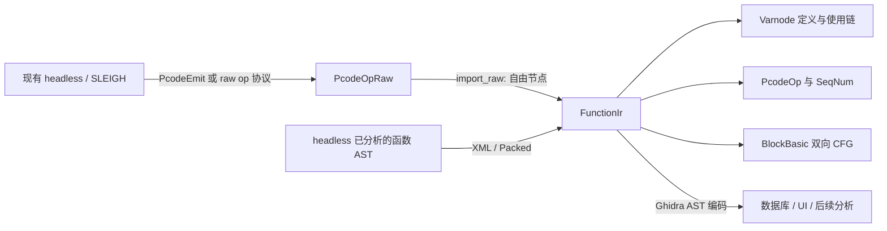

# Ghidra P-code IR（Rust）

本 crate 在 `LLMGhidra/src` 的 Cargo workspace 中实现 Ghidra P-code 的 raw 表示、SSA 图表示和原生交换协议。生产代码为纯 Rust、零第三方依赖，禁止 unsafe，不加载 JVM，也不调用 C++ FFI。它是反编译器的 IR 层，不是另一个指令集或 LLVM IR。

## 一致性基准

以项目根目录 `UPSTREAM_COMMIT` 标记的 Ghidra 12.1.3、提交 `8b4c91d4d5bd1549622bfbade0df199585b98365` 为版本锚点，具体行为以本项目 `native/decompiler/cpp` 的实际源码为准。Java 模型只用于理解交换格式，不是运行时依赖。

| Rust 模块 | 对应原实现 | 已实现的内容 |
|---|---|---|
| `opcode.rs` | `opcodes.hh/.cc`、`typeop.cc` | opcode 数值、保留空槽、名称、模板别名、比较取反、各 opcode 的 TypeOp 标志 |
| `address.rs` | `space.hh/.cc`、`address.hh/.cc`、`pcoderaw.hh` | 地址空间、字寻址、环绕、哨兵地址、SeqNum、VarnodeData、范围、寄存器名称解析、join 存储分配 |
| `raw.rs` | `PcodeOpRaw`、`PcodeEmit` | raw 操作、输出/输入、空间引用、发射接口、指令内相对分支 |
| `graph.rs` | `Varnode`、`PcodeOp`、`BlockBasic`、`BlockEdge`、VarnodeBank 的基础操作 | 创建 ID、输入节点、单一定义、逐槽使用链、节点修改/删除、操作顺序、双向 CFG、平行边/自环、phi 入边同步 |
| `flags.rs` | `varnode.hh`、`op.hh`、`block.hh` | 原生标志位值，包括附加标志、块与边标志 |
| `marshal.rs` | `marshal.hh/.cc` | Ghidra 元素/属性 ID、XML IR 子集、Packed 编解码、特殊空间、整数边界、输入格式检查 |
| `wire.rs` | `translate.cc`、`op.cc`、`varnode.cc`、`funcdata.cc`、`block.cc` | raw `<op>` 与函数 `<ast>` 的独立编解码、两阶段引用恢复、CFG 反向索引恢复、失败回滚 |

`0` 保留为 Java 模型中的 `UNIMPLEMENTED`，正常 C++ opcode 是 1–74，45 是空槽，75 是 `CPUI_MAX`，不能当作指令。该仓库的 `opcodes.hh` 已有 `SPULL=74`，但 `opcodes.cc` 的旧名称数组未补 SPULL；`native_name()` 对该项返回 `None`，不会复制上游数组越界行为。标准 IR 名称仍提供 `SPULL`。

“一致”的验证需要区分数据/协议一致与整个反编译器的等价性。本 crate 并未声称已经移植 Ghidra 全部 C++ 类和优化流程：`Heritage` 的 SSA 构造、`Action/Rule` 优化、`Cover/HighVariable` 合并、完整 `Datatype/TypeFactory`、调用规格、SLEIGH 解码器和机器码执行器不在当前实现中。已有 SSA 可以导入、维护和导出；`import_raw()` 导入的自由节点不会被虚假标记为完成 SSA 构造。后续接入现有 headless 时，这些模块仍需由真实分析管线提供。

## 使用和构建

从 `LLMGhidra/src` 使用 Windows 原生 Rust 工具链：

```powershell
cargo build --workspace --release
cargo run -p ghidra-pcode-ir --example arm64_ir
cargo test --workspace
```

示例构造 `ADD X0, X0, #1` 对应的 P-code 数据流，并通过 Packed 恢复函数图，输出 XML 和统计。它不把手工构造的 IR 冒充为从 ELF/SO 解码得到的结果。示例的空间编号由示例自己配置；实际接入必须使用 SLEIGH/headless 对应管理器的真实空间索引、寄存器偏移与端序，不能硬编码这套编号给所有架构。

应用接入路径：



基本接口见 `examples/arm64_ir.rs`。`FunctionIr` 独占节点，不公开能破坏双向关系的可变裸引用；修改通过 `set_input`、`set_output`、`set_opcode`、`insert_at`、`remove_edge` 等入口完成。调用 `validate()` 可检查所有已建立的关系。

## 必须保留的语义

- 同一 `(space, offset, size)` 可以对应多个不同 SSA 值，不能按存储地址去重所有 Varnode。
- 一个操作重复读取同一节点两次，必须保留两个使用槽；移除一个槽不应删除另一个使用关系。
- `SeqNum::time` 是操作标识，`order` 是基本块中的可变顺序。原 C++ equality 与排序使用不同字段，Rust 用显式 `same_time()`、`key()` 和 `compare()` 表达，避免违反 `Eq/Ord` 容器契约。
- `LOAD/STORE input[0]` 使用 `SpaceId`；`INDIRECT input[1]` 使用 `OpRef`。Rust 不保存 C++ 地址空间指针或操作指针的整数值。
- CFG 入边顺序决定 `MULTIEQUAL` 的输入槽。已有 phi 的块新增前驱可用 `add_edge_with_phi()`；`remove_edge()` 同步删除对应 phi 输入。底层 `add_edge()` 允许先构造边再填入 phi，完成后应验证。
- join 的片段按最高有效部分在前排列；单片段必须提供逻辑大小，分配地址按 16 字节对齐。
- Packed 使用 Ghidra 的头字节和高位在前的 7-bit 整数编码，不是 LEB128，也不是自定义 serde/bincode 格式。
- 解码失败不会把部分图或临时 join 分配留给调用者。未知标签、损坏引用、重复 ID、反向边槽缺口均返回错误。

## 格式边界

`PcodeOpRaw::to_xml/to_packed` 输出带 `size` 的 raw `<op>`，地址和序号由外层指令上下文提供。`FunctionIr::to_xml/to_packed` 输出 Ghidra `Funcdata::encodeTree` 的 `<ast>`，操作通过 `seqnum` 和 `addr ref` 引用节点。两者不能互相混用。

原生 AST 协议自身不序列化所有内部状态：包括死操作、分析缓存、完整 Varnode/Op/Block/Edge 标志。Rust 按相同协议处理，不向 Ghidra 数据流偷偷添加私有属性。因此 AST 导出不是整个内存分析状态的无损快照；需要完整内存副本时使用 `FunctionIr::clone()`。`order` 与定义—使用关系在导入时重建。

XML 解析器面向 Ghidra IR 的无文本元素格式，支持引号、实体、注释和声明，不提供通用 XML/DTD 功能。Packed 支持通用数字 ID，XML 支持本 crate 的 IR 元素和属性；不是整个 Ghidra 文档协议的通用替代品。

## 原生兼容性证据

`tests/native/oracle.cc` 从本项目 `native/` 源码构建并链接 Ghidra 静态库，调用原生 `XmlEncode`、`PackedEncode`、`SeqNum::encode`、`PcodeOpRaw::decode`，生成 `tests/fixtures/native_*`。Rust 测试逐字节比较输出，而不只做自身 encode/decode 往返。

在有 CMake 和 MSVC 的 PowerShell 环境中，从 `LLMGhidra/src` 重新生成：

```powershell
cmake -S pcode-ir/tests/native -B ../temp_data/pcode-ir/native-build -G "Visual Studio 17 2022" -A x64
cmake --build ../temp_data/pcode-ir/native-build --config Release
& ../temp_data/pcode-ir/native-build/Release/pcode_ir_oracle.exe pcode-ir/tests/fixtures
cargo test --workspace
```

原生依赖在上述 CMake 输出目录中从源码构建，不需要 `LLMGhidra1`、旧 `.lib` 或 Java。生产 Rust crate 不链接这些库；只有重新生成核对样本才使用它们。普通 `cargo test` 使用已提交 fixtures，不要求安装 CMake/MSVC C++ 工具链来构建 oracle。

其他核对覆盖本地源码中的 opcode/TypeOp 标志表、重复使用槽、同址不同 SSA 值、自环/平行边与 phi 删除、前向操作引用、join、整数边界、恶意截断输入和事务回滚。上述有限证据不能代替所有程序、全部分析算法的完整等价性证明。
