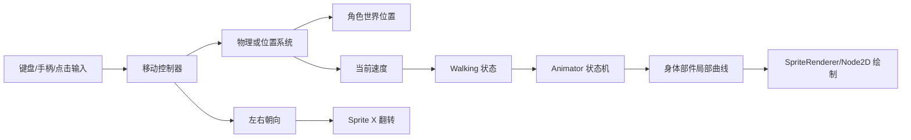
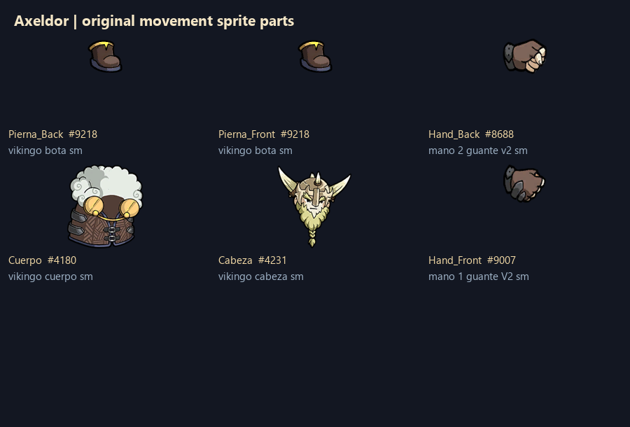
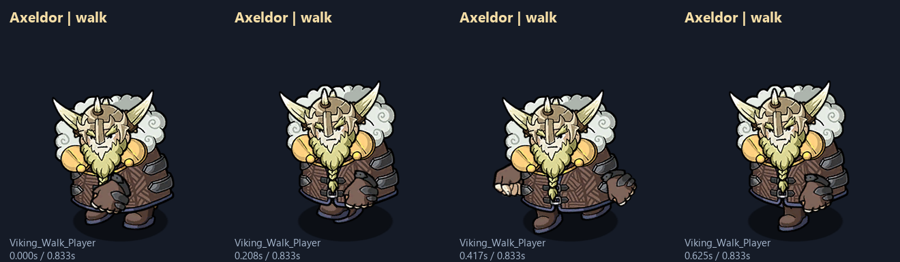
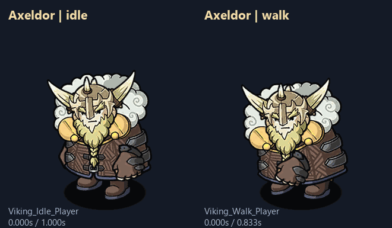
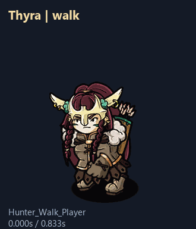

# 2D 分件人物移动设计指南

> 适用于 2D 角色、俯视角角色、横版角色和轻量 2.5D 角色。
>
> 本指南把“人物素材如何拆分、如何制作走路动作、如何接入移动代码、如何验收”整理成一套可复用流程。文中的 Nordic Ashes 数值是实测参考，用来帮助建立量级；新游戏应根据角色体型、镜头缩放和移动速度重新标定。

**使用范围**：本方案主要用于独立 Sprite 加 Transform 曲线的 2D 分件角色。需要八方向转身、逐帧像素动画、网格蒙皮或 3D 骨骼的项目，可沿用移动与表现分离、状态管理和验收流程，但需要对应的素材管线，不能仅靠翻转这套正面素材完成。

**制作路线**：先填写第 14 节的角色设计表 → 选择第 16 节的方向方案 → 按第 2–3 节准备素材与层级 → 按第 6 节制作循环 → 按第 7–11 节接入控制器 → 按第 17–20 节处理换肤、事件和特殊状态 → 完成第 12–13 节验收。

**证据标记**：写明 Nordic Ashes 或 Axeldor 的内容是案例观察；“推荐”“建议”和示例配置是面向新游戏的设计方案。示例数值不是该游戏完整源码的复刻。

## 1. 先确定职责边界

人物移动由三个系统共同完成：

| 系统 | 负责内容 | 不负责内容 |
|---|---|---|
| 移动控制器 | 输入、速度、加减速、碰撞、冲刺、朝向 | 手脚摆动和身体姿势 |
| 物理或位置系统 | 人物的真实世界位置、碰撞响应和阻挡 | 行走动画状态 |
| Animator / AnimationPlayer | 身体部件的局部位移、旋转、缩放、状态过渡 | 推动人物在世界中前进 |

推荐采用“**物理移动 + 局部动画**”方案：角色由 Rigidbody2D、CharacterBody2D 或自定义移动器移动，动画只表现迈步、摆臂和身体重心变化。除非项目明确需要动画驱动位移，否则关闭 Root Motion。这样可以避免动画位移与碰撞检测互相打架，也能让不同角色共用一套移动代码。



## 2. 角色素材的拆分方案

### 2.1 基本部件

一个可维护的基础角色至少拆成以下部件：

```text
Character
├─ Pivot                 角色移动和朝向的根节点
│  └─ Scaler             角色整体缩放和动画锚点
│     ├─ Shadow          脚底阴影
│     └─ PlayerSprite    所有可动身体部件的父节点
│        ├─ Leg_Back     后腿
│        ├─ Leg_Front    前腿
│        ├─ Hand_Back    后手
│        ├─ Body         身体/躯干
│        ├─ Head         头部
│        └─ Hand_Front   前手
```

根据角色设计，可以增加：

- Hair_Back、Hair_Front：头发拆成前后两层；
- Cape、Coat：披风或衣摆；
- Weapon_Back、Weapon_Front：武器按遮挡关系拆分；
- Shoulder_Left、Shoulder_Right：肩甲；
- Tail、Ear_Back、Ear_Front：尾巴和耳朵；
- Eye、Mouth、Effect：眼睛、嘴和可切换特效；
- Equipment：可替换装备或皮肤部件。

拆分原则是“需要独立运动、遮挡或换装的部分独立成节点”。不需要独立变化的小装饰可以合并进身体图，避免节点和曲线数量失控。

### 2.2 哪些东西必须单独保留

阴影建议独立 Sprite。它通常保持在脚底，只做椭圆缩放或透明度变化，能明显增强落地感。

前后腿和前后手建议独立 Sprite。这样可以用少量旋转曲线制造交替步伐，不需要绘制完整帧动画。

头部最好独立。头部只需要很小的上下位移或旋转，便能让动作更有生命力；头部独立也方便换发型、帽子和皮肤。

武器需要根据遮挡关系拆成 `Weapon_Back` 和 `Weapon_Front`，或者放在手部节点下。不要让武器层级依赖运行时临时调整，否则攻击、移动和受击动画容易互相覆盖。

### 2.3 Sprite 资源规格

每个部件应统一：

| 项目 | 建议 |
|---|---|
| Pixels Per Unit | 全部角色统一，例如 100 PPU；不要同一角色混用比例 |
| 透明边界 | 保留必要的旋转空间，但去除大量无效透明边 |
| Pivot | 以关节或安装点为中心，而不是一律放图片中心 |
| 导入过滤 | 像素风使用 Point；高清插画根据项目选择 Bilinear/Trilinear |
| 颜色空间 | 所有部件保持一致，避免身体和装备亮度不一致 |
| 命名 | 使用角色、部件和版本组成的稳定名称，例如 `Axeldor_Body` |

Pivot 决定旋转效果。腿的 Pivot 应靠近髋部，手的 Pivot 应靠近肩部或手腕连接点，头的 Pivot 应靠近颈部。Pivot 错误时，即使曲线数值正确，部件也会像在原地打转。

## 3. 节点和排序设计

### 3.1 根节点职责

`CharacterRoot` 负责世界位置、碰撞和移动；它与身体动作分离。其下的 `Pivot` 作为视觉朝向根节点，负责：

- 左右翻转；
- 角色整体视觉朝向；
- 装备和身体共同的视觉参考位置。

`Scaler` 负责：

- 角色视觉缩放；
- 不改变碰撞尺寸的视觉放大/缩小；
- 动画的统一锚点。

`PlayerSprite` 负责：

- 身体部件的共同父节点；
- 身体局部动画；
- 不直接参与物理位移。

碰撞体挂在 `CharacterRoot` 或稳定的 `Collision` 节点下，避免走路摆腿导致碰撞范围抖动。可选的挥刀攻击检测挂在专门的攻击挂点，但不能用它代替移动碰撞体。Godot 的 Y 排序通常使用脚底世界锚点；Unity 的 SortingGroup 也要以稳定的脚底位置判断前后关系。

### 3.2 推荐排序

常见的前后顺序如下：

```text
Shadow
Leg_Back
Hand_Back
Body
Head
Hand_Front
Weapon_Front / Effect
```

具体顺序应由画面检查决定。排序不能只依赖节点创建顺序；在 Unity 使用 Sorting Layer/Order，在 Godot 使用 `z_index` 或 CanvasLayer。所有可切换装备都应有明确排序规则。

### 3.3 身体基准姿势

制作动画前先定义一张基准姿势：

1. 脚底与阴影中心对齐；
2. 身体中心位于角色碰撞体中心附近；
3. 头部、手部和腿部关节没有明显断裂；
4. 前后部件在静止时已经拥有正确遮挡；
5. 向左和向右翻转后，脚底仍在同一个地面高度。

基准姿势必须作为所有动画的参考帧。不要先做走路，再反过来猜静止位置。

## 4. 移动参数设计

### 4.1 必要参数

每个角色或角色类型至少定义：

| 参数 | 含义 | 典型用途 |
|---|---|---|
| `move_speed` | 目标移动速度 | 控制最大速度 |
| `acceleration` | 加速强度 | 从静止达到目标速度 |
| `deceleration` | 减速强度 | 松开输入后的停步时间 |
| `walking_threshold` | 进入行走动画的速度阈值 | 防止微小速度触发行走 |
| `animation_speed` | 动画播放倍率 | 配合速度或角色特性 |
| `turn_mode` | 朝向策略 | 移动方向、瞄准方向或锁定方向 |
| `diagonal_scale` | 斜向速度修正 | 防止斜向移动过快 |
| `dash_duration` | 冲刺时间 | Dash 状态持续时间 |
| `dash_speed` | 冲刺速度 | 与普通移动分离 |

### 4.2 参考量级

Nordic Ashes 的实测素材中，大多数角色行走周期约为 0.833 秒，Unn 约 1.0 秒，Kaos 约 2.0 秒，Gnoki 约 0.583 秒。这些是动画节奏，不是移动速度。

开始制作新角色时，可以先使用以下参考范围，再通过游戏手感调整：

- 普通行走循环：0.65–1.00 秒；
- 厚重角色：0.85–1.30 秒；
- 轻小角色：0.45–0.75 秒；
- Idle 循环：0.8–1.5 秒；
- Walk ↔ Idle 过渡：0.04–0.10 秒；
- Dash 动画：0.15–0.35 秒。

不要把周期和速度直接绑定成固定公式。重型角色可以有慢动画但较高移动速度，小型角色可以有快动画但故意移动较慢，最终以视觉和操作感为准。

### 4.3 速度平滑

推荐使用带加减速的速度更新，而不是直接把输入乘速度：

```text
input = 读取输入向量
if length(input) > 1:
    input = normalize(input)   # 保留手柄小于 1 的模拟输入
target_velocity = input * move_speed

if input != 0:
    velocity = MoveToward(velocity, target_velocity, acceleration * delta)
else:
    velocity = MoveToward(velocity, Vector2.ZERO, deceleration * delta)

移动器.SetVelocity(velocity)
```

如果使用刚体，应在物理帧中设置速度或施加力；如果使用 CharacterBody2D，应在物理帧中设置 velocity 后调用移动函数。不要在渲染帧和物理帧同时写入位置。

## 5. 输入、朝向和翻转

### 5.1 输入处理

输入来源可以是键盘、手柄摇杆、点击目标或自动移动。无论来源如何，最后都应统一为一个二维方向向量：

```text
movement_input = Vector2(horizontal, vertical)
if length(movement_input) > 1:
    movement_input = normalize(movement_input)
```

点击移动应先转换为角色当前位置到目标点的方向，再进入同一套速度管线。不要为点击移动单独制作另一套 Animator 逻辑。

### 5.2 左右翻转

当角色按水平移动方向朝向时，推荐翻转专用视觉根节点的 X 缩放。先规定原图面朝哪一边，例如原图面朝右时：

```text
if abs(velocity.x) > facing_epsilon:
    visual_root.scale.x = abs(visual_root.scale.x) * sign(velocity.x)
```

保留缩放的绝对值，避免角色原本有特殊比例时被覆盖。原图面朝左时，符号需取反；不要假设所有素材 X=+1 都表示朝右。碰撞体和世界根节点不因视觉翻转而改变逻辑位置。居中的对称阴影可以随视觉翻转，也可以作为固定节点独立保留。

如果角色的攻击方向独立于移动方向，则将 `look_direction` 与 `movement_direction` 分开：

- 移动方向决定 `Walking` 和脚步动作；
- 瞄准或攻击方向决定头、武器和身体朝向；
- 只有视觉根节点的水平镜像由最终朝向决定。

## 6. 行走动画的制作流程

### 6.1 先做四个关键姿势

建议先制作四个关键时刻，再补齐曲线：

| 时刻 | 重点 |
|---|---|
| 0% | 第一只脚接触地面；另一只脚准备离地，建立循环起点 |
| 25% | 过脚姿势；一脚支撑，另一脚经过身体下方 |
| 50% | 第二只脚接触地面；两腿交换职责 |
| 75% | 反向过脚姿势；准备回到第一只脚落地 |

需要更自然的步态时，在两次接触后分别加一个压低姿势，过脚后加一个抬高姿势。一个周期有两次身体压低和抬高；两腿相差半周期，手臂通常与对侧腿配合，头部用较小幅度跟随。轻小角色可强调弹跳，重型角色可强调支撑时的下沉。

四个姿势应形成明确的前后脚交替。两条腿完全同步会像滑行，两只手完全同步会像机械摆臂。

时间轴最后一帧应与第一帧姿势相同，并检查速度切线连续。60Hz采样表示一秒有60个时间间隔，不代表必须手工画60张图。插画分件通常只需要少数关键姿势再用平滑曲线插值；像素逐帧动画则保持离散帧，不使用导致半像素模糊的连续缩放。

### 6.2 推荐曲线顺序

制作顺序建议是：

1. 先固定身体和头；
2. 调整后腿和前腿的旋转与少量位移；
3. 加入后手和前手的反向摆动；
4. 给身体加入轻微上下移动和缩放；
5. 调整头部的细微跟随；
6. 最后加入披风、头发、尾巴和特效。

不要一开始就给所有节点打满关键帧。先保证脚步和身体重心正确，再增加装饰部件。

每个动态属性指定一个写入者：朝向节点X缩放由控制器写，Body缩放由动画写，闪白由材质反馈写。两个系统不能同时争抢同一节点的同一属性。为各动作声明“本动作覆盖哪些属性、退出时恢复到什么值”，并建立参考姿势/Reset动画，防止Dash结束后仍保留拉伸或隐藏状态。

### 6.3 曲线建议

对每个部件优先使用以下属性：

- 腿：`localRotation.z`，必要时加少量 `localPosition.y`；
- 手：`localRotation.z`，幅度可以比腿大；
- 身体：`localPosition.y` 和小幅 `localScale`；
- 头：很小的 `localPosition.y` 或 `localRotation.z`；
- 阴影：只做轻微 `localScale.x`、`localScale.y` 或透明度变化；
- 披风/头发：跟随身体但有 1–3 帧延迟，形成惯性。

身体缩放应当非常克制。以 Nordic Ashes 的实测 Axeldor 为参考，身体 X 缩放约在 `1.000–1.038`、Y 缩放约在 `0.963–1.000`，用于表现步伐压缩，而不是明显挤压人物。

### 6.4 行走循环的落脚点

行走循环通常在半周期和周期末各有一次落脚：

```text
0%       第一脚接触（可把这一事件定义在相位 0）
50%      第二脚接触
100%     回到起始姿势，与下一周期 0% 是同一个时刻
```

落脚帧可以触发：

- 脚步音效；
- `StepBack` / `StepFront` 等脚部状态；
- 轻微脚底粒子；
- 地面灰尘或草屑；
- 触地震动。

音效事件应与脚真正接触地面的帧对齐。周期末和下一周期开始不能重复触发同一次落脚：使用半开区间 `[0, T)` 记录事件，或者仅在片段结尾触发，具体取决于引擎事件规则。低帧率也必须检测跨过的事件区间，不能只判断“当前相位恰好等于落脚相位”。

落脚时支撑脚在世界空间应尽量保持稳定：向前移动的角色根节点，会被脚相对身体向后的位移抵消。把循环动画放到实际移动速度下检验，避免只看原地预览觉得流畅、运行时却出现明显滑步。分件风格可以容许一定夸张，但脚步接触必须容易读懂。

## 7. Animator 状态机

### 7.1 基础状态

完整的人物移动状态机建议包含：

```text
Idle
  └─ Walking=true → Walk
Walk
  ├─ Walking=false → Idle
  ├─ Dash=true → Dash
  ├─ Dead=true → Die
  └─ Hit=true → Hit / Hurt
Dash
  └─ Dash结束 → Walk 或 Idle
Die
  └─ 动画结束 → Disabled / Corpse
```

需要时再增加：Attack、Cast、Revive、Interact、Knockback、Climb、Swim 等状态。状态数量增加后，优先使用参数和分层 Animator，避免每两个状态之间都建立独立过渡。

### 7.2 最小参数集

基础移动推荐使用：

| 参数 | 类型 | 作用 |
|---|---|---|
| `Walking` | Bool | Idle 与 Walk 的切换 |
| `SpeedMultiplier` | Float | 调整 Walk 播放速度 |
| `Dash` | Trigger，或由代码管理的 Bool | 请求或保持 Dash；明确复位规则 |
| `Dead` | Bool | 持续死亡状态，防止重新进入移动 |
| `Hit` | Trigger | 受击反馈 |
| `Pose` | Bool/Trigger | 角色选择界面或展示姿势 |

对于需要根据速度连续变化的角色，可以用 `Speed` Float 做 Blend Tree；对于分件角色，单个 Walk Clip 加 `SpeedMultiplier` 通常更容易维护。

### 7.3 过渡时间

过渡时间要短，避免输入已经停止但角色仍然明显滑步：

- Idle → Walk：0.04–0.10 秒；
- Walk → Idle：0.04–0.10 秒；
- Walk → Dash：0.05–0.12 秒；
- Dash → Walk：0.10–0.20 秒；
- 受击、死亡：按动作需要允许打断移动。

Nordic Ashes 的实测值是 Idle/Walk 约 0.05 秒，Walk/Dash 约 0.10 秒，Dash 回到移动约 0.15 秒，可以作为初始参考。

## 8. 动画速度和移动速度的连接

播放倍率应相对于制作该动画时的参考速度 `reference_walk_speed` 标定。这个速度属于动作资产，不应随加速增益一起改变，否则速度翻倍后分子、分母同时翻倍，动画节奏可能完全不变。推荐将实际自主移动速度映射为一个受限的倍率：

```text
speed_ratio = length(actual_locomotion_velocity) / max(reference_walk_speed, epsilon)
speed_ratio = clamp(speed_ratio, walk_rate_min, walk_rate_max)
animator.SetFloat("SpeedMultiplier", speed_ratio)
```

倍率上下限可从 `0.75–1.35` 起调；移动速度跨度很大时切到 Run，而不是无限加快 Walk。对倍率使用 0.05–0.12 秒平滑滤波，Walk 停止后进入 Idle，Idle 的呼吸速度独立控制。Nordic Ashes 实测采用有效加速度与基础加速度的比例写入 `SpeedMultiplier`；这是案例实现，新项目也可采用上述实际速度方案。

设一个原始步态周期为 `T`，播放倍率为 `r`，运行速度为 `v`，那么实际周期为 `T/r`，每周期的世界移动距离为 `v*T/r`。由美术确认期望步幅，再反推倍率，可以系统地减少滑步。这里的步幅是整个两步周期的距离，单步距离约为它的一半。

如果角色有独特节奏，可以将倍率乘以角色系数：

```text
effective_multiplier = speed_ratio * character_walk_rate
```

`character_walk_rate` 应记录在角色配置中，而不是散落在代码常量里。

## 9. 受击、冲刺和特殊动作

### 9.1 冲刺

冲刺建议由控制器负责真实位移，Animator 负责视觉表现：

```text
dash_direction = normalize(input_or_aim_direction)
dash_velocity = dash_direction * dash_speed
dash_timer = dash_duration
animator.SetTrigger("Dash")
```

冲刺动画可以：

- 拉伸身体或披风；
- 暂时隐藏腿部摆动；
- 添加拖尾或残影；
- 让角色朝冲刺方向翻转；
- 在 Dash 状态期间禁用普通 Walk 过渡。

不要通过播放一段带根运动的动画来代替碰撞可控的冲刺，除非项目专门采用动画驱动角色。

### 9.2 受击和死亡

受击通常只改变上半身、颜色或短暂闪白，不应破坏腿部的物理位置。死亡可以覆盖主运动层，并在动画结束后关闭控制器和碰撞体。

### 9.3 特效部件

粒子、披风、尾巴和装备应挂在明确的部件节点下。特效不应直接修改根节点位置，否则会造成镜头抖动或碰撞偏移。

## 10. Unity 实现要点

推荐结构：

```text
CharacterRoot              GameObject + Rigidbody2D + Collider2D
├─ Pivot                   Transform
│  └─ Scaler               Transform
│     ├─ Shadow            SpriteRenderer
│     └─ PlayerSprite      Transform
│        ├─ Leg_Back       SpriteRenderer
│        ├─ Leg_Front      SpriteRenderer
│        ├─ Body           SpriteRenderer
│        ├─ Head           SpriteRenderer
│        ├─ Hand_Back      SpriteRenderer
│        └─ Hand_Front     SpriteRenderer
└─ Animator                Animator（可放在 Scaler）
```

控制器示例：

```csharp
// 仅示意核心流程；碰撞层、输入系统和数值配置按项目替换。
void FixedUpdate()
{
    Vector2 input = ReadMovementInput();
    if (input.sqrMagnitude > 1f)
        input.Normalize();

    Vector2 target = input * moveSpeed;
    float rate = input.sqrMagnitude > 0.001f ? acceleration : deceleration;
    velocity = Vector2.MoveTowards(velocity, target, rate * Time.fixedDeltaTime);
    rigidbody2D.velocity = velocity;
}

void Update()
{
    // 用碰撞求解后的位移估算自主移动速度，并剔除击退、平台位移。
    Vector2 actualVelocity = ReadActualLocomotionVelocity();
    // 进入阈值略大于退出阈值，防止临界速度下反复切换。
    float threshold = isWalking ? walkingExitSpeed : walkingEnterSpeed;
    isWalking = actualVelocity.sqrMagnitude > threshold * threshold;
    bool walking = isWalking;
    animator.SetBool("Walking", walking);

    float ratio = Mathf.Clamp(actualVelocity.magnitude / Mathf.Max(referenceWalkSpeed, 0.001f), 0.75f, 1.35f);
    animator.SetFloat("SpeedMultiplier", ratio);

    if (Mathf.Abs(velocity.x) > facingEpsilon)
    {
        Vector3 scale = visualRoot.localScale;
        scale.x = Mathf.Abs(scale.x) * Mathf.Sign(velocity.x);
        visualRoot.localScale = scale;
    }
}
```

这段代码是接口级参考，`ReadMovementInput`、`ReadActualLocomotionVelocity` 和配置字段需要由项目实现，不是直接粘贴即可编译的完整控制器。Unity 6 可以使用 `Rigidbody2D.linearVelocity`；旧版本对应 `velocity`。示例按“原图面朝右”设置镜像，其他素材需要调整符号。

Unity 项目需要特别检查：

- `Animator.applyRootMotion = false`；
- Rigidbody2D 的移动写在 `FixedUpdate`；
- Animator 参数写在 `Update` 或由固定帧同步；
- Collider2D 不挂在会摆动的手脚节点下；
- SpriteRenderer 的 Sorting Layer 和 Order 在 prefab 中固定；
- 动画事件的方法名在目标组件上真实存在；
- 翻转只作用于视觉根节点。

## 11. Godot 实现对应关系

在 Godot 中可以使用以下映射：

| Unity | Godot |
|---|---|
| GameObject | Node2D / CharacterBody2D |
| Transform | Node2D Transform2D |
| SpriteRenderer | Sprite2D |
| Animator | AnimationPlayer + AnimationTree |
| Rigidbody2D | CharacterBody2D / RigidBody2D |
| Sorting Layer/Order | z_index / CanvasLayer |
| Animation Event | Call Method Track |
| Prefab | PackedScene |

推荐用 `CharacterBody2D` 作为移动根节点，用 `AnimationPlayer` 修改身体子节点的 `position`、`rotation` 和 `scale`。通过 `AnimationTree` 或代码控制 Idle、Walk、Dash、Die 状态。身体部件仍然保持独立 Sprite2D，不能把所有素材合并成一张图后再期待获得相同的局部摆动效果。

## 12. 资产制作检查表

### 12.1 素材检查

- [ ] 身体、头、前后手、前后腿已按独立运动需求拆分。
- [ ] 所有 Sprite 使用相同 PPU 和导入方向。
- [ ] 关节 Pivot 放在正确连接点。
- [ ] 基准姿势脚底与阴影对齐。
- [ ] 前后部件的排序经过实际画面检查。
- [ ] 皮肤替换时部件尺寸和 Pivot 仍保持一致。
- [ ] 装备和特效挂在明确节点下。

### 12.2 动画检查

- [ ] Idle、Walk、Dash、Die 至少有明确的基础状态。
- [ ] Walk 中前后腿交替，不能两腿同相滑动。
- [ ] 双手和身体的摆动幅度与角色重量一致。
- [ ] 动画首尾姿势一致，循环不跳帧。
- [ ] 落脚事件与脚落地帧对齐。
- [ ] 动画没有改变角色世界位置，除非项目明确使用 Root Motion。
- [ ] 速度倍率在极低和极高速度下都不会过快或过慢。

### 12.3 代码检查

- [ ] 输入统一转换为归一化二维方向。
- [ ] 速度在正确的物理帧更新。
- [ ] 使用加速度和减速度，不直接瞬移到目标速度。
- [ ] `Walking` 使用速度阈值而非输入是否按下判断。
- [ ] 朝向和移动方向的关系已经明确。
- [ ] 翻转只影响视觉节点。
- [ ] 冲刺、受击、死亡能正确打断或恢复移动。
- [ ] 碰撞体不会随身体部件摆动。

## 13. 运行时验收标准

### 13.1 视觉验收

1. 静止时人物脚底不漂浮，阴影位于脚下。
2. 从 Idle 进入 Walk 时没有明显跳姿势。
3. Walk 循环至少观察两个完整周期，首尾没有抖动。
4. 前后腿交替清楚，手部摆动不会穿过头部或身体。
5. 左右翻转后，部件遮挡仍然正确。
6. 不同缩放和镜头距离下，身体部件没有明显断缝。
7. 受击、Dash 和死亡不会留下错误的 Walk 姿势。

### 13.2 操作验收

1. 轻推输入时人物平滑加速。
2. 松开输入后按设计时间停下。
3. 斜向速度不会比水平或垂直方向快。
4. 与墙体接触时没有穿透或持续抖动。
5. 方向快速反转时视觉翻转和实际速度一致。
6. Dash 不会绕过碰撞规则，结束后能恢复 Idle 或 Walk。
7. 低帧率和高帧率下，世界速度和动画节奏都可接受。

### 13.3 数据验收

建议记录以下数据，便于后续角色批量调参：

```text
character_id
move_speed
acceleration
deceleration
walking_threshold
walk_clip
walk_length
sample_rate
animation_speed_multiplier
dash_duration
dash_speed
footstep_event_times
sprite_ppu
```

## 14. 角色设计表模板

新角色开始制作时，先填写这张表：

```yaml
character_id: example_001
display_name: Example
visual_root: Character/Pivot/Scaler
parts:
  - name: Shadow
    sprite: Example_Shadow
    pivot: feet_center
    sort_order: -10
  - name: Leg_Back
    sprite: Example_Leg_Back
    pivot: hip_back
    sort_order: 0
  - name: Leg_Front
    sprite: Example_Leg_Front
    pivot: hip_front
    sort_order: 1
  - name: Body
    sprite: Example_Body
    pivot: body_center
    sort_order: 5
  - name: Head
    sprite: Example_Head
    pivot: neck
    sort_order: 6
  - name: Hand_Back
    sprite: Example_Hand_Back
    pivot: shoulder_back
    sort_order: 2
  - name: Hand_Front
    sprite: Example_Hand_Front
    pivot: shoulder_front
    sort_order: 7
movement:
  world_unit: engine_unit
  move_speed: 5.0
  acceleration: 18.0
  deceleration: 24.0
  walking_enter_speed: 0.15
  walking_exit_speed: 0.10
  reference_walk_speed: 5.0
  diagonal_scale: normalized
  facing: movement_horizontal
animation:
  idle_clip: Example_Idle
  walk_clip: Example_Walk
  dash_clip: Example_Dash
  walk_length_seconds: 0.833
  sample_rate: 60
  walk_speed_multiplier: 1.0
  footsteps:
    - normalized_phase: 0.0
      event: StepBack
    - normalized_phase: 0.5
      event: StepFront
```

配置数值是示例，单位采用引擎世界单位；Godot 默认常用像素单位，需要按项目换算，例如角色高度 160 px、移动 320 px/s。实际控制器使用 enter/exit 两个阈值字段；它们表示速度而不是速度平方，和squared length比较时要先平方。事件相位是 `[0,1)` 中的比例，不是秒数，周期改变后无需手动修改落脚时间。

## 15. 参考案例中的可复用结论

本指南的结构来自一次完整的 Unity IL2CPP 资源和代码分析。该案例显示：

- 角色配置选择皮肤后，皮肤同时提供 `icon`、`prefab` 和 `animPrefab`；
- 战斗 prefab 与角色选择界面的展示 prefab 可以分开；
- 战斗 prefab 的 Animator 负责局部姿势，Rigidbody2D 负责世界移动；
- `Walking` 由实际速度阈值产生，而不是简单读取输入按键；
- `SpeedMultiplier` 由有效加速度或速度比例驱动；
- 行走动画使用脚步事件连接声音和脚部状态；
- 不同角色可以共享控制器代码，只替换部件 Sprite、Animator Controller 和动作曲线。

案例图示附在本指南的 `assets/` 子目录中。使用本指南设计其他游戏时，保留职责分离和验收方法，再根据游戏视角、角色重量和操作节奏修改数值。

## 16. 选择人物朝向和素材路线

先决定镜头和人物朝向，再画部件。不同路线需要不同的素材数量：

| 场景 | 推荐素材方案 | 方向控制 | 额外工作 |
|---|---|---|---|
| 正面卡通、俯视角生存游戏 | 一套正面或三分之二侧面分件 | 左右镜像；向上向下保持同一套造型 | 适合本指南的主要流程 |
| 横版动作 | 一套侧面分件 | 左右镜像；跳跃与落地分状态 | 增加重力、跳跃、接地和平台规则 |
| 四方向俯视角 | 正、背、侧面素材；侧面可镜像 | 按方向扇区选择素材组 | 转身时换部件和轴心，保证同一脚底锚点 |
| 八方向俯视角 | 八方向或五组加镜像 | 用角度选择方向并保持扇区迟滞 | 每个方向都需要动作或明确的动画复用方案 |
| 精细像素逐帧动画 | 每方向 Idle/Walk/Run 帧序列 | 切 Sprite 帧，不做连续缩放 | 保留移动、状态和事件设计，替换素材播放层 |
| 连续变形的插画角色 | 网格蒙皮与骨骼 | 骨骼动画、翻转或方向动作 | 增加权重、网格、插槽和皮肤绑定流程 |
| 3D 角色 | 模型、骨架、蒙皮 | 朝向旋转而非二维镜像 | 使用 3D 控制器与动画混合；本指南仅复用职责设计 |

四/八方向切换时，在角度边界留一个迟滞区，例如越过边界 5°–10° 才转向，避免摇杆轻微抖动导致正面/侧面素材反复切换。无输入时保留最后朝向。

有文字、单侧徽章或必须保持左右位置的装备时，镜像会改变信息。对这些部件准备对应版本，或者作为不镜像的独立层绘制；不能在临近交付时才发现角色盾牌和文字全部反了。

## 17. 一套动作如何支持多角色和换肤

### 17.1 固定节点接口

控制器只认识状态、速度、朝向和事件；动作资产通过固定节点路径绑定部件。建立一个明确的 rig 接口：

```text
RigRoot/Body
RigRoot/Head
RigRoot/Leg_Back
RigRoot/Leg_Front
RigRoot/Hand_Back
RigRoot/Hand_Front
Sockets/Weapon
Sockets/Foot_Back
Sockets/Foot_Front
Sockets/Effect
```

节点名和父子关系作为资源接口，不随画师文件名改变。导入时建立“画师图层 → rig 部件”的映射。空部件可保留节点并关闭渲染；动画路径不能指向不存在的节点。

同体型角色复用动作时，统一关节位置、部件基础比例和脚底坐标。较大差异应拆成 rig 家族，例如普通人形、重装人形、悬浮角色和小动物；不要让同一动作把所有体型拉伸到相同形状。

### 17.2 皮肤与角色参数分开

建议数据分成四种：

| 资源 | 保存内容 | 主要负责人 |
|---|---|---|
| CharacterDefinition | ID、体型家族、移动数值、能力和默认皮肤 | 策划/程序 |
| SkinDefinition | 部件 Sprite、材质、调色、展示头像、装备挂点 | 美术/技术美术 |
| MotionProfile | Idle/Walk/Run/Dash 等动作、参考速度、事件相位 | 动画/程序 |
| CharacterRig | 节点、关节、排序、物理锚点和视觉锚点 | 技术美术/程序 |

换肤可以只替换 Sprite，也可以替换整套 rig 或动作 profile，前提是保留控制器接口。不同皮肤若改变轮廓，不自动改变碰撞体；碰撞规格作为明确的角色玩法数据处理。

### 17.3 热切换与批量验证

切换皮肤时保存状态、朝向和动作相位；加载新资源后重新绑定事件，再恢复相位，避免换装让人物突然抬错脚。移除旧事件监听，防止每换一次皮肤脚步声多播放一次。

批量角色验证至少检查：必需节点存在、所有 Sprite PPU 一致、动作路径可解析、事件函数存在、参考速度大于零、enter 阈值大于 exit 阈值、方向组齐全。发现缺失时输出角色 ID 和具体资源路径，不用“资源加载失败”覆盖所有原因。

## 18. 状态优先级和物理时序

### 18.1 状态是唯一的运动权限来源

建议定义一个明确的优先级：

```text
Dead > Stunned/Knockback > Dash > AttackLock/InteractLock > Locomotion
```

项目可以调整顺序，但每个物理帧只允许一个状态提交角色运动。普通移动、Dash 协程和受击函数同时写速度会产生冲刺被抵消、击退失效或停不下来的问题。

| 状态 | 移动输入 | 自主速度 | 动画 | 退出规则 |
|---|---|---|---|---|
| Locomotion | 接收 | 普通加减速 | Idle/Walk/Run | 更高优先级状态进入 |
| Dash | 可锁定或允许有限转向 | 独立冲刺速度 | Dash | 计时完成或被打断 |
| Knockback | 通常暂停 | 不用玩家步态速度 | Hurt/滑动 | 击退时间或速度衰减结束 |
| AttackLock | 根据技能规则 | 限速或为零 | Attack | 技能解锁移动 |
| Dead | 禁止 | 归零或项目定义的死亡运动 | Die | 复活或移除 |

暂停和时间缩放也属于状态管理。明确哪些计时器随游戏时间停止，哪些 UI 或恢复计时使用真实时间；暂停时不要继续触发脚步事件。

### 18.2 分清意图速度、实际速度和外力

保存以下量，避免碰墙、滑冰和击退都误触发行走：

```text
desired_velocity       输入希望达到的速度
motor_velocity         加减速后的自主移动速度
external_velocity      击退、风力、平台等额外速度
actual_world_velocity  碰撞求解后的位移 / 物理步长
```

Walk 的驱动速度应是经过碰撞限制的自主移动部分。碰墙时输入仍为 1，但实际自主位移为 0，应该根据项目选择站立推墙或专用推墙动画；击退时角色虽在移动，也不应播放正常迈步声。横版角色悬空时切到 Jump/Fall，不能仅凭水平速度触发接地脚步。

如果移动器无法直接提供速度分量，可记录物理帧前后位置估算实际速度，再结合当前状态、输入和接地标记过滤外力。移动平台的世界位移也要扣除，否则站在平台上的角色会自行走路。

### 18.3 每帧顺序

```text
渲染帧：读取输入并缓存；更新展示、UI和瞄准
物理帧：确定权限状态 → 计算自主/外力速度 → 碰撞求解
        → 得到实际位移 → 更新Walking、Facing和动作目标倍率
动画更新：平滑表现参数 → 推进动作相位 → 派发跨过的事件
渲染：物理插值位置 + 身体局部姿势
```

实际引擎可能先动画再物理，允许一帧滞后，但必须规定唯一数据来源。不要在 Update、FixedUpdate 和动画事件中分别随意写入角色世界位置。

## 19. 声音与特效事件的可靠实现

事件定义建议包含 `event_id`、`foot`、`normalized_phase` 和 `surface_query`。落脚事件派发时：

1. 确认角色处于可落脚的状态且接地；
2. 确认当前自主移动速度超过有效阈值；
3. 使用脚部挂点查询地面类型；
4. 从对应材质音效中随机选一个，避免连续重复；
5. 生成相应灰尘、水花或草屑；
6. 记录循环号和事件 ID，避免重复播放。

动作混合时，仅选占主导的运动片段派发脚步事件，或由独立脚步调度器接管。Idle/Walk 两个片段权重都非零时，不能两边同时播放声音。关闭角色、切皮肤、回对象池时清理事件和状态。

在低帧率下，用上一次相位与本次相位之间的区间枚举事件；跨越循环末尾时分成 `[previous,1)` 和 `[0,current]`。跳过多个周期时限制一次派发数量，避免卡顿恢复瞬间播放大量脚步声。

## 20. 从制作到交付的阶段流程

| 阶段 | 输入 | 输出 | 放行条件 |
|---|---|---|---|
| 需求定义 | 镜头、世界尺寸、操作、角色定位 | 角色表、方向方案、移动/朝向规则 | 单位、参考速度、状态权限已确定 |
| 美术拆分 | 角色设计稿 | 部件 PNG/图层文件、轴心和关节图 | 遮挡正确，关节可旋转，镜像可用 |
| rig 搭建 | 部件与规格 | 角色场景/prefab、挂点、碰撞体 | 基准姿势、脚底坐标、排序通过检查 |
| 动作制作 | rig、动作参考速度 | Idle/Walk/Run/Dash/Hurt/Die 与事件 | 循环、接触、动作路径、过渡无错误 |
| 运行集成 | rig、profile、参数表 | 可控角色与换肤接口 | 碰墙、停止、反转和状态中断正常 |
| 批量验证 | 全角色与皮肤 | 资源检查结果、问题清单 | 必需资源齐全、曲线和事件绑定有效 |
| 交付验收 | 实机运行场景 | 正式资产、演示录屏、最终数值表 | 完成第12–13节以及本节运行测试 |

运行测试覆盖：静止、水平、垂直、斜向、连续反转、轻推摇杆、贴墙、沿墙、角落、加速增益、减速效果、Dash 中断、击退、受击、死亡、暂停恢复、换肤和对象池重用。分别在低/正常/高帧率以及项目支持的镜头尺度下检查。网络游戏再检查本地预测、远端插值和传送纠正；足音由本地确定的表现事件产生，避免服务器和客户端各播放一次。

建议交付目录：

```text
characters/<character_id>/
  source/              原始绘画或动画工程
  sprites/             已导出的部件素材
  rig/                 prefab 或 scene
  motions/             动作与动画控制器
  config/              角色、皮肤、动作数据
  previews/            待机/行走/冲刺演示与部件图
  review/              验收记录与参数说明
```

最终交付必须能在游戏中运行，不以原地 GIF 代替碰撞、控制手感和状态切换验收。离线预览用于动画检查，运行视频用于确认真实位移与步态是否匹配。

## 21. 常见问题与定位顺序

| 表现 | 优先检查 | 修正方向 |
|---|---|---|
| 人物像在滑行 | 支撑脚移动、参考速度、周期倍率 | 对齐世界步幅与动画步幅；提高或降低播放倍率 |
| 部件旋转后断开 | Pivot、连接处遮盖、父子层级 | 把轴心放到关节，保留遮盖余量 |
| 行走首尾跳动 | 第0帧/末帧属性、曲线切线 | 保持姿势与切线连续；检查未复位属性 |
| 翻转后碰撞偏移 | 翻转节点是否包含碰撞体 | 仅镜像视觉分支，保持物理根节点 |
| 碰墙仍踏步 | 使用意图速度还是实际速度 | 改用碰撞后自主位移，或设计推墙状态 |
| 松开输入突然立正 | 减速度、速度阈值、过渡时间 | 让速度与Walking协调，加入阈值迟滞 |
| 高速时脚步像抽搐 | 倍率上限、Walk参考速度 | 增加Run状态与独立节奏 |
| 受击结束姿势异常 | 状态退出、写入属性未复位 | 明确状态所有权与恢复的基础姿势 |
| 换肤后音效翻倍 | 事件监听未清理 | 解绑旧实例，确保单一事件派发者 |
| 脚步声与落脚不同步 | 事件相位、动作混合、时间缩放 | 用接触帧标定相位，限制主导片段派发 |
| 阴影跟着身体跳 | Shadow是否为Body子节点 | 使用固定脚底锚点，单独控制视觉变化 |
| 跨角色复用动作变形 | rig家族、关节与基础比例 | 分体型profile，保留统一控制接口 |

## 22. Nordic Ashes 图示与已验证边界

以下图示来自安装资源中的真实 Sprite、Prefab 和编译动画曲线，是用于理解结构的案例；新游戏应制作自己的素材。

### 部件图



### 行走四个采样姿势



### 待机与行走对比



### 弓箭手的行走



离线预览重建的是原始部件与局部动画曲线，不包含真实游戏 Shader、粒子、状态过渡、物理位移和音频；它不是游戏运行录屏。Axeldor 的行走 clip 约0.833秒、60Hz，包含42个 streamed 标量曲线通道，其 cubic 曲线到下一关键点的最大数值误差约 `2.05×10⁻⁵`，支持对采样方式的核对；这不等于运行时所有效果已还原。

关联证据保存在 [evidence/](evidence/)：原始查询报告、clip采样信息和17个角色动作摘要。VA均属于本次 `GameAssembly.dll`，不可直接用于其他版本或游戏。

| 结论 | 证据 |
|---|---|
| 实际速度平方与阈值比较后写 `Walking` | `PlayerController.CheckWalking`，VA `0x1809232B0`；字符串映射为 `Walking` |
| 有效加速度除以基础加速度写 `SpeedMultiplier` | `UpdateSpeedAnim`，VA `0x1809257C0`；汇编 `divss` 与 `Animator.SetFloatString` |
| 水平朝向通过视觉Pivot的X缩放实现 | `Look`，VA `0x1809243D0`；`CheckDirection`，VA `0x1809231D0` |
| 世界移动由Rigidbody2D驱动 | `FixedUpdate`，VA `0x180923910`；velocity与AddForce调用 |
| 战斗Walk与展示Idle/Pose分开 | 战斗控制器`Viking_Character`；展示控制器`Viking_Character Anim` |
| 迈步通过部件Transform完成 | `Viking_Walk_Player`的14组Transform绑定，全在身体部件路径上 |
| clip带落脚和音频事件 | 原始`StepBack`、`StepFront`、`PlayAudio("Step")`事件配置；这些方法的全部副作用未逐个反编译核对 |

案例数值为观察事实；本指南给出的速度平滑、迟滞、实际速度分离、网络与对象池规则是通用实施建议。读者无需进行IL2CPP反编译，就能直接按角色表、素材规范、状态规则和验收流程开始制作。

