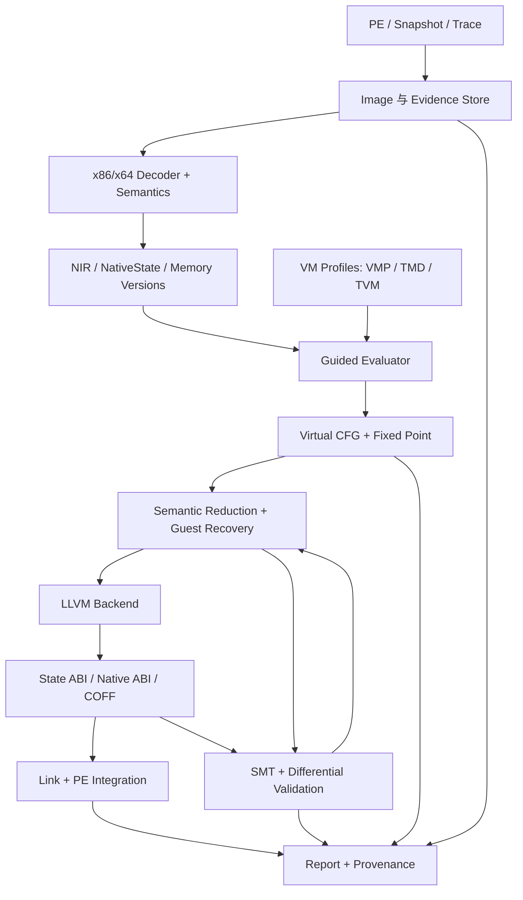

# NeREUS：基于 Rust + LLVM 的虚拟化代码 Lifting 与语义恢复框架

> 状态：设计提案，尚未实现。  
> 编写日期：2026-11-03。  
> 项目位置：`tools/NeREUS/`。本文路径均相对于该目录。  
> 目标家族：VMProtect（VMP）、Themida / Code Virtualizer（本文简称 TMD）、Tencent VM（本文简称 TVM）。TVM 在此不指 Apache TVM。

## 1. 目标与设计结论

NeREUS 应当是一个可扩展的二进制语义恢复框架：把受虚拟机保护的原生函数恢复成可分析、可验证的 IR，进一步生成可执行的目标代码，并在具备充分证据时重建函数 ABI 和二进制集成信息。

推荐技术路线是：**Rust 承担加载、机器语义、显式状态 SSA、引导符号求值、VM 适配、证明与调度；LLVM 承担规范化后的优化和机器码生成。** 在 LLVM 前保留一层规模受控的 NeREUS IR（NIR），用来表达 LLVM 不直接负责的客体机器状态、内存版本、虚拟控制流和恢复证据。

完整链路为：

```text
PE / 内存快照 / 辅助轨迹
  → 原生指令解码与精确语义
  → NIR + 显式机器状态
  → VM 引导的部分求值与 CFG 不动点
  → 去除有证据的解释器内部状态
  → 恢复后的客体函数 NIR
  → LLVM IR / bitcode
  → 状态 ABI 对象代码 / 已恢复 ABI 对象代码
  → 经验证的链接、适配与 PE 集成
```

这里的 LIFT 包含两个不同任务：一是把保护后机器码翻译成 IR；二是从解释器与原程序混合的语义中分离原程序行为。只完成第一项不能算完成去虚拟化，只生成通过 LLVM verifier 的 IR 也不能算证明正确。

最终交付应同时包含三类产物：

1. **分析产物**：原生 CFG、虚拟 CFG、NIR、LLVM IR、源地址映射和未解决问题。
2. **执行产物**：状态 ABI 的函数实现、运行时桥接，以及满足条件的原生 ABI 实现和重定位对象。
3. **证据产物**：输入身份、假设、覆盖范围、局部证明、差分结果、反例和集成资格。

本设计覆盖从基础语义到多家族恢复、原生输出与二进制集成的完整目标。阶段划分只决定实现顺序，不把目标缩小为单路径 trace lifter 或仅能处理算术表达式的演示程序。

## 2. 参考文章与适用边界

### 2.1 已阅读资料

用户指定的文章是 [Static Devirtualization of Tencent VM，2026-07-31](https://aftermathlabs.net/blog/31/07/2026/)（下文 [S1]）。其核心启发是：引导符号求值、受控字节码常量化以及原生状态边界可以帮助消去解释器；循环恢复是明确风险。文章中的布局和启发式属于其分析对象，不能直接当作整个 TVM 家族的规范。

同时参考了 [Static Devirtualization of Themida](https://aftermathlabs.net/blog/09/05/2026/)（[S2]）与 [VMProtect 2 - Part Two, Complete Static Analysis](https://aftermathlabs.net/blog/21/06/2021/)（[S3]）。前者说明应减少对 handler 外观的依赖；后者提供 VMP2 分析背景。这些材料不构成 VMP3、所有 Themida 引擎或其他 TVM 构建的兼容性证明。

以下架构、接口、状态算法、验证门槛和实施计划是 NeREUS 的设计建议，并非对作者私有框架的复刻说明。文中不沿用文章覆盖率作为本项目指标。

### 2.2 支持范围

| 维度 | 完整项目目标 | 必须声明的限制 |
| --- | --- | --- |
| 输入体系结构 | x86-64 与 x86；架构接口允许后续扩展 | 两者分别验收，不能由 x64 结果推定 x86 正确 |
| 输入格式 | PE32+、PE32，以及带映射描述的内存快照 | 加壳后尚未出现的代码不能仅凭文件恢复 |
| 保护家族 | VMP、TMD、TVM，各自包含独立构建配置 | 家族名称不是全版本支持承诺 |
| 分析方式 | 静态为主；快照与动态轨迹辅助发现和验证 | 单条轨迹只提供已观察路径 |
| 输出 | NIR、`.ll`、`.bc`、CFG、JSON 报告、COFF 对象、集成副本 | ABI、异常或控制流不完整时限制输出资格 |
| 函数类型 | 分支、循环、间接调用、原生逃逸、嵌套 VM、动态栈 | 每项能力须在支持矩阵中独立标记 |
| 执行环境 | Windows 工具端；可选 Linux 分析/验证 worker | 用户态和内核态环境契约分别建立 |

本项目处理虚拟化代码语义。通用脱壳、完整操作系统模拟、源码变量名恢复、任意 C++ 类型恢复不是自动附带能力；相应信息可由外部工具提供。内核样本允许离线 lift，但执行与验证依赖匹配的隔离测试环境，不能把用户态 harness 的结果外推为驱动可运行。

## 3. 核心设计约束

1. **语义优先**：遇到不支持的指令、未知目标或预算耗尽，输出带原因的边界，禁止无声跳过。
2. **解释器状态与客体状态分离**：native RIP/RSP、VIP/VSP 和 guest RIP/RSP 是不同概念，不能仅凭地址所在节区归类。
3. **事实附带来源**：常量、内存区域、调用摘要和分支结论必须说明适用路径、映像版本及证明条件。
4. **VM 知识集中在适配层**：入口模式、VIP 定位、解密状态、转移判别和嵌套规则可以定制；机器指令语义不按保护家族复制。
5. **求值与恢复可撤销**：发现新写入、新入边、代码变化或未知调用后，依赖旧事实的结果必须可失效并重新计算。
6. **静态与动态证据分层**：动态值可以生成候选、检查反例；未经泛化不能变成无条件静态事实。
7. **分析完整性与执行资格独立**：CFG 完整不代表完成形式证明，随机差分通过不代表具备正确的异常展开信息。
8. **LLVM 是后端，不是语义补丁**：不得依赖 `-O3` 自动发现 VM 边界、纠正 flags 或补全原程序控制流。

## 4. 总体架构与模块



### 4.1 Cargo workspace 建议

| crate / 组件 | 职责与边界 |
| --- | --- |
| `nereus-core` | 地址、位宽、ID、目标环境、配置、错误、schema；不依赖 LLVM |
| `nereus-image` | PE 映射、RVA/VA/文件偏移转换、重定位、导入、unwind 与快照叠加 |
| `nereus-x86` | 解码适配、寄存器别名、指令到 NIR 的语义；x86/x64 模式显式区分 |
| `nereus-ir` | 表达式 DAG、SSA、块参数、effect token、校验、解释器和序列化 |
| `nereus-memory` | 路径内存、区域分类、别名分析、版本与失效依赖 |
| `nereus-eval` | 抽象/符号求值、工作队列、状态合并、循环与间接目标解析 |
| `nereus-vm` | VM profile 接口、证据验证、会话与 VM frame 管理 |
| `nereus-vm-vmp` | VMP 子配置，独立维护 VMP2、VMP3 样本能力 |
| `nereus-vm-tmd` | Themida / Code Virtualizer 子配置、嵌套上下文 |
| `nereus-vm-tvm` | Tencent VM 子配置与原生状态边界发现 |
| `nereus-opt` | 位向量归约、MBA、切片、状态提升与受证据约束的 DCE |
| `nereus-smt` | SMT-LIB 生成、求解器隔离进程、预算、缓存与证明义务 |
| `nereus-llvm` | NIR lowering、LLVM C API 封装、verifier、pass pipeline、目标代码 |
| `nereus-runtime` | guest 内存与外部调用桥接、escape dispatcher、故障交付 |
| `nereus-verify` | 指令/块/函数/代码生成差分，反例缩减与报告 |
| `nereus-link` | COFF 链接、适配 stub、PE 副本集成、重定位与元数据审计 |
| `nereus-cli` | 命令、profile/config 加载、批处理、可恢复任务 |

这些 crate 是稳定职责划分，可以按依赖顺序创建；不要求在尚无实现时生成全部空壳。依赖方向为 core → IR/image → semantics/memory → evaluator/profile → recovery → backend/verify/link。`core` 与 `ir` 不回依赖 CLI 或家族 crate。

### 4.2 技术选型

| 层次 | 建议选择 | 选择理由与替代方案 |
| --- | --- | --- |
| 主语言 | Rust stable，锁定具体工具链 | 核心逻辑使用安全 Rust；FFI 集中封装 |
| 指令解码 | `iced-x86` | 解码与指令信息来源；它不是执行语义引擎 [S4] |
| 原生语义 | 自有 NIR 语义表 + 生成/差分工具 | 能控制 flags、故障、子寄存器和状态映射；是主要工程成本 |
| 外部语义参考 | Remill 作为可选参考后端/交叉检查 | 可减少盲区；不让 Windows 主路径依赖其全部构建链 [S5] |
| LLVM 绑定 | `llvm-sys` + 项目内窄安全封装 | 明确控制类型、属性、target machine 和 pass；不向分析层泄漏 LLVM 指针 |
| PE 与对象文件 | 评估 `object` 的读取能力，PE 元数据专门处理 | 导出 COFF 与完整 PE 重写是不同能力；写入缺口需自行实现 |
| SMT | Z3，优先隔离进程 + SMT-LIB2 | 可终止、可复现；Rust 端抽象保留更换 solver 的空间 [S10] |
| 验证执行 | NIR 解释器 + 独立 emulator + 隔离 native runner | 避免用同一份语义实现互相证明；emulator 不支持的指令需单列 |
| 图与存储 | ID arena、hash-cons DAG、持久化内存 overlay | 控制大表达式、分叉复制和状态共享成本 |
| 用户界面 | CLI 优先，JSON/CFG 为稳定接口 | 后续 IDA/Ghidra 接入通过报告和地址映射，不侵入分析内核 |

选择自有 NIR 不是另写一个完整机器码编译器：NIR 只负责语义、恢复与证据；指令选择、寄存器分配、调度和对象代码生成交给 LLVM。Rust + LLVM 不等于所有依赖必须是 Rust；默认核心使用 Rust，必要的 LLVM C++ 接口放在小型 C ABI shim 中。

## 5. 输入模型、地址与发现

### 5.1 Image 模型

统一地址表示建议为 `GuestAddr { image_id, rva }` 或明确的绝对 guest VA。文件偏移、RVA、加载后 VA 和宿主指针使用不同类型，禁止隐式相互转换。

每次分析绑定以下身份信息：

- 原文件 SHA-256、映像架构、首选基址与分析加载基址。
- 节区、映射权限、导入绑定策略、重定位结果及不可用页。
- 快照来源、捕获时机、缺失页、修改页和可信度。
- 目标 CPU 特性、操作系统/ABI、异常、TLS 与段寄存器契约。
- profile、语义表、IR schema、优化规则和工具链版本。

磁盘映像和运行时快照允许同一地址有不同字节。读取必须携带 image/memory epoch；不能把快照中的已解密字节推广为任意执行时刻恒定不变。

### 5.2 函数与 VM 入口发现

候选来源包括用户指定 RVA、导出/PDB、PE exception directory、反汇编调用目标、已知入口 stub、profile 识别和轨迹观察。每个候选保留来源。

识别输出是 `Candidate`，而不是立即认定 VM：继续验证状态保存、控制流汇聚、字节码依赖和上下文访问。节区名、短跳转、`int3` 填充只能增加置信度；改名和变异后仍允许使用手工声明入口。

扫描阶段无法确认的入口保留在报告分母中，不能只统计成功处理的函数。批量发现率和已知入口恢复率分别报告。

## 6. NIR、机器状态与精确语义

### 6.1 三类状态

```text
NativeState：解释器当前运行所用的物理寄存器、flags、native PC/SP
VmFrame：VM 实例、VIP/VSP、dispatcher、解密状态、嵌套关系
GuestState：恢复目标程序的寄存器、flags、客体内存、guest PC/SP
```

开始时 NativeState 与 GuestState 可能共享同一组符号来源，但 VM entry 之后不再把 native RSP 当成 guest RSP。只有 profile 提供映射且通过边界一致性校验时，才把 VM 上下文槽解释为 guest 寄存器。

IR 中使用 `ValueId`、`BlockId`、`MemoryId`、`EffectId`，不用 Rust 或 LLVM 原始地址作为持久身份。表达式保留原生指令 VA、字节码范围、VM frame、规则版本和派生链。

### 6.2 值域与操作

| 类别 | 必须表达的内容 |
| --- | --- |
| 值 | 定宽位向量、布尔、符号输入、受定义性掩码约束的值、带区域来源的地址 |
| 整数 | 模加减乘、逻辑、比较、扩展/截断、拼接/提取、移位与 rotate |
| 状态 | 寄存器读写、lazy flags、段基址、控制状态和观测事件 |
| 内存 | 小端 load/store、访问宽度、对齐、别名、内存版本、权限与故障 |
| 控制流 | `br`、`condbr`、`switch`、`call`、`return`、`escape`、`unresolved` |
| 系统效果 | 外部调用、原子操作、fence、异常、CPU 查询、特权与环境操作 |

每个可能读写内存或发生外部效果的节点显式接受并产生 memory/effect token。为已证明不别名的区域拆 token 是优化，不是初始假设。

块参数承担 SSA phi 的作用。跨块的寄存器和内存状态必须显式传递；NIR verifier 检查类型、支配、块参数数量、effect 连续性及终结指令。

### 6.3 指令语义合同

语义实现至少覆盖以下容易误译的行为，并逐项记录支持矩阵：

- `AL/AH/AX/EAX/RAX` 别名及 x64 下写 EAX 的高位清零；前缀对寄存器选择的影响。
- CF/PF/AF/ZF/SF/OF 的计算、保留和未定义状态；DF 等被字符串操作使用的标志。
- shift/rotate 的计数屏蔽，计数为零时的 flags 保留，以及不同位宽差异。
- `ADC/SBB` 的进位/借位、双宽乘除、除零与商溢出、`CMOV/SETcc`。
- push/pop、`call/ret`、`ret imm`、地址大小、操作数大小和 x86 段语义。
- SSE/AVX、x87、MXCSR、字符串指令、LOCK/原子、CPUID、时间和特权操作。

对复杂指令允许先输出结构化语义 helper，但 helper 必须有明确输入、输出、内存效果和故障合同。无法执行/验证的 helper 标记能力缺口，不能等价于已支持。

flags 使用 lazy thunk 延迟展开，并保留写入位掩码。体系结构未定义的位表示为有作用域的非确定值；一次读取稳定性和后续覆盖规则由语义合同规定。不能把整组 flags 随意设为零，也不能把所有未定义行为转换成 LLVM poison。

## 7. 内存模型与受控常量化

### 7.1 区域划分

建议区域包括 `ImageCode`、`ImageData`、`Bytecode`、`VmContext`、`VmStack`、`GuestStack`、`GuestHeap`、`External`、`Unknown`。这些是可修订的分析标签，而不是天然互不别名的地址空间。

内存为按字节定义的小端映射：路径 overlay 覆盖基础映像，支持重叠写、部分写、跨边界读和符号地址。对符号地址使用 store chain / SMT array / 保守摘要，不能只维护 `HashMap<常量地址, 值>`。

### 7.2 load → constant 的准入规则

一次常量提升必须同时记录并检查：

1. 地址在当前路径和 epoch 下可确定，字节确实可读取。
2. 映像来源和重定位/导入处理已经确定；地址常量可以表示为符号重定位而非裸数。
3. 所有到达该读取的写入已处理；不存在可能命中的未知写或未建模外部调用。
4. 提升依据适用于该读取点，而非仅因为地址落在名为 `.tvm0` 或 `.vmp*` 的节。
5. 循环和状态合并后的 memory version 仍满足上述条件。

字节码与解密表是优先候选，但同样接受版本管理。运行时解密结果来自路径 overlay；自修改字节码或代码触发 epoch 变化、解码缓存失效以及相关 CFG 重分析。

PE 只读属性是证据之一，不能替代对运行时权限改变和写入行为的建模。普通客体输入、全局可写变量、堆、MMIO、TLS 等默认保持符号或环境依赖。

### 7.3 未知写与调用失效

未知地址写入按 may-alias 集合 havoc 对应区域；若无法排除对字节码/VM context 的影响，必须使相关解密和跳转结论失效。外部调用无摘要时，保守处理可达内存、逃逸指针和环境副作用；未证明不可达的全局状态也不能直接保留为常量。

采用依赖图记录 `Fact → MemoryVersion / Summary / ProfileEvidence`。新事实冲突后回滚到受影响块，重跑状态合并；不能保留已从旧常量推导出的单一路径 CFG。

## 8. VM profile 与多家族适配

### 8.1 Profile 的职责

Profile 负责“如何引导”，核心 evaluator 负责“如何证明并执行语义”。推荐接口如下，代码仅表达合同，尚不是可编译实现：

```rust
// 家族插件返回候选和证据；核心负责校验事实及其有效范围。
pub trait VmProfile: Send + Sync {
    fn id(&self) -> ProfileId;
    fn probe(&self, image: &ImageView, entry: GuestAddr) -> Vec<VmCandidate>;
    fn initialize(&self, cx: &mut AnalysisContext, candidate: &VmCandidate)
        -> Result<VmSession>;
    fn observe(&self, state: &EvalState, event: &NativeEvent)
        -> Vec<GuidanceProposal>;
    fn checkpoint(&self, state: &EvalState) -> Result<VirtualLocation>;
    fn classify_transfer(&self, state: &EvalState, transfer: &Transfer)
        -> TransferProposal;
    fn recover_guest(&self, state: &EvalState, boundary: &Boundary)
        -> Result<StateMappingProposal>;
}
```

`GuidanceProposal` 可以建议内联、字节码区域、VIP/VSP 位置或 VM 边界，每项含证据和前置条件。核心接受、拒绝或将其保留为显式假设。手工 profile hint 与自动推断使用同一机制，不能直接绕过验证。

插件默认是静态链接的 Rust crate。跨版本第三方扩展若有需要，使用有 schema/version 的进程协议；不承诺 Rust trait 的动态库 ABI 稳定。

### 8.2 家族能力与待验证事项

| 家族 | 适配关注点 | 必须靠样本确认的变化 |
| --- | --- | --- |
| VMP | VM entry、VIP/VSP 发现、handler 目标计算、解密依赖和 VM exit | VMP2 与 VMP3 分开；寄存器分配、rolling key、handler 变异、多个 VM 实例 |
| TMD | context/虚拟栈来源、虚拟调用与返回、嵌套 VM frame | 引擎类型、上下文位置与共享方式、重入和异常控制流 |
| TVM | dispatcher、VIP 更新、原生状态物化点、虚拟条件转移 | 节区名、寄存器/槽偏移、原生逃逸边界及平台元数据布局 |

不能把 VMP2 的固定 handler 表模型直接当作 VMP3 的事实，也不能把某个 TMD 布局写入通用 MemoryModel。各 profile 的内部可使用模式定位候选，最终仍以语义和状态一致性判断。

### 8.3 支持矩阵的组织

配置身份由 `family + engine/build fingerprint + architecture + options` 组成。每一格分别记录：识别、入口恢复、字节码解析、分支、循环、嵌套、native escape、异常、状态 ABI 输出和原生集成。

没有受保护样本时，配置只能标记 `planned`。基于文章推断的 TVM 规则标记 `hypothesis`；取得对应样本并通过回归后才能变更为 `validated-on-corpus`。该状态仍不表示支持全部未见构建。

## 9. 引导符号求值与控制流恢复

### 9.1 两类变量与两类图

将状态至少分为：

- **解释器控制状态**：VIP、handler 选择、必要解密种子、VM frame 等。只在足以确定且不依赖未约束客体输入时特化。
- **客体语义状态**：函数参数、普通寄存器、guest flags、可变内存和循环变量，默认符号化。

native CFG 用于执行原生解释器语义；virtual CFG 用于表示恢复出的原程序块。两者通过事件和状态映射连接。解释器 dispatch 循环不能被误认为原程序循环；同一 VIP 也不一定代表同一个解释状态。

### 9.2 虚拟位置、状态键和缓存

虚拟块位置建议表示为：

```text
VirtualLocation = (
    image/region identity,
    VM instance + normalized nested-frame identity,
    VIP,
    decoder/handler mode,
    relevant decoder-state abstraction,
    bytecode/code epoch
)
```

不能只以 VIP 作 visited key，也不能把所有 guest 表达式放进 key 导致循环无限克隆。对影响解码的有限状态分区；无法有限化时使用通用解码摘要、符号 dispatch 或有界特化，并报告残留控制流。

区分三种缓存：纯指令语义模板缓存、含前置条件的块摘要缓存、路径内的求值结果。路径结果不得仅凭 `(VIP, handler)` 在其他状态复用。

### 9.3 循环与 SSA 不动点

采用“发现位置 → 合并入口状态 → 重新求值 → 更新后继”的工作队列。抽象域包含常量集合、known bits、区间/同余和符号表达式；合并扩大状态集合。对增长过快的域执行 widening，并撤销依赖已失效常量的剪枝。

```text
worklist ← 函数入口
while worklist 非空:
    取位置及新的到达状态
    与该位置已知入口状态 join
    若状态未扩大且摘要仍有效，则复用摘要
    否则为变化的寄存器、flags、内存建立/更新块参数
    符号执行至下一个虚拟边界、外部边界或未决点
    校验常量提升，做受预算约束的局部归约
    解析所有可行后继，将新状态加入队列
    若发现回边，扩大 loop header 并重评估既有出边
直到所有入口状态与摘要稳定，或产生明确的预算/能力边界
```

循环头在第一次到达时就具有可更新的块参数。即使初次求值把条件折叠为单边，也保存原条件及其依赖；新回边到达后重新计算，不能仅追加一条回边后停止。

必须用以下回归检查算法：

```c
for (int i = 0; i < 10; ++i) sum += a[i];
```

正确恢复应包含携带 `i`、`sum` 和内存状态的循环头，以及退出边。还需覆盖零次迭代、do-while、break/continue、嵌套和不可约循环。超出有限域的解密 key 不通过任意丢弃 key 来强行合并；保留动态语义或报告不完整。

### 9.4 间接控制流

解析顺序为：常量折叠 → 有限值集 → 规范化条件选择 → jump table → 路径约束下 SMT → profile 建议 → 辅助轨迹候选。

SMT 枚举目标时，只有在覆盖已枚举目标的排除查询不可满足后，才能标记集合穷尽。枚举上限、timeout 或 solver unknown 均不是“没有更多目标”。

分类至少包括：解释器 dispatch、客体分支、客体间接调用、VM 进入/退出、native escape、嵌套进入/返回和未知转移。未知目标终结为 `UnresolvedTransfer`，保留表达式、路径条件和原因。

辅助轨迹给出的两个目标不能直接改写成完整二叉分支。尚有剩余可行域时保留 default unresolved 边；分析输出可以继续，完整输出资格不能通过。

### 9.5 条件恢复

优先识别通用位向量模式：`select(cond,a,b)`、掩码选择、表驱动选择、flags 组合和地址算术。家族 DAG 规则只提供候选，必须验证分支条件及目标表达式等价。

支持全部需要的 x86 条件组合，而不只处理单独 ZF/CF；有符号比较须正确组合 SF/OF。不能将“SMT 只能求出两个目标”直接解释成某一条 `Jcc`，也不能在规则不匹配时猜测条件。

### 9.6 调用、返回与嵌套

dispatcher 调用的内联由 profile 与证据驱动。普通 guest 调用生成具有 ABI、内存效果和异常效果的摘要；递归通过调用图 SCC 求摘要不动点，禁止无限内联。

`ret` 不一概当作函数退出：结合栈数据流、VM frame、保存返回地址和 guest 状态判别。尾调用、返回地址改写、VM 内部返回和真正 guest return 分别处理。

嵌套 VM 使用 frame 栈保存 context 映射、VIP/VSP、解码状态及父 frame。深度/状态预算耗尽时输出 `nested_vm_budget`，不能把内层效果当空操作。

## 10. 归约与客体语义恢复

### 10.1 分阶段优化

| 阶段 | 主要工作 | 准入条件 |
| --- | --- | --- |
| 解码局部 | 常量折叠、known bits、解密切片、有限目标解析 | 只用当前有效的路径与内存事实 |
| NIR 规范化 | copy propagation、CSE、表达式归一、块参数化简 | effect 顺序和定义性保持 |
| VM 语义消减 | 已证明私有的 context/stack 提升、死状态删除 | 逃逸、别名与异常观测检查通过 |
| 条件/MBA | 位向量规则、条件选择重写、局部 SMT 化简 | 位宽、前置条件与故障等价检查 |
| 客体 CFG | 不可行边删除、块合并、循环规范化 | 目标集合穷尽及 loop header 已稳定 |
| LLVM | SROA、mem2reg、InstCombine、SCCP、GVN、DCE、CFG 化简等 | lowering 合同通过；效果与异常模型已明确 |

不把全局优化器放进每条原生指令执行循环。优先增量化简；到间接转移或虚拟边界才执行较重优化。优化是否继续以结构/事实是否变化判断，并有迭代预算。

### 10.2 MBA 规则管理

规则库采用定宽位向量语义，包含模式、替换、位宽、前置条件和证明结果。例如模整数恒等式 `(a | b) + (a & b) = a + b` 可作为规则；若 flags 或中间访存可观察，必须把这些效果纳入比较，不能仅替换输出值。

每条规则在目标位宽上由 SMT 验证，保存查询与规则版本。在线归约优先确定性的规范化和已证明规则；e-graph 可作后续受预算的候选生成器，不作为正确性基础。超时保留原表达式。

### 10.3 去掉解释器状态的判定

从 guest 返回状态、可观察内存写、外部调用、异常与退出事件反向切片。只有在 context/栈区域不逃逸、不被外部别名引用、不参与 guest 地址计算、且不会改变可观察故障的条件下，才能将其写入消去。

若 guest 依赖 VM 私有区域的实际地址、VM 完整性检查或共享 context，保留对应区域和运行时依赖，在报告中标记残留。不能为了生成漂亮 IR 而删除仍有语义作用的保护器逻辑。

## 11. 原生边界、ABI、栈与异常

### 11.1 Native escape 与 boxed instruction

原生逃逸不等于“重新执行原地址即可”。分两种情况：

1. 已有精确语义的原生片段：继续 lift，并通过状态映射接回 VM。
2. 依赖 CPU/系统或暂不支持的片段：生成 `NativeEscape`，带片段范围、完整 live state、内存/异常合同和继续位置。

可执行 escape 必须由运行时 adapter 恢复要求的寄存器/flags/栈，执行可重定位的片段或受控原地址调用，再捕获状态。RIP-relative 指令、内部相对跳转和异常 PC 映射均需处理。不存在合格 adapter 时只导出分析边界，不能宣传为独立可执行函数。

CPUID、计时、TLS、系统调用和特权行为通过环境模型/明确 helper 处理；环境依赖不能任意常量化。把某指令留给硬件执行只是实现选择，不证明它与原环境一致。

### 11.2 两种输出 ABI

**状态 ABI** 是通用、可验证的输出合同，概念形式为：

```text
ExecResult nereus_fn(CpuState* state, GuestMemory* memory, Runtime* runtime)
```

`ExecResult` 表示返回、尾调用、未解析转移、guest fault 或 escape 请求。真实实现的布局和调用约定版本化。参数明确包含 guest 状态，不要求猜测原 C 原型；它是最终产品的一类正式输出，不自动意味着原函数可直接替换。

**原生 ABI** 输出要求原函数的参数、返回值、栈布局、非易失寄存器、隐藏参数和调用点足够明确。未知原型时可以生成汇编 adapter 包装状态 ABI，但不能凭 RCX/RDX 等使用情况随意生成 C 签名。

Windows x64 必须遵循对应寄存器与 shadow space 规则 [S8]。x86 的 cdecl/stdcall/fastcall、栈清理和 SEH 注册链独立实现，不复用 x64 的假设。浮点、向量、varargs 和结构体返回都需要专门合同。

### 11.3 栈模型与重建

默认把 guest 栈指针表示为符号基址 `S0 + offset`，保留必要对齐约束。解释器原生栈、客体栈、VM 虚拟栈分别跟踪。用于求值的合成地址不能作为真实指针流入 LLVM 输出。

固定栈框架通过所有路径的栈偏移、调用约束、内存访问和返回平衡共同恢复。边界处偏移和“高水位”只作为候选证据，不足以证明整个 frame 大小。

动态分配、stack realignment、栈探测、栈地址逃逸和跨函数栈引用必须显式支持或保留状态 ABI。LLVM 产生的 spill frame 与 guest 栈保持独立；仅当证明地址不可观察且所有引用可修正时，才合并为直接原生栈框架。

外部 native call 需要正确 guest ABI adapter：包括寄存器、guest 栈参数、内存映射和返回后的状态。不能在 LLVM 普通函数体中临时切 RSP 后假定编译器 spill 和 unwind 仍然正确。

### 11.4 SEH、CET 与可观察故障

区分三个层次：分析可表示故障；状态运行时可交付 guest fault；原生集成可保持系统级异常行为。三者分别验收。

- 读取原始 `.pdata/.xdata` 和 handler 信息作为分析证据，不能直接复制到改写后的 PC 范围。
- 生成代码的 prolog/epilog、栈分配和寄存器保存必须与新 unwind 记录一致 [S9]。
- 自定义 guest SEH 逻辑与 LLVM EH/funclet 的映射需要单独 lowering；普通 `invoke` 不能自动恢复保护器自定义展开 [S12]。
- 对 native escape 和重编译片段维护原始 PC、guest PC、新 PC 的映射，明确异常上下文可见性。
- CET 相关的调用/返回平衡及间接入口约束列为目标属性；不得机械保留解释器内部的 shadow-stack 修正。
- faulting load/store、除法故障和副作用的次序纳入观测。死代码删除必须有明确的 fault 观测合同。

异常/CET 集成未验证的函数仍可导出 IR 和状态 ABI，但不能获得 `native-integration-ready`。是否接受“只保证正常路径”的分析结果由输出 contract 明示，不能隐藏在优化开关中。

## 12. LLVM 后端合同与二进制集成

### 12.1 LLVM 使用方式

采用独立 LLVM 安装，不绑定 rustc 内置 LLVM。立项工程验证后，锁定一组具体 Rust、LLVM、`llvm-sys`、链接器和 solver 版本，并写入构建清单。本文不凭“最新版本”假定兼容。

Windows 构建须确认目标/宿主 triple、MSVC CRT、`llvm-config`、头文件和库可用；仅安装 `clang.exe` 不足以保证 `llvm-sys` 能构建 [S6]。优先用固定源码构建或已验证开发包，记录组件及哈希。

Rust 层通过 C API 管理 context/module/builder/target machine，以 RAII 封装所有权与线程边界。pass pipeline 使用 New Pass Manager 支持的入口 [S13]；自定义 C++ pass 或特殊 codegen 需求才使用 shim。每个并行任务独立 LLVM context，不跨线程共享裸对象。

### 12.2 NIR → LLVM 的语义规则

LLVM 的 UB/poison 与机器行为存在差异 [S7]。后端采用以下项目合同：

| 问题 | NeREUS lowering 规则 |
| --- | --- |
| 溢出 | 整数计算默认模语义；无证明不加 `nsw/nuw/exact` |
| 大移位与除法 | 先落实 x86 计数/故障语义，避免直接产生不受保护的 LLVM UB |
| 未定义 flags | 用显式输入/运行时非确定状态建模；不滥用 `undef/poison` |
| guest 地址 | 默认整数地址 + 内存接口；不假装任意 guest 地址都是有效宿主指针 |
| 指针与属性 | `inbounds/noalias/nonnull/dereferenceable` 等只在具备证明时使用 |
| 未知效果 | 外部 helper 显式声明效果；不随意添加纯函数或无异常属性 |
| 未决控制流 | 降为报告/运行时终结边界，禁止用 `unreachable` 掩盖未知行为 |

guest 内存接口默认是可观察、有顺序、可返回故障的操作，不依赖普通 LLVM 非 volatile load 保持 guest fault 行为。仅在页可访问、映射有效、别名和故障合同得到证明时，才降为直接 load/store。

为兼顾优化与正确性，维护两种可互检的 lowering：精确运行时内存路径用于状态执行；已证明局部区域可提升为 LLVM SSA/alloca 的路径用于优化。若使用返回结构体承载 `{value, fault}`，每个访问后显式分支处理 fault，禁止通过 `select` 投机执行有故障的 helper。

每次 lowering 后运行 LLVM verifier。维护白名单 pipeline 和逐 pass dump；修改 LLVM/规则版本必须重跑语义回归。可用 Alive2 对其支持范围内的 LLVM 局部转换做补充检查，不能把它当作原二进制到新函数的全程证明 [S11]。

### 12.3 三层输出与集成

1. **可分析 IR**：允许带未解析边界，始终附带恢复范围。
2. **可执行对象**：状态 ABI 或满足条件的原生 ABI；列出所有 helper、逃逸与原映像依赖。
3. **PE 集成副本**：链接并布局新代码/数据，修复重定位、导入/跳转与异常信息，生成可回滚 patch manifest。

COFF 由 LLVM target machine 生成，链接通过锁定的 linker 工具完成。PE writer 消费已布局的结果，不把 `.obj` 直接拼到节区里。必须处理 image alignment、节权限、RVA/VA、相对跳转范围、ASLR、TLS/导入引用和 unwind 范围；CFG/CET/load-config 按实际输出更新。

集成前审计跨函数入边、函数内部被引用地址、共享 VM 状态和原始代码依赖。存在函数中部入口或外部引用未迁移时，不允许只 patch 主入口后宣称成功。

输出写入新文件，保留输入。修改 PE 可能使原签名失效；驱动签名、部署和运行许可属于独立集成条件，不能由离线 lifting 结果推断。独立输出与依赖原映像的输出在 manifest 中分开。

## 13. 命令接口、配置与产物

以下为拟定接口，用于约束实现，不表示命令已经存在。路径示例均位于项目子目录。

```powershell
# 发现候选、分析指定函数、导出与验证。
nereus inspect --input samples/private/example.exe --out out/example/inspect
nereus analyze --input samples/private/example.exe --entry-rva 0x12340 --profile tvm-auto --config configs/analysis.toml --out out/example/fn_12340
nereus export --analysis out/example/fn_12340 --emit nir,llvm,bitcode,cfg,coff --abi state
nereus verify --analysis out/example/fn_12340 --suite tests/corpus/example.toml --out out/example/verify
nereus integrate --analysis out/example/fn_12340 --input samples/private/example.exe --output out/example/example.devirt.exe
```

`--entry-rva` 与 `--entry-va` 互斥；`--profile auto` 无匹配时输出候选/诊断，允许指定 profile 与手工 hint。`integrate` 读取既有证据并验证输入身份，资格不满足时返回具体拒绝原因。

拟定配置示例：

```toml
schema_version = 1

[target]
architecture = "x86_64"
abi = "windows-x64"
environment = "user-mode"

[analysis]
strategy = "static-guided"
stack_model = "symbolic-base"
unknown_transfer = "preserve"
constant_policy = "versioned-evidence"

[budgets]
native_steps_per_function = 10000000
virtual_blocks_per_function = 100000
states_per_location = 64
indirect_targets_per_query = 256
expression_nodes = 5000000
smt_timeout_ms = 5000
function_timeout_s = 600
memory_limit_mb = 4096

[output]
abi = "state"
retain_unresolved = true
emit_provenance = true
```

这些预算是可配置起点，不是性能承诺；达到任何上限都记录原因并使完整性状态降级。`states_per_location` 到上限时先尝试保守合并，不能任意删除剩余状态。

一次分析目录建议包含：

```text
out/<sample>/<function>/
  manifest.json           # 输入身份、版本、假设和环境合同
  report.json             # 完整性、验证、资格与统计
  native.cfg.json
  virtual.cfg.json
  lifted.nir.json         # 含完整原生解释器语义的可复查结果
  recovered.nir.json      # 消减后的客体语义
  recovered.ll
  recovered.bc
  recovered.obj
  source-map.json         # native / bytecode / guest / generated PC 映射
  dependencies.json       # helper、escape、原映像和外部环境依赖
  proofs/                 # 规则/局部证明和 SMT 查询
  counterexamples/        # 失败输入及可重放状态
  checkpoints/            # 带 schema 和输入哈希的中间状态
```

文件仅在相应步骤成功后出现；manifest 区分 planned、emitted 和 validated。中间过程不得生成到仓库根目录，脚本按功能放在 `scripts/<task>/`，临时数据放在 `temp_data/<task>/`。

## 14. 完整性、验证等级与失败合同

### 14.1 正交状态

报告不使用一个含糊的 `success: true`，至少分为：

| 维度 | 建议值 |
| --- | --- |
| 恢复范围 | `complete-under-contract` / `partial` / `trace-only` / `failed` |
| 验证等级 | `unverified` / `differential-tested` / `locally-proved` / `function-proved-under-contract` |
| 执行资格 | `analysis-only` / `state-runtime-ready` / `native-object-ready` / `native-integration-ready` |
| 依赖情况 | 原映像、helper、环境、escape、显式假设的列表 |

`complete-under-contract` 要求该 contract 下所有可达边界已解析或由完整外部摘要覆盖、循环分析稳定且无未支持语义；它本身不是等价证明。包含假设的结论必须显示假设，不能显示成无条件完整。

### 14.2 等价定义

对满足前置条件 `P` 的入口状态 `s`，在匹配的环境事件序列 `E` 下，比较原程序与恢复程序的观测：

```text
Obs(Original, s, E) == Obs(Recovered, MapIn(s), E)
```

`Obs` 包括合同规定的返回状态、可观察内存、外部调用及参数、故障类型/位置映射、异常上下文和终止行为。可证明无关的 scratch 状态允许商掉，但必须先定义状态关系与可观察集合。

包含非确定 CPU/系统事件时，验证通过重放同一事件或证明允许行为关系完成。若只证明一向 refinement，报告必须写明方向；不能宣称双向等价。函数级含循环证明需要归纳不变量或其他充分方法，有限展开只能标记有界结果。

### 14.3 验证层次

| 层次 | 验证内容 | 不能替代的工作 |
| --- | --- | --- |
| IR/LLVM verifier | SSA、类型、effect 与合法 IR | 机器语义正确性 |
| 指令差分 | NIR 对照独立 emulator/native，包括 flags、边界值与 faults | 全函数控制流完备 |
| 局部 SMT | MBA、条件、摘要、内存提升和切片义务 | 不带循环不变量的全函数证明 |
| VM 边界差分 | 映射前后 guest 状态、VIP 与解码状态 | 未观察路径的正确性 |
| 函数差分 | 原保护函数、NIR、LLVM 与生成机器码的观测 | 对所有输入的形式证明 |
| 集成验证 | 装载、ASLR、ABI、栈、异常展开、外部调用及元数据 | 保护器所有未见版本兼容性 |

在可执行原样本的隔离环境中采集 reference；测试 runner 与分析进程隔离并有资源上限。对原程序已经故障的输入也比较故障合同，不能统一忽略。

### 14.4 回归语料与验收

建立带源码 oracle 的未保护函数与相应受保护函数配对语料。每个保护家族的样本清单记录工具版本、VM 引擎、选项、架构和文件哈希；私有样本与可公开 fixture 分目录。

强制回归类别：整数/flags 边界、别名和重叠写、输入相关全局值、双分支和多目标、有限/无限循环、switch、递归/尾调用、嵌套 VM、原生逃逸、异常和动态栈、自修改/运行时解密、未知调用破坏 context、同 VIP 不同 key、不同 ASLR 基址。

每项能力的验收至少要求：

1. 手写可审查 fixture 与独立 oracle；语义表条目全部有对应验证记录。
2. 函数差分覆盖随机输入、定向边界、内存别名和异常输入，保存固定 seed。
3. 生成代码经过独立反汇编与运行对比；`llc` 成功不是结束条件。
4. 目标 profile 在独立留出样本上回归，避免只适配训练用构建。
5. 预期不能处理的样本稳定输出正确失败类型，不误报完整。

报告分别统计候选发现、已知虚拟函数、CFG 完整、状态输出、原生对象、集成成功和验证等级。所有失败/超时保留在分母；无法知道入口全集时注明分母是已知集合。性能按同一硬件、预算和样本给出 wall time、峰值内存、SMT 时间与节点数量的中位数及尾部值。

### 14.5 标准失败类别

建议包含 `unsupported_instruction`、`unknown_memory_alias`、`symbolic_decoder_state`、`unresolved_transfer`、`profile_mismatch`、`code_epoch_conflict`、`external_summary_missing`、`exception_mapping_missing`、`abi_ambiguous`、`loop_fixpoint_budget`、`nested_vm_budget`、`solver_unknown`、`resource_budget`、`verification_counterexample` 和 `integration_metadata_missing`。

每条失败至少给出地址、VM frame/VIP、IR 节点、前置条件、影响范围及复现 checkpoint。支持从指定失败点重新分析，人工补充信息也要进入 manifest，不得修改结果文件伪装自动成功。

## 15. 工程目录与可复现构建

建议最终目录如下；本次只创建本设计文档：

```text
NeREUS/
  DESIGN.md
  Cargo.toml
  Cargo.lock
  rust-toolchain.toml
  crates/
    nereus-*/
  native/
    llvm-shim/             # 仅在 C API 能力不足时启用
    state-adapters/        # 汇编/ABI/escape adapter
  runtime/
    targets/               # 用户态/内核态环境合同和运行时资源
  profiles/
    vmp/
    tmd/
    tvm/
  configs/
  schemas/
  rules/
    mba/
    branches/
  tests/
    semantics/
    cfg/
    memory/
    corpus/
    integration/
  samples/
    public/
    private/               # 本地样本，不提交受限制二进制
  scripts/
    build/
    corpus/
    verify/
  docs/
    adr/
    formats/
    support-matrix.md
  toolchains/
    manifest.toml
  temp_data/
    <task>/
  out/
    <sample>/<function>/
```

工具链检查应一次验证：Rust workspace、LLVM 链接、IR verifier、New PM、x86/x64 COFF 生成、linker、solver，以及最小 ABI runner。检查结果写入 manifest，随后固定依赖；不假定本机 PATH 中的多个 LLVM 可以混用。

缓存 key 至少含映像/快照哈希、profile 与规则版本、语义版本、环境合同及相关 memory epoch。可恢复 checkpoint 独立版本化；不兼容的旧缓存明确拒绝读取。

大规模任务按函数并行，函数内部先保持确定性调度。日志使用稳定 ID，不包含宿主指针；相同输入和 seed 的 IR/报告支持结构化比较。LLVM 与 solver worker 崩溃只使所属任务失败，不破坏整个批次。

## 16. 实施顺序与阶段门槛

### M0：工具链、合同与语料基线

锁定工具链组合，制定 NIR schema、状态/效果/异常合同、profile schema 与结果状态；建立配对样本 manifest 和独立 runner。打通 Windows x64 与 x86 的对象生成/链接可行性，确认 LLVM 开发库来源。

**完成条件**：版本可复现、最小语义函数从 NIR 到机器码验证通过、故障与未知状态可以报告。输出不是仅能编译的空 workspace。

### M1：通用原生语义与内存

完成 x64/x86 整数控制流、子寄存器、flags、栈、内存版本与 NIR 解释器；为向量、浮点、原子和环境指令建立 helper/精确语义及能力清单。

**完成条件**：未保护语料可执行对比；重叠写、符号地址、故障与不支持项不误报；所有已支持语义条目有独立验证。

### M2：Evaluator、循环与单 VM 通路

实现工作队列、不动点、状态分区、间接目标求解、事实失效与 guest 切片。用自有可控 VM fixture 验证这些算法，同时接入可获得的 TVM profile 样本；未取得 TVM 样本时如实保持待验证。

**完成条件**：分支与有限循环没有错误剪枝；同 VIP 不同 key 和自修改内存回归通过；可以导出具有完整性证据的恢复 NIR 与 LLVM。可控 VM 是测试设施，不替代三大家族目标。

### M3：VMP、TMD、TVM 家族支持

分别完善 VMP2/VMP3 profile、TMD 引擎与嵌套 VM、TVM 构建配置；统一 native escape、外部调用摘要、VM 重入及多实例识别。

**完成条件**：三个家族都在实际配对语料上有能力矩阵和留出回归；不把单个版本跑通视为整个家族完成。缺样本的配置列为阻塞项，不用合成 fixture 冒充商业保护兼容结果。

### M4：代码生成、ABI、栈与运行时

实现状态 ABI、外部调用/escape adapter、guest 内存运行时及对象依赖清单；完善原生 ABI 恢复、动态栈、向量/浮点、递归与尾调用支持。

**完成条件**：原保护函数、恢复 IR 和生成代码在目标合同下差分通过；不具备原生 ABI 证据的函数仍提供正式状态 ABI 输出并准确标记限制。

### M5：异常、平台元数据与 PE 集成

实现异常状态映射、新 unwind 信息、CET/CFG 条件、ASLR、跨函数引用与新节布局；在映像副本上链接集成，生成完整 patch manifest。

**完成条件**：集成样本通过正常路径、异常展开、栈回溯、多基址装载和调用约定检查；所有残留运行时/原映像依赖可见。用户态和内核态各自验证，不能互相代替。

### M6：稳健性、覆盖与对外接口

增加大规模批处理、预算调优、增量恢复、反例缩减、schema 稳定与 IDA/Ghidra 导入；持续扩大保护版本/配置矩阵，补齐未实现的目标语义。

**完成条件**：固定语料的覆盖、正确性和性能可重复；失败不污染已验证结果；已声明支持的全部配置达到对应门槛。不得用“总体成功率”掩盖某一目标家族未完成。

工期取决于配对样本、商业保护构建可用性、精确指令语义和 ABI/异常复杂度。M0 后根据语义条目和能力矩阵估算人日；不在缺少语料时给出无法验证的短期全版本承诺。

## 17. 关键风险与决策记录

| 风险 / 决策 | 处理策略 | 触发升级或失败的条件 |
| --- | --- | --- |
| 自有 x86 语义工程量大 | 语义表、自动生成、独立差分；可插入 Remill 参考后端 | 未支持语义禁止静默降级 |
| 过度常量化剪掉真实路径 | 入口合并、memory version、事实失效和循环重评估 | 不能建立不动点则 partial |
| 解密状态与 guest 数据纠缠 | 相关状态分区；必要时保留符号 decoder | 无法穷尽目标则 unresolved |
| 版本变异破坏启发式 | profile 子配置和证据验证；手工 hint 同样留痕 | profile 冲突不继续按旧布局推断 |
| native escape 重定位不安全 | 精确 lift 优先；有合同的 adapter 与 PC 映射 | 无 adapter 则 analysis-only |
| LLVM 引入语义偏差 | 窄 lowering、属性白名单、逐 pass 回归、故障显式化 | 任一反例阻止执行资格提升 |
| 原生集成比 IR 恢复困难 | 从开始保留 ABI、栈、异常和地址来源 | ABI/元数据缺失阻止集成 |
| 状态/表达式爆炸 | 持久化共享、摘要、widening、分阶段求解和硬预算 | 超限报告范围与复现状态 |
| 原样本或版本不足 | 配对语料 + 留出构建 + 明确 planned 状态 | 无样本不报告实际支持 |

初始 ADR 应至少记录：采用 NIR 的理由；状态 ABI 与原生 ABI 的关系；guest fault 观测合同；符号栈基址；VM profile 的证据接口；未知边保留策略；LLVM 版本/绑定方案；PE 集成资格与依赖规则。

## 18. 参考资料

以下资料访问日期为 2026-11-03。在线主分支文档会变化，实现时还需把实际依赖锁定到具体 release/commit。

- **[S1]** Aftermath Labs：[Static Devirtualization of Tencent VM](https://aftermathlabs.net/blog/31/07/2026/)。用户指定阅读材料，作为方法背景和样本相关假设来源。
- **[S2]** Aftermath Labs：[Static Devirtualization of Themida](https://aftermathlabs.net/blog/09/05/2026/)。引导求值与家族适配背景。
- **[S3]** Aftermath Labs：[VMProtect 2 - Part Two, Complete Static Analysis](https://aftermathlabs.net/blog/21/06/2021/)。VMP2 专属背景，不外推 VMP3。
- **[S4]** icedland：[iced](https://github.com/icedland/iced)。解码、编码和指令信息。
- **[S5]** lifting-bits：[Remill](https://github.com/lifting-bits/remill)。原生指令到 LLVM bitcode 的参考实现；其 Windows 支持状态需按锁定版本评估。
- **[S6]** tari：[llvm-sys](https://github.com/tari/llvm-sys.rs)。Rust LLVM C API 绑定、版本与构建要求。
- **[S7]** LLVM：[Language Reference](https://llvm.org/docs/LangRef.html)、[Undefined Behavior Manual](https://llvm.org/docs/UndefinedBehavior.html)。lowering 语义边界。
- **[S8]** Microsoft：[x64 calling convention](https://learn.microsoft.com/en-us/cpp/build/x64-calling-convention?view=msvc-170)。Windows x64 ABI。
- **[S9]** Microsoft：[x64 exception handling](https://learn.microsoft.com/en-us/cpp/build/exception-handling-x64?view=msvc-170)。unwind 与 PE 异常元数据。
- **[S10]** Z3Prover：[Z3](https://github.com/Z3Prover/z3)。位向量及路径约束求解。
- **[S11]** AliveToolkit：[Alive2](https://github.com/AliveToolkit/alive2)。LLVM 转换验证的补充工具，使用范围随其能力限定。
- **[S12]** LLVM：[Exception Handling](https://llvm.org/docs/ExceptionHandling.html)。后端异常表示背景。
- **[S13]** LLVM：[Using the New Pass Manager](https://llvm.org/docs/NewPassManager.html)。后端 pass 调度接口。
