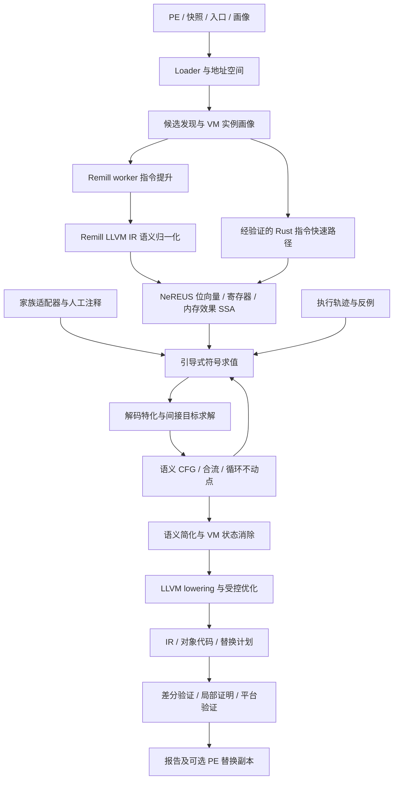

# NeREUS：基于 Rust + LLVM 的虚拟化代码提升与去虚拟化系统设计

日期：2026-11-03  
状态：完整系统架构设计；Windows 基础环境与单指令提升调用链已搭建，VM 恢复、NIR 导入和重写尚未实现。本文完整系统命令、接口和产物格式仍为拟定契约，当前实际可用接口见 README。  
修订：明确引入 Remill，作为默认机器指令语义提供器；Rust 保留恢复引擎、语义归一化与验证职责。  
项目目录：`tools/NeREUS/`。文内路径除特别说明外均相对此目录。

## 1. 目标与关键决策

NeREUS 面向 VMProtect（VMP）、Themida / Code Virtualizer（本文用 TMD 表示）和 Tencent VM（本文用 TVM 表示）等原生代码虚拟化保护，恢复受保护函数的可分析、可验证、可重编译语义。TVM 在本文中特指参考文章中的 Tencent VM，不指 Apache TVM 或其他同名项目。

最终目标包括：定位虚拟化入口、提升宿主机器指令、消解解释器执行过程、恢复原始语义控制流、生成 LLVM IR 与目标代码，并在满足语义和平台条件时生成可供离线验证的 PE 替换副本。设计覆盖多种 VM 家族、实例变体、嵌套虚拟化、原生执行片段、循环、调用、异常以及分析失败的完整表达，实施阶段只规定顺序，不缩小最终目标。

采用以下架构决策：

| 决策 | 选择 | 原因 |
|---|---|---|
| 主体语言 | Rust | 管理解码、IR、符号状态、内存、适配器、调度与报告 |
| 指令语义来源 | Remill 为默认提供器，Rust 为经验证的快速路径与语义补充 | 复用已有指令语义，避免完整 x86/x64 语义库成为主要自研负担 |
| 后端 | LLVM，经隔离的 Rust 绑定使用 | 通用 SSA 优化、目标代码生成、目标平台 ABI 支持 |
| 分析核心 IR | Rust 原生、位精确、带显式效果的 SSA IR | 不把机器语义的未定义标志位、异常和地址空间错误表达为 LLVM UB |
| 去虚拟化路径 | 原生指令语义提升 + 引导式部分求值 | 以解释器实际行为为依据，减少对固定 opcode 表和 handler 模板的依赖 |
| VM 家族差异 | 适配器与实例画像 | 将入口、VIP、解码状态和退出协议与共享求值器分离 |
| 控制流 | 增量 CFG、上下文敏感状态、循环不动点 | 防止按一次执行轨迹恢复整个函数 |
| 常量化 | 带来源、内存版本、适用条件的读取证明 | 不把运行时业务数据和可变字节码误认为文件常量 |
| 正确性优先级 | 可追溯语义 > 表面简洁 > 性能 | 未解决行为必须出现在 IR 和报告中 |
| 结果判定 | 恢复程度与验证强度两个独立维度 | LLVM verifier 通过、测试通过和全函数等价不是同一结论 |

系统不能承诺对任意商业版本、任意自修改程序完全自动成功。支持单位是“家族 + 实例画像 + 指令/行为能力 + 可复现样本”，不能用识别了产品名称代替支持证明。

## 2. 参考文章与设计依据

主要阅读来源是 Aftermath Labs 的 [Static Devirtualization of Tencent VM](https://aftermathlabs.net/blog/31/07/2026/)（2026-07-31）。文章以引导式符号求值消解解释器，强调字节码常量化、虚拟分支恢复、原生执行边界和循环处理。本文据此选择语义驱动架构；后续的数据结构、算法、验收门槛和工程分层是 NeREUS 的设计方案，不是对作者私有框架实现的复述。

补充阅读 [Static Devirtualization of Themida](https://aftermathlabs.net/blog/09/05/2026/) 和 [VMProtect 2 - Part Two, Complete Static Analysis](https://aftermathlabs.net/blog/21/06/2021/)。这些材料分别提供跨 VM 引导思路及 VMP2 实例研究；历史版本规律只作为画像候选依据，不能推广成所有版本的架构事实。

相对参考文章，NeREUS 明确增加以下工程约束：

1. 分析过程中使用的假设必须能失效、重算，并传递到最终产物。
2. 业务循环必须通过 SSA 合并和状态不动点恢复，不能仅靠 VIP 去重。
3. Remill 提升产生的 LLVM IR 必须先经过机器语义归一化；最终 LLVM 编译后端只接收满足契约的表示，未知行为不能转换成 `unreachable`。
4. 代码生成、ABI 重建、异常兼容和 PE 回写分别验收。
5. 静态结论、轨迹观察、人工假设和求解器证明分别记录。

## 3. 范围、平台与交付产物

### 3.1 平台范围

| 维度 | 完整设计范围 | 实施顺序与边界 |
|---|---|---|
| 分析宿主 | Windows x64；支持 Linux 上离线分析 | 首先保证 Windows 开发与运行路径 |
| 输入架构 | x86-64、x86-32 | x64 先实现；32 位有独立寄存器、栈、ABI 与 SEH 模型 |
| 文件 | PE32+、PE32、配套模块与内存快照 | ELF 可经 loader 插件扩展，不作为三类 Windows VM 的完成条件 |
| 指令语义 | VM 解释器及受保护业务代码实际可达的指令 | 按能力清单扩展至整数、标志、原子、SIMD、浮点和系统边界 |
| 执行环境 | 普通进程；带明确环境模型的系统代码分析 | 内核片段静态恢复与内核环境可执行性分别声明 |
| 虚拟化结构 | 单层、多入口、多解释器、嵌套层、混合原生片段 | 层数和资源上限可配置，超限保留未完成前沿 |
| 可变代码 | 可证明写入、版本化快照、分阶段解密 | 无稳定字节来源时输出条件化结果或未解决节点 |

本项目恢复机器级行为，不承诺恢复原始变量名、源代码类型、模板结构、注释或原始编译器布局。C 风格展示和反编译器集成是语义产物的消费者。

### 3.2 输入契约

每次任务至少有：输入文件哈希、架构、装载基址或重定位策略、目标入口集合、环境配置、可用内存范围和资源预算。输入可由以下来源组合：

- 原始 PE 与导入/导出/重定位/异常目录。
- 运行后模块快照，附装载地址、页面权限、已应用重定位及采集时点。
- 明确入口 RVA；自动扫描只能产生候选，不能保证穷尽。
- VM 画像、人工内存注释、已知调用摘要、跟踪记录。
- 同一函数的未保护版本，用作验证参考，不作为去虚拟化所必需的输入。

加壳解压、装载后解密与 VM 去虚拟化分别建模。尚不可见的解释器或字节码不能凭磁盘内容猜测；任务应报告需要哪一阶段的快照。

### 3.3 输出契约

| 产物 | 内容 |
|---|---|
| `input.manifest.json` | 输入哈希、基址、快照、工具链及配置摘要 |
| `discovery.json` | 候选入口、证据、画像匹配结果及歧义 |
| `raw.nir` / `semantic.nir` | 原生提升与恢复后的机器语义 IR，带格式版本 |
| `frontend/` | Remill 语义 bitcode、提供器/布局清单和导入诊断，可按配置保留用于复现 |
| `function.ll` / `function.bc` | 经 verifier 检查的 LLVM 表示，标明外部运行时依赖 |
| `function.obj` | 目标代码、重定位和相关符号 |
| `cfg.json` / `cfg.dot` | 语义块、边、异常边、未解决前沿 |
| `mapping.json` | 原生地址、VIP、IR 节点及输出地址的溯源映射 |
| `assumptions.json` | 所有未消解前提、来源、作用域、依赖及可执行检查 |
| `validation.json` | 验证方法、用例、求解结果、反例及环境限制 |
| `report.json` / `report.md` | 机器可读与人工可读结论 |
| `rewrite/` | 替换计划、修改清单和新 PE 副本；不覆盖输入 |

输出都写入指定任务子目录。缓存、样本、脚本不得写入 AutoRE 根目录或无分类的 `temp_data/` 根目录。

## 4. 整体架构



核心分三层：

1. **机器语义层**：由 Remill 和经验证的 Rust 补充提供指令转换，统一归一化为 NeREUS IR；只回答机器状态如何变化，不认识 VMP/TMD/TVM。
2. **恢复层**：利用适配器提供的边界与字节来源消解解释器，恢复原程序状态转移。
3. **编译与验证层**：将恢复结果生成 LLVM IR、代码及平台元数据，验证产物满足声明的契约。

适配器不能直接修改 LLVM 对象或绕过内存证明系统；LLVM 后端不读取家族名。这样新增 VM 主要扩展画像和边界识别，而不复制执行引擎。

这里有两次用途不同的 LLVM IR：前端 Remill LLVM IR 用于表达指令语义，后端 LLVM IR 用于编译恢复后的函数。两者之间由 NeREUS IR 隔离；不将原始解释器 bitcode 直接运行标准优化管线后视为去虚拟化结果。

## 5. Rust 模块与依赖方向

建议使用独立 Cargo workspace，不依附其他工具的编译生命周期：

```text
tools/NeREUS/
  Cargo.toml
  Cargo.lock
  rust-toolchain.toml
  crates/
    nereus-core/          # 地址、ID、诊断、预算、配置与格式版本
    nereus-loader/        # PE、重定位、快照与地址空间
    nereus-ir/            # 位精确 IR、效果 SSA、序列化及 verifier
    nereus-x86/           # iced 解码、寄存器规范、提供器路由与 Rust 快速路径
    nereus-remill/        # worker 协议、语义 bitcode 导入、状态/内存/效果归一化
    nereus-memory/        # 内存版本、别名、分区与常量读取证明
    nereus-eval/          # 符号求值、路径约束、抽象域与工作队列
    nereus-vm/            # Adapter API、画像与分层 VM 上下文
    nereus-vmp/           # VMP 适配
    nereus-tmd/           # Themida / Code Virtualizer 适配
    nereus-tvm/           # Tencent VM 适配
    nereus-recover/       # 间接控制流、循环、调用及 CFG 恢复
    nereus-opt/           # 机器语义化简与 MBA 规则
    nereus-smt/           # 求解器协议、查询缓存与证明记录
    nereus-llvm-support/  # LLVM 绑定与解析基础设施，仅供前端/后端边界使用
    nereus-llvm/          # 最终 LLVM lowering、Pass 与代码生成
    nereus-abi/           # 调用契约、guest 栈、native bridge 与异常
    nereus-rewrite/       # COFF 链接、PE 副本生成与元数据核验
    nereus-validate/      # 独立参考执行、差分与反例归约
    nereus-cli/           # 命令行与任务编排
  profiles/{vmp,tmd,tvm}/
  schemas/
  runtime/               # checked memory、环境调用与桥接支持
  native/remill-worker/   # C++ Remill API 封装，独立进程；不实现 VM 策略
  third_party/remill/     # 实施时登记固定 revision，保留许可证及本地补丁清单
  toolchains/            # Remill、LLVM、XED、Clang、Rust 与语义库构建清单
  tests/{semantics,remill,ir,memory,cfg,adapters,llvm,abi,rewrite}/
  fixtures/{synthetic,regressions}/
  scripts/{build,corpus,validation}/
  docs/{DESIGN.md,adr/}
  temp_data/{research,benchmarks}/
```

依赖原则：`core → ir/loader → semantics/memory → eval/vm → recover/opt → llvm/abi → rewrite`。此处箭头表示提供基础能力的方向。`nereus-remill` 是实现稳定语义接口的前端模块，经 `nereus-llvm-support` 读取 bitcode 后产出 NIR；`core/ir/memory/eval/recover` 不持有 LLVM 对象，不依赖 Remill C++ ABI 或某个 VM 家族。前后端只共享 LLVM 基础封装，不形成 `recover → 最终代码生成 → 前端` 的依赖环。

`validate` 通过稳定接口调用各层，并使用独立参考执行器。各函数可并行分析；一个函数内部的状态表、LLVM Context 和求解器会话默认由所属 worker 独占。并发优化是实现细节，不改变确定性输出顺序。

仓库已有 `LLMGhidra/src/pcode-ir` Rust workspace。NeREUS 可在后续评估 P-code 导入/导出，先通过文件或稳定数据协议集成；未验证语义、维护边界和许可证前，不直接共享内部类型。

## 6. 技术选型与构建约束

| 能力 | 选型 | 使用边界 |
|---|---|---|
| x86 解码 | `iced-x86`；Remill 路径同时使用其自身解码器 | 对长度、模式、控制流类别进行一致性检查；不手工把 iced opcode ID 当 Remill 语义 ID |
| 机器语义 | Remill 默认，Rust 快速路径/补充 | 所有来源归一化到相同 NIR 契约并接受独立执行差分 |
| LLVM 绑定 | `inkwell`，必要时经局部 `llvm-sys` 扩展 | 封装在 `nereus-llvm-support`，由 `nereus-remill` 和最终 `nereus-llvm` 使用；不向 VM 适配器暴露指针 |
| SMT | Z3，经 `Solver` trait 封装 | 主要使用 QF_BV；涉及内存时使用数组理论或受限切片 |
| 二进制读写 | 评估 `object` 等成熟库，补充 PE 专项模块 | 必须验证异常目录、重定位、Load Config 等所需字段 |
| 元数据 | `serde` + JSON；内部 IR 版本化编码 | 对外报告以可检查性优先 |
| CLI / 日志 | `clap`、`tracing` | 日志和结果 schema 分开演进 |
| 测试 | Rust 单测、性质测试、语义差分、固定回归语料 | 以反例和语义断言为主，不以快照文本相同为主 |

项目官方能力依据见 [iced](https://github.com/icedland/iced)、[Inkwell](https://github.com/TheDan64/inkwell)、[Z3](https://github.com/Z3Prover/z3)。不在本文硬编码未经本机验证的“最新可用组合”。实施时选定 LLVM 主版本、Inkwell release、Rust MSRV、链接方式和目标 triple，记录到工具链清单并由 CI 锁定；LLVM 工具、头文件和库必须属于同一套发行物。

### 6.1 Remill 引入结论与取舍

**决定引入 Remill，作为完整分析发行版的默认机器指令语义依赖。** 纯 Rust 仍可构建 NIR、优化、报告及受限语义能力，但缺少 Remill 时必须报告提供器缺失/能力缩减，不得声称提供完整默认指令覆盖。最终生成的目标函数是否依赖运行时 helper，取决于恢复结果；不要求部署 Remill 到目标程序运行环境。

原方案将 Remill 仅列为可选对照，低估了完整实现 x86/x64 部分寄存器、标志、复杂指令及扩展语义的工程成本。NeREUS 的核心投入应放在状态和内存建模、解码特化、CFG/循环恢复及验证上。引入现成语义库可以降低重复实现成本；这是工程判断，不是已测覆盖率或性能结论。

| 路线 | 收益 | 主要代价 | 决策 |
|---|---|---|---|
| 完整自研 Rust x86/x64 语义 | 直接生成 NIR，便于细粒度控制 | 指令覆盖、边界行为与长期维护负担大 | 不作为全面覆盖的主路线 |
| Remill 指令语义 → NIR → LLVM | 复用语义实现，同时保留恢复引擎控制权 | C++ 构建、版本固定、bitcode 导入与行为审计 | 默认路线 |
| 仅在 Remill LLVM IR 上直接做全部恢复 | 少一层转换 | 需在 LLVM 中自行维护 VM 上下文、证明失效和循环状态合流 | 不采用为共享核心 |
| Remill + 经验证的 Rust 快速路径 | 常见指令可减少 worker/导入成本 | 必须管理两个提供器的能力和一致性 | 作为明确受控的组合 |

Remill 官方将自己定位为机器指令到 LLVM bitcode 的提升库，列出 x86/amd64 等架构；当前 README 提供 `clang-cl` Windows 构建说明，同时仍将 Windows 支持标为 experimental。由此选择隔离构建与 worker，而不是因为构建风险放弃复用语义。参见 [Remill 官方仓库](https://github.com/lifting-bits/remill)。

### 6.2 Remill 与 NeREUS 的职责划分

| Remill 提供的基础 | NeREUS 必须完成的工作 |
|---|---|
| 指令解码与语义 bitcode | VM 入口/实例画像、VIP/VSP、解码上下文 |
| 寄存器状态及指令转换 | 规范寄存器与标志、业务/解码来源、跨块 SSA |
| guest 访存及控制流 intrinsic | 版本化内存、常量读取证明、目标求解和边界分类 |
| 语义库中已实现的指令行为 | 对照实际可达指令审计缺口、补充异常和环境契约 |
| 指令级控制转移信息 | 原程序 CFG、循环不动点、VM 层间关系 |

Remill 的原始产物并不是恢复后的函数，也不提供 VMP/TMD/TVM 解码器。指令能被 Remill 解码或产生 bitcode，只代表前端某一步成功；不能直接升级为“指令行为在当前观察模型下完整支持”。

必须区分两级机器状态：Remill `State` 表示当前被提升的原生 CPU 状态，其中包含解释器使用的寄存器；VM 上下文/VSP 中保存的才可能是原业务程序的 guest 状态。前端不能把每个 Remill RAX 写入都解释成原业务 RAX 写入。共享求值器先跟踪原生状态转换，适配器通过已经验证的保存/恢复关系建立 guest 投影；只有恢复后的 guest 可观察状态才进入语义函数的输出契约。

### 6.3 默认集成边界：独立 worker

使用自建 `native/remill-worker/` 封装 Remill C++ API，默认通过版本化进程协议交互。该 worker 是 NeREUS 拟实现组件，不是声称上游已有相同命令行或 RPC 功能。它接收架构模式、guest PC、机器字节、CPU features 和提供器版本，返回指令/短块语义 bitcode、解码信息、状态布局、原生地址映射及能力诊断。

- worker 不执行样本，不读取分析器宿主地址空间来代替 guest load，不调用求解器，也不做 VM 画像选择。
- 以进程级常驻 worker 和批量请求减少 IPC 成本；遇到真实基本块终止、故障敏感指令或需保留的边界时截断批次。
- 不跨边界传递 `LLVMContext*`、`Module*`、`State*` 或 C++ 对象；使用字节流、文件产物和版本化 schema。
- 帧格式限制消息/产物大小，并记录超时、退出码、请求 ID 与错误；worker 崩溃只使所属任务失败，不产生成功语义。
- 原始 bitcode 仅允许接收匹配构建清单的提供器产物，并经 LLVM verifier 和 NIR 导入检查。

未来可在证明性能确有收益后增加本机 C ABI fast path，但必须保持同一请求/结果契约；进程内链接要求严格匹配 LLVM、C++ ABI、CRT 和构建选项，不能仅凭 LLVM 主版本相同就混用。

### 6.4 Windows 与跨宿主构建

Windows 发行优先配套 Windows worker，采用兼容 MSVC ABI 的 `clang-cl` 工具链。已在本机完成固定 Remill revision 的 x86/x64 原生构建、语义库生成、worker 和 Rust/Inkwell bitcode 往返检查，具体组合和构建补丁见 [基础环境记录](ENVIRONMENT.md)。这证明 Windows 构建路径可行，不代表第 6.9 节的完整语义集成验收已经完成。

若固定 revision 的 Windows 路径存在未解决问题，可显式配置 Linux/WSL worker 进行离线语义提升，Windows Rust 主进程仍负责分析。此路径是计划支持的替代部署方式，须分别完成路径/协议、产物布局和一致性验收，不是当前已可用能力。

guest 架构、worker 宿主架构、语义 bitcode 的 DataLayout 和最终代码生成 triple 分别记录。Linux worker 产物中的运行时对象布局必须按其实际 DataLayout 解析，再转换成与宿主无关的 NIR；不能仅修改 triple 就把带宿主假设的 IR 当 Windows IR 使用。Linux 提升测试也不构成 Windows ABI、SEH 或 CET 的执行验证证据。

### 6.5 从 Remill LLVM IR 到 NIR 的转换契约

Remill 的设计区分 `State` 等运行时内存与被提升程序的 guest 内存，后者通过 intrinsic 访问。NeREUS 以这个边界为导入依据，而不是将所有 LLVM `load/store` 解释成 guest 访存。参见 [Remill 架构文档](https://github.com/lifting-bits/remill/blob/master/docs/DESIGN.md) 与 [指令提升过程](https://github.com/lifting-bits/remill/blob/master/docs/LIFE_OF_AN_INSTRUCTION.md)。

| 前端表示 | 归一化结果与检查 |
|---|---|
| `State` 中可定位的寄存器读取/写入 | 通过固定版本布局与字段描述映射为规范寄存器操作；验证偏移、位宽和别名 |
| 提升器局部 `alloca` 及其 load/store | 证明局部且不逃逸后标量化；不与 guest memory 混合 |
| `__remill_read_memory_*` | NIR `Load`，携带 guest 地址、宽度、内存版本、故障和读效果依赖 |
| `__remill_write_memory_*` | NIR `Store`，建立新内存 token，并恢复对应故障顺序 |
| `__remill_function_call/return`、`__remill_jump` | 原生控制流事件；之后由 VM 边界分析判断 guest call、dispatcher 或退出 |
| `__remill_undefined_*` | 架构允许的不确定值，明确生成位置及使用关联；不替换为零 |
| `__remill_sync/async_hyper_call` | 环境事件候选，按具体事件建立 `EnvOp/Raise` 或标记未支持 |
| 原子区域、barrier 与 compare-exchange intrinsic | 只有在能够保留原子性、内存次序及故障语义时映射到 NIR；不按普通 load/store 展开 |
| 标量/向量 LLVM 运算和纯 helper | 支持子集内精确导入；语义库 helper 的展开仅限经过审计的调用图 |
| 未知 helper、动态 `State` 访问或不支持的 LLVM 操作 | 显式导入失败/残留节点，禁止默认为无副作用 |

具体名称和签名绑定固定 revision，并从能力清单核验；上表不是对任意版本的字符串匹配承诺。intrinsic 类别的源码依据见 [Remill Intrinsics.h](https://github.com/lifting-bits/remill/blob/master/include/remill/Arch/Runtime/Intrinsics.h)。

内存读取 intrinsic 可能没有返回新的 memory 指针，不能据此把 load 当成可随意移动的无效果纯函数。归一化时依照指令边界和真实依赖恢复内存/效果顺序，尤其保留故障发生在写寄存器之前还是之后的区别。

bitcode 交付前仅允许经过批准的语义 helper 展开与局部结构整理，不运行会掩盖 guest 行为的通用优化。上游语义库本身的 Clang 编译同样必须固定参数并审计；若行为已经在编译时因错误前提消失，事后删除属性无法恢复，需要重建、补丁或独立语义补充。

### 6.6 正确性缺口与补充策略

NeREUS 不能把 Remill 当无条件正确的语义 oracle。对实际指令路径逐项记录以下状态：`Decoded`、`Lifted`、`Normalized`、`BehaviorAudited`、`DifferentiallyChecked`。这些是验收标签，不表示任意前项都能推出后项。

- **异常**：检查除法、访存、特权操作等是否保留 NeREUS 观察模型要求的 fault 条件、部分状态更新和 guest PC；不足时在进入通用优化前增加指令级受审计补充。
- **未规定值**：核对生成频率和关联关系；LLVM `undef/poison` 不能直接被解释为任意但合法的机器状态，也不能只加 `freeze` 就声称修复。
- **内存属性**：`inbounds/noalias/nounwind` 等可能仅适用于提升器自己的运行时对象，不能转移为 guest 地址或外部调用的前提。
- **原子、浮点与系统状态**：核对原子区域、舍入/MXCSR、FS/GS 和环境事件；库中存在相关函数不代表 NeREUS 已实现其完整支持。
- **新扩展与特殊指令**：以固定 revision 的能力矩阵为准，包括实际遇到的 CET 等指令；缺少能力时使用经验证的 Rust 补充或显式 `Unsupported/Partial`。

补充必须在 provider manifest 中逐项登记指令/编码/模式、原因、来源和验证证据。无法匹配语义时不能悄悄换到旧缓存或另一个提供器。

### 6.7 Rust 快速路径与解码一致性

Rust 模块保留高频简单指令的直接 NIR 发射、特殊行为补充和小规模独立对照。新增快速路径需要对比参考硬件/独立模拟器，并与归一化 Remill 路径交叉检查；两者一致仍不替代独立参考验证。

`iced-x86` 服务于扫描、编码检查和路由；worker 使用 Remill 自身的解码路径。两者对指令长度、架构模式、操作数或控制流分类发生实质分歧时，报告 `DECODER_MISMATCH` 并停止该块的严格恢复，不能拼接两种解码结果继续执行。

提供器选择按指令能力与固定策略确定，记录在任务 manifest；默认 Remill，有证据且明确启用的 Rust 快速路径可替代指定操作。`native-only` 是能力受限模式，不是完整默认发行的验收捷径。

### 6.8 工具链、缓存与分发

固定 Remill commit、必要本地补丁、语义库 bitcode 哈希、LLVM/Clang、XED、编译选项、状态布局哈希、CPU features、导入器/协议版本和 Rust 工具链。可以使用上游 superbuild 或经过验证的外部 LLVM 配置，但最终必须落到一份可重现清单，参见 [Remill 依赖管理文档](https://github.com/lifting-bits/remill/blob/master/docs/DEPENDENCIES.md)。

前端缓存键包括上述语义相关版本、架构模式、实际机器字节及影响语义的 guest PC/重定位信息；不能只用 opcode 或文件地址。下游解码摘要另含画像、内存内容版本与假设依赖。重建语义库或更新修补规则时相应缓存全部失效。

开发构建可以选择不下载/编译 worker，以运行不需要指令提升的模块；完整分析发行必须携带或明确定位兼容 worker 及语义资源，并在启动时验证清单。分发清单保留 Remill 及各依赖的许可证、版本与必要声明；不把第三方源码下载到项目根目录。

### 6.9 Remill 集成退出条件

集成完成至少要求：Windows 默认部署或显式替代部署可复现；单指令与短块请求可稳定导入；状态、guest memory、标志和控制流映射有独立差分证据；异常/原子/浮点缺口有能力标签；解码冲突、未知 helper、worker 崩溃、版本不匹配和预算耗尽均产生可审查失败。

导入质量必须单独度量：实际遇到的指令中解码率、成功提升率、归一化率、行为审计/验证覆盖和语义摘要膨胀，以及 worker/IPC/导入耗时。不能用 Remill 声称支持的 ISA 范围替代这些实测指标。

## 7. Loader、地址与程序发现

### 7.1 地址模型

必须区分文件偏移、RVA、装载 VA、guest 虚拟地址和分析器宿主地址。建议用不同 Rust newtype 表达；禁止把 `u64` 隐式转换为宿主可解引用指针。

每个内存对象记录模块、区间、权限、内容版本、重定位状态和来源。读取跨节区边界、零填充区域、未映射页或快照缺页时有明确结果，不能返回默认为零的成功读取。

### 7.2 入口发现

来源包括 PE 导出、符号、调用引用、入口跳板、异常函数表、用户指定地址以及已确认 VM dispatcher 的反向引用。候选发现和 VM 识别分离：

1. 从入口执行有限的语义探索，记录保存寄存器、建立上下文、读解释字节和分派行为。
2. 多种证据合并为可解释评分；分数用于排队，不用于证明语义正确。
3. 生成一个或多个 `VmInstanceProfile`，逐一验证入口与边界。
4. 歧义不能自动选择得分最高的画像后丢弃其余候选；记录选择依据并支持用户修正。

节区名、`call` 后跟 `int3`、固定寄存器、固定栈差等只能是画像线索。入口可能共享 dispatcher；一个文件也可能包含多个不同实例。

## 8. 机器语义 IR

### 8.1 为什么在 Remill 前端与 LLVM 编译后端之间保留 NIR

机器指令有有限位宽回绕、部分寄存器写入、未规定标志位、可观察内存故障以及系统状态。直接把所有这些压成普通 LLVM 算术和宿主指针，会让优化器基于错误前提删掉有效路径。

NeREUS IR 同时承担分析表示和语义审计格式。Remill 前端已经使用 LLVM IR，但恢复阶段仍需要显式 VM/guest 状态、读取证明失效和可重算的入口状态；这些由 Rust NIR 承载。经过第 6.5 节归一化后，无论语义来自 Remill 还是 Rust，求值与恢复算法使用同一套表示，完成恢复后再 lowering 到最终 LLVM 编译模块。

### 8.2 类型与操作

基本类型包括 `Bits<N>`、`Bool`、向量、结构值、`GuestAddr<W>`、`MemoryToken`、`EffectToken`。支持任意所需位宽，不限于 Rust 原生整数宽度。

核心操作包括：

- 精确位向量算术、比较、提取、拼接、扩展、截断、移位和旋转。
- `ReadReg` / `WriteReg` 的规范化表示，以及 SSA 化后的寄存器值。
- `Load` / `Store`，携带位宽、大小端、对齐、内存 token 和故障语义。
- `AtomicRmw`、栅栏和显式内存次序。
- `Call`、`NativeRegion`、`EnvOp`、`Raise`、`OpaqueEffect`。
- `Jump`、`Branch`、`Switch`、`Indirect`、`Return` 及异常后继。
- `Phi` 或等价的块参数，覆盖寄存器、内存和效果流。

内存 token 表达读写依赖；效果 token 表达外部调用、系统状态、原子次序和可能抛出的行为。分区 token 只有在别名关系被证明后才能拆分。

### 8.3 x86 状态规范

GPR 以架构全宽寄存器为规范对象，别名单独映射。例如写 `EAX` 将 `RAX` 高 32 位清零，写 `AX`/`AH`/`AL` 只覆盖对应范围；不得把部分写入变成全寄存器覆写。

标志位按位延迟计算，至少精确覆盖 `CF/PF/AF/ZF/SF/OF/DF` 及实际可达操作依赖的其他位。每个标志有 `Defined(expr)`、`Preserved`、`ArchitecturallyUnspecified(symbol)` 等状态。未知不是零，不是任选后永远固定的全局常量，也不是 LLVM `poison`。

SIMD、x87、MXCSR、FS/GS、段基址和特权状态按能力表建模。当前后端不支持的可达行为保留原生/环境节点并降低恢复等级；不能静默略过。

### 8.4 指令语义边界

- 加减乘按目标位宽模运算，不附加无溢出假设。
- 移位计数按具体指令规则处理；不能将 x86 的掩码计数直接替换为 LLVM 未约束计数。
- 除零和商溢出产生相应机器异常，不能依赖 LLVM 整数除法的 UB。
- 访存错误、非规范地址、页权限和环境访问在声明的观察模型下可见。
- 未规定状态采用显式符号值和关系约束；依赖这种状态的分支保持多种可能性。

## 9. 分析状态、来源与假设系统

### 9.1 状态组成

```text
AnalysisState {
  native_pc, architecture,
  native_registers, native_lazy_flags,
  guest_state_projection,
  memory_version, effect_frontier,
  vm_layer_stack,
  decode_context,
  path_constraints,
  assumptions,
  provenance,
  budget
}
```

`vm_layer_stack` 的每层包含 VM 实例、VIP、VSP、上下文对象、解码状态和返回协议；不能用单个全局 VIP 表达嵌套 VM。

`native_registers` 对应 Remill 提升的解释器/原生片段状态；`guest_state_projection` 是从原生状态与 VM 内存中恢复的业务状态映射，不强制它始终物化为另一套寄存器数组。跨边界或生成验证观察时才按需要物化；两者的等价关系由画像和数据流证据维护。

### 9.2 来源不是简单二值污点

值记录来源集合，例如 `ImageLiteral`、`RelocatedAddress`、`BytecodeRead`、`DecodeState`、`GuestInput`、`GuestMemory`、`Environment`、`TraceObservation`。一个值可同时影响解码和业务运算，不能凭用途标签把它强制常量化。

每个具体值或重写附带证明对象：依据、前提、作用域、依赖的内存版本及失效条件。所有依赖形成可逆索引；前提变更时使受影响的 handler 摘要、控制流边和 LLVM 片段一起失效。

### 9.3 前提等级

| 类别 | 示例 | 处理 |
|---|---|---|
| 输入事实 | 指定快照某版本的字节 | 对该快照成立，不能自动推广到其他时点 |
| 分析证明 | 当前路径对目标地址无别名写入 | 允许优化，保留查询/分析记录 |
| 画像候选 | 某偏移是 VIP 槽 | 经行为验证后升级，否则保留歧义 |
| 用户前提 | 某回调不会改写解释器区间 | 输出条件化结果；回写前落实前提或拒绝 |
| 轨迹观察 | 某次间接跳转到地址 A | 用于发现和验证该路径，不证明仅有 A |

“条件化恢复”本身是有用产物，但不能标为无条件完整恢复。

## 10. 内存模型与受控常量化

### 10.1 分区是证明结果

逻辑候选分区包括解释器代码、字节码、handler 表、VM 私有上下文、VM 栈、guest 栈、guest 堆/全局、TLS 和外部环境。默认保留可能别名；并非所有 VM 都有物理独立的上下文或 VSP 区域。

只有证明地址不重叠、对象不逃逸且跨调用不被改写，才能将分区当作独立内存。VM 私有状态可与业务栈相邻甚至交叠，不能仅凭节区名或栈偏移消除其写入。

### 10.2 读取处理顺序

对 `load(address, width, memory_version)`：

1. 查询当前路径的最新覆盖写入，按字节处理部分覆盖和大小端拼接。
2. 若地址为符号表达式，进行别名和范围分析；未知写入必须影响候选读取。
3. 只有相关版本内容已知、所有覆盖字节存在、读取不会被相关写入或环境事件改变时，才能返回证明支持的常量。
4. 否则生成符号 load，保留故障与效果依赖。

例如先 `store8(p + 1, x)` 再 `load32(p)`，结果必须拼接 `x` 和其他有效字节，不能从原始文件读取整个 dword。

### 10.3 字节码提升规则

可以被特化的对象是“当前解码上下文中已知的字节及相关状态”，不等价于“某个区间永久只读”。候选读取需要满足：

- 证明其参与 VM 解码/分派，或由已验证画像明确指定。
- 地址和内容对当前分析上下文已知，重定位及装载写入已经考虑。
- 当前内存版本内无未建模的覆盖写入或可能别名写入。
- 没有把业务输入、运行时计数器或快照中偶然的值作为无条件常量。

业务 load 同样可在通常的证明条件下优化；禁止的是以“当前看见一个具体值”为理由冻结运行时数据。

### 10.4 写入与外部调用失效

已知写入建立新内存版本，并更新或撤销相关读取证明。未知地址写入使所有可能别名的分区失效。未知外部调用对可到达/已逃逸对象保守 havoc；只有可靠调用摘要才能缩小范围。

自修改解释器需要代码页版本和重新解码；自修改字节码需要解码缓存失效。若必须运行目标才能得到新字节，则建立新快照阶段，记录其输入依赖，不能把观察到的明文无条件推广到所有路径。

## 11. VM Adapter 与实例画像

### 11.1 API 责任

以下为接口草案，省略具体错误、所有权及序列化类型，不作为可直接编译代码：

```rust
trait VmAdapter {
    // 返回证据和候选画像，不凭单一特征宣布支持。
    fn probe(&self, input: &ProbeInput) -> Vec<ProfileCandidate>;
    fn analyze_entry(&self, input: &EntryInput) -> EntryAnalysis;
    fn locate_state(&self, input: &StateInput) -> StateLayoutCandidates;
    fn classify_boundary(&self, input: &BoundaryInput) -> BoundaryCandidates;
    fn decode_identity(&self, input: &DecodeInput) -> DecodeIdentity;
    fn guide_indirect(&self, input: &IndirectInput) -> Guidance;
    fn check_invariants(&self, input: &InvariantInput) -> Evidence;
}
```

适配器返回建议、关系约束、摘要及证据，不返回未经验证的“最终正确 IR”。共享引擎负责确认内存读取合法性、路径可行性、状态合并和语义重写。

Rust trait 插件先作为 workspace 内静态模块。未来若需第三方动态插件，采用版本化 C ABI 或进程 RPC，不直接把 Rust trait object 当稳定跨版本 ABI。

### 11.2 画像结构

`VmInstanceProfile` 至少记录：家族标签、版本信息或未知、样本/实例 ID、入口与 dispatcher 集合、VIP/VSP/上下文定位表达式、字节来源、解码状态投影、handler 边界、退出协议、嵌套切换、能力需求、证据及失效条件。

寄存器和偏移是画像数据，不是编译时硬编码。画像不能按家族共用某个样本的密钥、handler 地址或解密初始值。

### 11.3 三类 VM 的适配重点

| 家族 | 研究时优先检查的结构 | 需要进入解码身份的内容 | 不允许的泛化 |
|---|---|---|---|
| VMP | 入口状态保存、VIP/VSP 数据流、handler 分派和状态化解码 | 实例、VIP、实际影响解码的滚动状态、字节码版本 | 把某个 VMP2 寄存器分配或 handler 表用于所有 VMP 版本 |
| TMD | 多种 VM 实例、上下文位置、层间调用与退出协议 | 当前层、返回协议、有效解码状态和上下文别名关系 | 假设每个实例都使用相同栈布局或固定解释器 |
| TVM | 上下文、共享 dispatcher、原生边界及平台兼容逻辑 | 验证后的 VIP、实例、调用/返回和解码状态 | 把某个节区名、R11 或单一 `int3` 模式当充分条件 |

表中是拟定适配工作项。任何产品版本支持声明都必须绑定实际语料与结果；本文没有已验证的商业版本支持列表。

### 11.4 Handler 语义摘要

引擎可将解释器片段总结为 `输入投影 → 寄存器/内存/效果变换 + 后继协议`。摘要键包括代码哈希、架构、画像版本、入口模式、解码状态投影、相关内存内容版本和依赖前提。

摘要只要求同一可观察语义，不要求不同样本的机器字节相同。规则模板是加速路径；失配后回到原生语义提升，不能直接认定 handler 无语义或跳过。

## 12. 引导式符号执行与部分求值

### 12.1 执行原则

输入 guest 寄存器、业务内存、环境返回值默认符号化。解释器所需且已证明已知的状态可以具体化。引擎交替执行局部求值、常量传播、效果分析和间接目标恢复，避免先完整展开整个解释器再优化。

工作队列包含待分析语义位置与抽象入口状态，不是单纯的原生 PC。队列条目有状态版本和依赖；合流导致入口状态变化后必须重新处理，并撤销基于旧状态删除的边。

```text
发现入口并验证候选画像
初始化符号 guest 状态、已知映像对象和 VM 层栈
重复取出状态发生变化的语义块：
  根据当前版本提升/复用原生语义
  在明确前提下进行局部求值和读取转发
  遇到边界时恢复 guest 效果并分类
  遇到间接控制流时生成有证据的候选目标或未解决前沿
  为每个可行后继合并状态、建立 phi 并更新依赖
  状态或前提变化时将受影响块重新入队
直至不动点或预算耗尽
消除已证明不影响可观察行为的 VM 实现状态
检查完成性、生成 LLVM 产物及验证任务
```

### 12.2 内联与调用分类

VM dispatcher 和内部 handler 可按已验证画像引导内联。业务调用保持调用语义；不应把所有可解析函数递归内联。需要区分：VM 内部转移、guest call、tail call、boxed/native region、最终返回、异常转移及层间 VM 调用。

对未知间接 call，可保留 `IndirectCall(target, guest_state, memory, effects)`。只要完整保留目标表达式、调用行为和异常，间接调用本身不一定表示恢复失败；但 ABI 和运行时桥接仍须独立完成。

### 12.3 资源预算

预算至少覆盖每函数原生提升指令数、状态数、语义块数、上下文变体数、重处理次数、嵌套深度、IR 节点数、SMT 次数/耗时、总时间和内存。默认值通过基准语料校准，而不是作为语义假设。

达到预算保留当前 IR、待处理队列和失败原因，标记 `Partial`，不得用“未访问到”推断不可达。长任务按函数和稳定状态版本检查点恢复。

## 13. 控制流恢复：身份、合流与循环

### 13.1 分离解码身份与业务状态

使用两种不同对象：

- `DecodeIdentity`：确定当前位置如何解释下一段字节所需的最小状态投影。
- `BlockEntryState`：该语义块所有入口的业务寄存器、内存、效果和路径约束的抽象合并。

建议的候选解码键为：

```text
(module_instance, vm_instance, layer_shape, vip,
 handler_mode, proven_decode_state_projection,
 relevant_code_and_bytecode_version)
```

不能只以 VIP/handler 地址去重。相同 VIP 的滚动状态或字节码内容不同，可能表示不同指令；反过来，把所有业务寄存器值放入键会导致循环无限克隆。

代码/字节码版本优先用相关内容的规范化标识，不以每次写入递增的全局时钟永久区分等价状态。涉及符号或不断变化的解码状态时，证明可参数化则生成参数化摘要；否则保留上下文变体并在超限时报告未解决，不能强行合并。

### 13.2 循环恢复算法

对一个已经具有相同解码身份的块再次到达时：

1. 比较入口抽象状态，确定哪些业务值和内存发生变化。
2. 为变化值引入块参数/phi；内存和效果也必须合流。
3. 以新入口状态重新求值该块及依赖后继，恢复之前可能被入口特化折叠掉的分支。
4. 重复至不动点；结合区间/已知位/仿射关系提升收敛性。
5. widening 只可过近似保留行为；失去精度后可 narrowing 或标记未解决，不能缩小为某一条路径。

例如循环条件来自 `i < 10`，第一次到达 `i = 0` 不能永久把条件化为真。回边带来新 `i` 后，头块必须形成 `i = phi(0, i_next)`，并恢复退出边。提交最终 CFG 前必须核对每条已删边的证明仍适用于最终入口状态。

对不可归约 CFG、多入口循环、递归及 VM 层变化使用 SCC 和上下文摘要，不能假设每个函数都能转为结构化 while。

### 13.3 两种常量使用范围

**解码特化**仅用于已证明决定解释器流向的数据。**语义优化**必须对块的全部可达入口状态成立。路径条件可以优化当前分支，但不得污染其合流点或被作为全函数前提缓存。

需要推测性特化时，保留原始转换和依赖图；如果无法可靠撤销错误折叠，就保守不折叠。不能用添加运行时 guard 掩盖本应恢复的循环语义而仍称完整静态恢复。

## 14. 间接分支、VJCC 与路径可行性

按以下顺序处理符号目标：

1. 常量传播和位精确算术化简。
2. 精确内存转发及字节码解码求值。
3. 表达式 DAG 规范化，识别 `select(cond, a, b)`、比较/掩码和地址组合。
4. 模式匹配恢复虚拟条件分支；每个规则绑定位宽、标志语义和侧条件。
5. 受约束的跳转表分析及有限目标枚举。
6. SMT 证明等价、证明不可行或寻找额外目标。
7. 保留合法间接跳转；否则输出 unresolved frontier。

两个候选目标不代表只有两个目标。若声称有限集合完整，必须验证目标不属于集合的查询不可满足；求解器 `unknown`、超时或达到枚举上限均不构成完备性证明。

VJCC 的处理不是仅替换文本里的条件码。必须恢复条件、目标及其路径效果，分别验证两侧状态变换；短路、条件写内存和异常不能被一个纯 `select` 吞掉。

原生 JCC 与虚拟分支共享同一套标志语义。对 `CF/ZF/SF/OF/PF` 的复合条件按真实布尔表达式恢复，不依赖固定编译形状。未规定标志位所控制的分支保留其可能性，不当作死分支。

## 15. 优化、MBA 与证明边界

### 15.1 分层优化管线

| 阶段 | 允许操作 | 限制 |
|---|---|---|
| 原生提升后 | 寄存器规范化、位宽归一、局部常量折叠 | 保留所有可观察效果和故障 |
| 求值过程中 | 读取证明、写入转发、解码摘要、局部 DAG 简化 | 所有折叠均有作用域与失效依赖 |
| CFG 不动点后 | SCCP、死值/死状态消除、VM 私有内存消除 | 只有证明无逃逸/无可观察效果才删写入 |
| 语义规范化 | MBA、标志化简、分支恢复、栈对象分析 | 带条件证明；未知副作用是屏障 |
| LLVM lowering 后 | 受控标准 Pass、代码生成 | 只有正确 lowering 之后才能利用 LLVM 假设 |

MBA 规则是位向量恒等式或有明确前提的等价式。规则文件记录位宽域、前提、效果要求、证明方式、反例测试和版本；不照搬来源中含 gadget 占位符或隐含前提的式子。

自定义等式先由 Z3 验证 `precondition ∧ lhs != rhs` 不可满足，再进入规则库。固定宽度证明不能自动推广到所有宽度；内存和效果重写另外验证。

### 15.2 控制复杂度

以低成本规范化、公共子表达式、已知位和固定规则为主；e-graph/超优化只用于受限纯表达式切片，有节点、迭代和时间上限。收益函数同时考虑节点数、位宽、load 数和可识别条件，不以“打印字符更少”作为唯一目标。

固定点优化需要稳定排序、规则方向和增长预算。保留优化前后溯源及可选 IR 检查点，方便定位第一个错误 Pass。

### 15.3 证明的实际范围

局部恒等式证明只证明局部转换；循环不变式证明、内存等价、调用契约和异常行为是独立义务。[Alive2](https://github.com/AliveToolkit/alive2) 可作为兼容 LLVM 版本下的局部优化验证工具，不能据其一次成功推导整个虚拟化函数全输入等价。

## 16. VMEXIT、原生片段和环境调用

### 16.1 边界分类

每个边界都输出 guest 状态映射和依据，至少区分：

- guest 函数返回。
- guest 直接/间接调用及返回到 VM 的继续点。
- guest tail call。
- 执行一段原生指令后继续 VM。
- 异常、非局部退出和系统事件。
- 进入内层或返回外层 VM。

栈恢复、目标范围、上下文恢复顺序和后续分派共同构成证据。单个 `ret`、固定 RSP 差或“跳出 VM 节区”不足以判断函数结束。

### 16.2 原生区域处理

能精确建模的原生指令继续提升；能证明调用契约的区域使用摘要。否则保留 `NativeRegion`，列出输入/输出寄存器、标志、可达内存、环境和异常效果。

未知语义区域默认可改变所有相关 guest 状态及内存。若没有可靠读写集合，就不能使用窄摘要。仅依赖不透明原生区域维持行为的结果属于残留执行器/混合恢复，不得计入完全去虚拟化。

### 16.3 环境行为

`CPUID`、时间源、TLS、系统寄存器和外部 API 等建模为有环境标识的操作。它们按声明的运行环境执行或由测试 harness 提供受约束值；不能随意常量化。

特权指令可以静态表达，但其可执行产物需要相应权限及环境。普通用户态差分测试不能替代内核上下文验证，也不通过伪造返回值宣称等价。

## 17. 调用、guest 栈与 ABI 恢复

### 17.1 两级函数接口

**状态接口**是语义基线：输入 guest 状态、guest 内存及环境，返回状态和退出原因。它用于解释执行、差分测试、未知签名及复杂行为。

**直接 ABI 接口**用于重编译和调用原程序：从真实寄存器/栈提取参数、执行恢复函数，再按目标 ABI 返回。只有能证明真实契约、栈关系和副作用映射时，才从状态接口升级。

不能把任意二进制函数都强行猜测成标准 C 签名。ABI wrapper 可保留机器状态接口；证明参数和返回值后再逐步去掉无关状态。

### 17.2 guest 栈不能等同编译器栈

guest 初始栈指针使用抽象基址 `GuestStackBase + offset`。需要为计算而引入分析用数值锚点时，它只是可撤销坐标编码；最终 IR 必须消除该锚点，并验证没有泄漏到 guest 结果或地址比较。

分离 guest 栈对象与 LLVM 生成代码的 spill frame。只有对不逃逸、别名受控、生命周期和故障行为可证明的 guest 栈区域，才映射到 LLVM 局部对象；其余保留 guest memory。

边界处观察到的最大栈深度只用于候选估计，仍需检查所有路径、动态分配、对齐、栈探测、栈地址逃逸及异常展开。动态 `alloca` 不能靠固定高水位替代。

### 17.3 Windows x64

调用 wrapper 必须处理参数寄存器、栈参数、32 字节 shadow space、对齐、易失/非易失寄存器、向量寄存器、返回值、varargs 和 tail call。具体规则依据 [Microsoft x64 calling convention](https://learn.microsoft.com/en-us/cpp/build/x64-calling-convention?view=msvc-170)，实现时从测试用例逐项验证，不仅比较 RAX。

guest call 可以访问 caller frame、返回地址或栈参数。原生 bridge 必须证明在真实调用时能呈现所需 guest 栈关系；普通宿主函数调用不天然满足这一点。无法建立桥接时仍可提供状态接口，直接 ABI 产物标为不支持。

### 17.4 x86-32

分别支持 `cdecl`、`stdcall`、`fastcall`、`thiscall` 和观察到的自定义约定，记录清栈责任、参数寄存器、x87/SSE 返回方式和 FS 相关状态。不能只把 x64 寄存器位宽改为 32 就宣称支持 32 位。

## 18. 异常、SEH、CET 与可观察行为

### 18.1 观察模型

函数正确性比较应包含：声明为可观察的寄存器/标志、内存变更、外部调用及顺序、返回/尾调用行为、显式异常，以及目标环境中需要保留的故障类型和 guest 地址映射。

选择忽略异步中断时刻、计时或某些调试观测时，必须作为观察模型公开，而非默认全部二进制行为已等价。不能以“保护代码副作用”名义自动删除业务可见行为。

### 18.2 异常图与展开元数据

PE `.pdata/.xdata` 可用于发现函数、理解上下文和异常路径；其中与解释器有关的展开结构不是可以直接复制到新代码的元数据。

恢复图保留异常边和 guest 原始 PC；代码生成后建立新 PC 到 guest PC 的映射。LLVM 常规 unwind 信息描述的是生成代码实际帧，源程序 SEH filter、handler、清理动作及 guest 上下文重建仍需恢复或专门桥接。参见 [Microsoft x64 exception handling](https://learn.microsoft.com/en-us/cpp/build/exception-handling-x64?view=msvc-170) 与 [LLVM Exception Handling](https://llvm.org/docs/ExceptionHandling.html)。

对同步访存异常，普通 LLVM load 不能直接保证 guest 故障 PC、CONTEXT 和恢复动作等价。需使用 checked-memory 路径或专门异常桥接；未完成该路径的产物只能声明受限观察模型，不通过直接替换的完整异常门槛。

x86 SEH 链、x64 表驱动展开和 C++ EH 分开支持。遇到未知 handler 或无法恢复的 scope 结构，IR 保留异常依赖并阻止完整 PE 替换结论。

### 18.3 CET 与控制流元数据

识别 shadow stack 相关操作时，区分 VM 内部平衡机制与 guest 必需行为。对内部操作的消除必须证明与新 call/ret 结构一致；不能逐条照搬后形成新的失衡。

回写后核验目标平台适用的 CET、CFG、间接入口要求及 Load Config 信息。识别能力和执行环境能力分别记录，不能把工具“能解码相关指令”写成“已兼容相关系统机制”。

## 19. LLVM lowering 与优化契约

### 19.1 两种 LLVM 产物

1. **状态式 LLVM IR**：显式 guest 状态/内存与运行时 helper，语义覆盖优先，可用于验证和残留行为表达。
2. **直接 ABI LLVM IR**：满足调用、内存、异常条件后将可证明的机器状态标量化，生成可调用目标函数。

状态式 IR 中仍存在必要的 memory/env helper 并不等于未恢复；残留 VM dispatcher、未知 handler 或不透明 VM 片段则必须降低恢复程度。报告分别列举依赖，不用一个 `clean=true` 混淆它们。

### 19.2 禁止引入错误的 LLVM 前提

| 机器语义场景 | lowering 要求 |
|---|---|
| 有限位宽回绕 | 使用普通整数运算；未经证明不加 `nsw/nuw` |
| 部分寄存器更新 | 显式提取/拼接/零扩展 |
| x86 移位/旋转 | 先实现计数规则，再生成相应位运算 |
| 除零/除法溢出 | 显式检查并转到 guest 异常路径 |
| 未规定标志位 | 显式符号输入/helper，保留正确关联与自由度 |
| guest 地址 | 使用 guest memory 接口；证明后才能物化为合法宿主指针 |
| 潜在错误访存 | checked helper 或已验证异常桥接 |
| 非对齐读取 | 按实际语义设置对齐；不可凭位宽声明自然对齐 |
| 未知目标 | 保留间接操作/显式未解决节点，不生成 `unreachable` |
| 外部调用 | 未证明不加 `readnone`、`readonly`、`nounwind` 等属性 |
| 内存别名 | 不凭 VM/业务标签增加 `noalias`、TBAA 或 `inbounds` |
| 原子与浮点 | 保留相应内存次序、舍入/异常和目标环境约束 |

LLVM 的 `undef`、`poison`、`freeze` 具有特定语义；`freeze` 不是修复错误模型的通用工具。相关约束以 [LLVM LangRef](https://llvm.org/docs/LangRef.html) 和 [LLVM UB Manual](https://llvm.org/docs/UndefinedBehavior.html) 为准。

### 19.3 Pass 管线

先 verifier，再使用明确列出的 Pass 组合；不直接把 `-O3` 当去虚拟化算法。可评估 `instcombine`、`simplifycfg`、`sccp`、`gvn`、`dce/adce` 等，但每项通过固定工具链下的语义回归后才能启用。

LLVM 阶段不能替代上游状态不动点。需要在求值过程中借助 LLVM 化简时，只导出纯表达式切片，携带有效前提；回导必须有可验证映射/等价证据，不能依赖优化后仍保留任意 metadata 或 Value 地址。

每次产物记录 target triple、DataLayout、CPU features、ABI、Pass 列表、绑定版本和运行时 helper 版本；`.ll`、`.bc`、`.obj` 使用相同配置。

该处 `.ll/.bc/.obj` 指最终编译产物。`frontend/` 中 Remill bitcode 的模块布局和提供器清单另行保存，不直接拼接进最终模块；只有已归一化并满足契约的语义可穿过 NIR 边界。

## 20. 对象代码与 PE 回写

### 20.1 回写流程

```text
满足声明条件的恢复 IR
  → LLVM 生成 COFF 对象
  → 解析符号、重定位、unwind、外部依赖
  → 构造替换计划和地址映射
  → 校验所有入口、引用、平台元数据及前提
  → 生成输入文件的替换副本
  → 结构检查、装载检查和声明环境下的执行验证
```

计划包含输入哈希、修改区间、旧/新字节摘要、节区布局、跳板、重定位、导入、异常目录、Load Config 更新、回滚依据和不可满足条件。禁止原地覆盖源文件。

### 20.2 必须处理的问题

- 短入口空间不足、相对跳转范围、RIP-relative 引用、函数内部入口及其他代码的内部引用。
- PE 文件/节区对齐、虚拟大小、SizeOfImage、页权限及装载重定位。
- 新代码与 bridge 的导入、符号和链接依赖。
- 新 unwind 与原有异常作用域、地址到 guest PC 的映射。
- CFG/CET 等平台要求及相关入口表。
- 重编译代码对原 VM 区域、原上下文和原生片段是否仍有依赖。

可保留原 VM 供未恢复函数使用；只有全模块引用分析证明无用时才能删除对应区域。模块部分替换与单函数完整恢复是不同统计维度。

文件修改会影响原有签名有效性，产物记录此状态，不声称保留原签名。系统代码的部署/签名/真实内核运行不由“成功生成 PE”推出。

### 20.3 回写准入

至少满足：语义 CFG 闭合、没有必要的未知效果、所有前提已落实或属于明确固定环境、ABI 和异常契约成立、重定位与元数据完整、必要验证已通过。未满足则仍导出 IR/对象/诊断，拒绝将该函数列入可替换集合。

保留原 VM 作为局部 fallback 需要完整状态物化、继续点和可证明的桥接协议；不能简单跳回某个 handler。没有该证明时仅允许保留整个原函数，不能拼接一个表面可运行的混合替代函数。

## 21. 结果等级、诊断与覆盖率

### 21.1 恢复程度

| 状态 | 定义 |
|---|---|
| `NotVirtualized` | 在声明的发现策略下无匹配证据，不代表数学上证明未虚拟化 |
| `Unsupported` | 已知需要的架构、指令或边界尚无能力 |
| `Partial` | 保留有效已恢复语义及未解决前沿 |
| `Conditional` | 在尚未落实的前提下闭合 |
| `Residual` | 仍依赖不透明原生/VM 片段或原 VM 执行 |
| `Recovered` | 声明观察模型下语义闭合，无必要的不透明 VM 行为 |

产物状态另列 `IrValid`、`ObjectEmitted`、`AbiReady`、`RewriteReady`。例如 `Recovered + IrValid` 不自动是 `RewriteReady`。

### 21.2 验证强度

验证项使用列表而不是单个容易误解的递进标签：IR verifier、指令差分、函数差分、路径覆盖证据、局部 SMT、带展开界限的验证、循环不变式/全函数证明、ABI 测试和平台测试。

`timeout`、`unknown`、`not-run`、`pass`、`counterexample` 分别存储。随机差分通过只表示已执行测试未发现反例；有限展开不能写为无限循环全输入等价。

### 21.3 诊断与指标

稳定错误码至少包括：`ENTRY_AMBIGUOUS`、`PROFILE_UNCONFIRMED`、`UNSUPPORTED_INSN`、`SEMANTICS_PROVIDER_MISSING`、`SEMANTICS_VERSION_MISMATCH`、`DECODER_MISMATCH`、`REMILL_IMPORT_UNSUPPORTED`、`SEMANTICS_GAP`、`WORKER_FAILED`、`BYTECODE_MUTABLE`、`ALIAS_UNRESOLVED`、`INDIRECT_UNRESOLVED`、`DECODE_CONTEXT_DIVERGED`、`LOOP_NOT_CONVERGED`、`NATIVE_EFFECT_UNKNOWN`、`EXCEPTION_UNMODELED`、`ABI_UNPROVEN`、`BUDGET_EXCEEDED`、`VALIDATION_MISMATCH`。

统计同时报告：候选/已确认函数数、画像失败数、恢复/条件化/残留/部分数量、已知/未解决边、支持/未支持语义操作、求解器结果、总时间/峰值内存，以及验证观察模型。

同时列出 Remill 与 Rust 各自处理的指令数、导入失败原因及每条能力的验证状态，防止通过跳过难指令提高表面恢复率。

函数恢复率的分母是确认的受保护函数集合；必须另报发现策略及可能漏报。样本、家族、版本与验证强度分层统计，不能只报告成功样本。参考材料的覆盖率属于作者自己的样本，不是 NeREUS 的预期指标。

## 22. CLI 与配置草案

以下命令用于说明职责，尚未实现：

```powershell
# 扫描入口与 VM 候选，输出可审查证据。
nereus scan --input samples/target.exe --out runs/scan-001

# 以显式入口进行恢复，可指定或自动选择经过验证的画像。
nereus lift --input samples/target.exe --entry-rva 0x12340 --family auto --config configs/analysis.toml --out runs/lift-001

# 单独验证已有任务，复用其输入与前提清单。
nereus validate --run runs/lift-001 --suite suites/function-diff.toml

# 先生成替换计划，再按固定输入哈希生成副本。
nereus rewrite plan --run runs/lift-001 --out runs/rewrite-001
nereus rewrite apply --plan runs/rewrite-001/plan.json --output runs/rewrite-001/target.devirt.exe
```

拟定配置：

```toml
[input]
architecture = "x86_64"
image_base = "from-pe"

[analysis]
mode = "static-guided"
memory_policy = "proof-required"
loop_policy = "fixed-point"
observation_model = "guest-sync-effects"

[semantics]
provider = "remill"
transport = "process"
provider_manifest = "toolchains/semantics.manifest.json"
worker = "toolchains/bin/nereus-remill-worker.exe"
native_fast_paths = "verified-only"
unknown_intrinsics = "reject"

[limits]
native_instructions_per_function = 2000000
states_per_function = 100000
decode_variants_per_position = 256
smt_query_timeout_ms = 2000
function_timeout_ms = 300000

[output]
emit = ["nir", "llvm-ir", "bitcode", "cfg", "report"]
allow_partial = true
```

预算数值仅作配置形式示例，不是已测性能或推荐默认值。`allow_partial` 仅控制是否导出部分结果，不提升结果等级；分析策略配置不能关闭关键正确性检查后仍标记严格恢复。

任何人工常量、画像覆盖和调用摘要都必须进入 manifest 与 assumptions，保证同样输入及配置可以重现结论。

## 23. 验证体系与样本策略

### 23.1 指令与 IR 层

对整数、部分寄存器、标志、移位边界、除法、条件移动、原子、SIMD/浮点分别建立性质测试和独立执行差分。边界值覆盖零、全一、符号边界、溢出、非对齐、别名重叠与故障输入。

参考执行采用受控硬件或独立模拟器，并记录其已知限制。NeREUS 自身 IR 解释器与 NeREUS LLVM 后端比较只能检查两种实现的一致性，不能独自证明原生语义正确。

Remill 已成为默认语义来源，因此“NeREUS 与 Remill 一致”不再是独立正确性证据。指令层验证应覆盖原始机器执行、Remill bitcode 的受控执行、导入后 NIR 以及最终 LLVM 产物，定位错误发生在上游语义、编译选项、导入器还是后端。共用语义生成的两个执行器只能作为内部一致性检查。

升级 Remill revision、语义编译选项、布局或 LLVM 版本时重跑相关差分，并使全部受影响的前端/摘要缓存失效；不将旧 revision 的测试状态继承给新版本。

IR verifier 检查 SSA 支配、phi 参数、类型位宽、效果闭合、内存版本、异常后继和来源完整性。LLVM verifier 是额外结构检查，不承担机器语义验证。

### 23.2 必须覆盖的回归场景

| 类别 | 必须包含的用例 |
|---|---|
| Remill 导入 | `State` 别名与部分寄存器、局部/guest 内存分离、未知 helper、不确定值、故障顺序、原子与浮点环境 |
| 提供器协议 | 双解码冲突、manifest/布局不匹配、worker 崩溃/超时、跨宿主布局、缓存失效 |
| 循环 | 固定计数、输入相关、嵌套、多入口、零次执行、回边改变已折叠条件 |
| 解码 | 同 VIP 不同解码状态、状态汇合、变体过多、嵌套 VM |
| 内存 | 部分覆盖、未知别名、外部调用改写、VM/guest 状态交叠 |
| 可变字节 | 自修改字节码、代码页修改、装载后解密、不同快照时点 |
| 分支 | VJCC、跳转表、非二元目标、求解器 unknown/超时 |
| 调用 | 直接/间接、递归、tail call、自定义约定、返回地址相关行为 |
| 栈 | 动态分配、对齐、探测、指针逃逸、callee 访问 caller frame |
| 原生片段 | 可提升、可靠摘要、未知副作用、环境依赖 |
| 异常 | 除法故障、访存故障、SEH handler、unwind、非局部退出 |
| 平台 | 适用的 CET/CFG、x64 ABI、x86 清栈、SIMD 非易失状态 |
| 预算 | 每类预算耗尽仍保留一致 IR、未解决前沿与可重现诊断 |
| 回写 | 跳板距离、内部入口、重定位、异常表、签名状态及失败拒绝 |

### 23.3 语料分层

1. 自建小函数：可获得精确参考语义，包括容易被错误常量化的反例。
2. 自建多种解释器：改变寄存器、字节码方向、handler 编码、上下文和嵌套方式，避免只适配一个模板。
3. 对照保护语料：相同源码/构建产生未保护与受保护版本，记录版本、配置、编译器和哈希。
4. 家族独立留出集：画像/规则开发不得读取留出结果后继续将其算作独立验证。
5. 实际目标回归集：固化最小反例与预期失败类别；不公开或提交不适宜分发的二进制，保留生成方式及哈希。

### 23.4 函数差分与失败归约

执行原函数和恢复函数时使用相同初始 guest 状态、内存、环境事件及调用摘要；比较退出类型、寄存器、写入集合、外部效果序列和异常。含非确定事件的函数使用录制/重放或受约束环境，不直接比较两次独立运行结果。

发现反例后保存输入种子、状态、内存切片、环境、首个分歧 guest PC / VIP / IR 节点及相关 Pass。归约应保留失败机制，优先定位第一个差异，不能只比较最终反编译文本。

## 24. 实施路线与验收门槛

各阶段累积使用同一套 IR、证明和产物格式，不以阶段完成代替三类 VM 的整体完成。

| 阶段 | 工作内容 | 进入下一阶段的门槛 |
|---|---|---|
| P0：基础契约 | ADR、工具链、schema、语料 manifest、模块边界；固定 Remill/Clang/LLVM/XED 组合及 worker 协议 | Windows worker 或明确替代部署可复现；语义 bitcode/布局清单固定；结果等级可表达失败 |
| P1：机器语义底座 | Remill worker、LLVM→NIR 导入、x64 状态/整数/标志映射、效果 SSA、内存版本与补充契约 | 原始执行与导入语义差分无已知错误；重叠读写、故障顺序与未知 intrinsic 有明确处理；不存在静默降级 |
| P2：恢复引擎 | 工作队列、来源/前提、摘要、目标求解、循环不动点 | 自建 VM 的完整 CFG 与参考语义匹配，包括循环反例和状态化解码 |
| P3：TVM 适配 | 验证画像、上下文/边界、虚拟分支、原生片段 | 训练集与留出集分开报告；不使用节区名等单一特征作结论 |
| P4：VMP 与 TMD | 状态化解码、多实例、多层上下文、退出协议 | 两家族独立样本通过同样验收；列明版本边界和未支持行为 |
| P5：语义覆盖扩展 | 扩展 Remill 导入与受审计补充，覆盖 x86-32、原子、SIMD/浮点、动态栈和复杂调用 | 不以库覆盖代替产品覆盖；架构与行为能力矩阵逐项有独立差分证据 |
| P6：LLVM 与 ABI | 状态式/直接 ABI lowering、受控 Pass、对象代码 | 无新增 UB 前提；ABI、桥接、返回与栈测试通过 |
| P7：异常与平台 | SEH、故障映射、unwind、CET/CFG、复杂环境 | 声明观察模型内的平台测试通过；未完成条件严格阻止回写 |
| P8：PE 重写 | 替换计划、COFF 处理、元数据、PE 副本 | 结构/装载/执行检查通过；失败时完整保留原输入 |
| P9：完整交付 | 家族留出集、性能、增量恢复、文档与回归 | 所有范围项有能力状态及证据；覆盖率分母与失败原因公开可复现 |

P6 的基础 LLVM backend 可与 P2–P5 交错建设，以便持续验证，表格不是必须串行的开发排期。未给定人员、语料和性能约束前不虚构工期；每阶段以退出条件判断完成。

最终交付必须同时具备三类适配器、可审计的语义恢复、明确的平台能力、失败报告、可重现验证和可用工具链。未恢复函数可以存在，但不能隐去，也不能将轨迹级结果描述为完整函数级能力。

## 25. 主要风险与处理方案

| 风险 | 失效表现 | 处理与可交付结果 |
|---|---|---|
| 过早业务常量化 | 循环退出丢失、只保留一条路径 | 分离解码身份，状态合流重算，保留删边证明 |
| 解码状态爆炸 | 同 VIP 大量克隆、无法收敛 | 最小投影、参数化摘要、规范化内容版本；超限明确 Partial |
| 错误别名假设 | 从旧映像读值、误删业务写入 | 默认保守别名、字节级内存、未知调用失效 |
| LLVM UB | 优化后消失的分支或故障 | 机器语义前置、受控属性、逐 Pass 差分 |
| Remill 导入/语义缺口 | State 布局错位、未知 intrinsic、故障或不确定值丢失 | 固定版本布局、显式归一化、审计补充、原始机器独立差分 |
| 前端构建与膨胀 | Windows 编译受阻、helper 展开过大、IPC 成本高 | 常驻 worker、批量与语义缓存、明确替代部署；性能证据后启用 Rust 快速路径 |
| 异常信息不完整 | 正常返回正确但 unwind/SEH 错误 | 异常图、guest PC 映射、独立平台门槛 |
| 不透明原生片段 | 表面 IR 简洁但关键行为仍未知 | 显式效果、Residual 等级、禁止完整回写声明 |
| 错误画像 | 解出合理但错误的 handler 序列 | 多证据、可撤销选择、独立语义验证 |
| 单样本过拟合 | 某版本成功，其他实例失败 | 画像数据化、变异自建 VM、按家族留出集 |
| 环境相关行为 | JIT/差分偶现偏差 | 录制重放、环境契约、状态接口 |
| 工具链漂移 | 绑定、Pass 或对象格式行为变化 | 版本锁定、构建清单、升级专项回归 |
| 回写破坏模块 | 内部入口或元数据失效 | 显式计划、全引用检查、生成副本、失败拒绝 |

## 26. 已确定决策与待实证事项

已确定：引入 Remill 作为默认指令语义来源，经独立 worker 和 Rust 导入器归一化到 NIR；Rust 承担共享恢复核心及经验证的快速路径/补充；LLVM 承担最终编译。继续采用独立家族适配器、显式内存/效果 SSA、带依赖的常量化证明、上下文敏感循环恢复、恢复与验证分级，以及分离的 PE 回写流程。

基础环境已选定 Rust 1.96.0、LLVM/语义 Clang 17.0.6、原生 Clang 19.1.5、Inkwell 0.11.0 和固定 Remill revision；共享锁定信息见 `toolchains/versions.lock.json`。运行环境与真实验证边界见 [ENVIRONMENT.md](ENVIRONMENT.md)，后续工具链变更需更新锁定信息并重做相应验收。

实施前需要实证而不阻塞本文设计的事项：

- 将已通过本机 Windows 基础检查的固定工具链组合扩展到 CI，完成布局、NIR 导入与独立行为差分验收；替代部署需要单独验证。
- 收集并登记 VMP、TMD、TVM 的具体版本、架构、实例画像与留出样本。
- 测量核心整数路径、自修改解码及多层 VM 的状态增长，校准预算。
- 实测 Remill 语义导入子集、异常/不确定值缺口、helper 膨胀和 worker 成本；据证据确定 Rust 快速路径与补充清单，并评估 P-code 互操作。
- 用具体 SEH、栈逃逸和原生调用样本验证 guest/native bridge 的可行边界。
- 固定产品默认观察模型、每种模型的测试集以及各类可执行产物的准入要求。

上述事项决定版本能力和工程参数，不改变完整目标，也不允许用未经验证的成功率代替验收。

## 27. 参考资料

以下资料在 2026-11-03 查阅。设计中的来源事实通过就近链接标明；其他结构和流程为拟定方案。

1. [Aftermath Labs — Static Devirtualization of Tencent VM](https://aftermathlabs.net/blog/31/07/2026/)
2. [Aftermath Labs — Static Devirtualization of Themida](https://aftermathlabs.net/blog/09/05/2026/)
3. [Aftermath Labs — VMProtect 2 - Part Two, Complete Static Analysis](https://aftermathlabs.net/blog/21/06/2021/)
4. [LLVM Language Reference Manual](https://llvm.org/docs/LangRef.html)
5. [LLVM IR Undefined Behavior Manual](https://llvm.org/docs/UndefinedBehavior.html)
6. [LLVM Exception Handling](https://llvm.org/docs/ExceptionHandling.html)
7. [Microsoft — x64 Calling Convention](https://learn.microsoft.com/en-us/cpp/build/x64-calling-convention?view=msvc-170)
8. [Microsoft — x64 Exception Handling](https://learn.microsoft.com/en-us/cpp/build/exception-handling-x64?view=msvc-170)
9. [iced 官方仓库](https://github.com/icedland/iced)
10. [Inkwell 官方仓库](https://github.com/TheDan64/inkwell)
11. [Remill 官方仓库](https://github.com/lifting-bits/remill)
12. [Z3 官方仓库](https://github.com/Z3Prover/z3)
13. [Alive2 官方仓库](https://github.com/AliveToolkit/alive2)
14. [Remill — Design and Architecture](https://github.com/lifting-bits/remill/blob/master/docs/DESIGN.md)
15. [Remill — Life of an Instruction](https://github.com/lifting-bits/remill/blob/master/docs/LIFE_OF_AN_INSTRUCTION.md)
16. [Remill — Runtime Intrinsics](https://github.com/lifting-bits/remill/blob/master/include/remill/Arch/Runtime/Intrinsics.h)
17. [Remill — Dependency Management](https://github.com/lifting-bits/remill/blob/master/docs/DEPENDENCIES.md)
